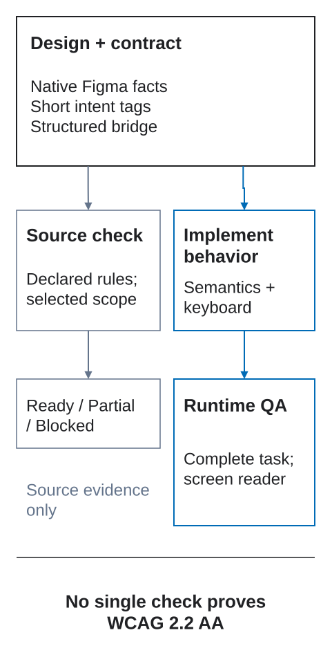

<h1>
  <picture>
    <source media="(prefers-color-scheme: dark)" srcset="assets/brand/dfc-bridge-lockup-dark.svg">
    <source media="(prefers-color-scheme: light)" srcset="assets/brand/dfc-bridge-lockup-light.svg">
    
  </picture>
</h1>

## Design Frontend Contract

**Prepare a design so the file answers the developer's questions.**

DFC Bridge is a method for making a design understandable before implementation. A developer or AI should be able to tell which screens belong together, which layers are the same element, and what each control does—without guessing from appearance.

Languages: [English](README.md) · [Русский](README.ru.md) · [中文快速入门](docs/zh/00-designer-quick-start.md)

**Documentation site:** [poliklot.github.io/dfc-bridge](https://poliklot.github.io/dfc-bridge/)

## Where to start

Do not read the documentation front to back. Choose your task:

| I want to… | Start here | Then use |
| --- | --- | --- |
| prepare a design for the first time | **[Designer quick start](docs/00-designer-quick-start.md)** | [DFC Bridge by example](examples/README.md) |
| review a design before handoff | **[Designer checklist](docs/17-designer-checklist.md)** | [Full preflight review](docs/08-preflight-checklist.md) |
| resolve one specific question | **[Example catalog](examples/README.md)** | [Tag grammar](docs/13-tag-grammar.md) |
| build a validator or adapter | **[Transfer contract](docs/04-transfer-contract.md)** | [Validation and autochecks](docs/11-validation-and-autochecks.md) |

> **Recommended designer path:** quick start → matching example → checklist. The full specification is reference material, not a prerequisite.

## Minimal example

The “Contact” button appears on a wide and a narrow version of the home page. Give it the same stable name and the same real modal target in both. These are Figma layer names; the parts in square brackets are tags, not visible button text:

```text
home [page=home] [route=/] [bp=1440] [view=default]
  hero [section=home-hero]
    contact-button [action=modal:contact-modal]
  contact-modal [modal=contact-modal]

home [page=home] [route=/] [bp=375] [view=default]
  hero [section=home-hero]
    contact-button [action=modal:contact-modal]
  contact-modal [modal=contact-modal]
```

Now the reader can see that `contact-button` is the same control at both widths and should open `contact-modal`. Figma still holds the actual layout. The action tag declares the intended behavior; it does not wire up a prototype or implement the modal. This tree is a naming excerpt, not a complete handoff: modal states, closing behavior, and layout still need to be prepared and checked.

## Core idea

Use the information where it belongs:

1. **Build the real structure in Figma.** Use its hierarchy, Auto Layout, components, variants, and layout settings. Do not copy these native properties into hand-written metadata.
2. **Use stable names and short tags for meaning.** Names connect the same element across widths. Tags identify a page or section, a link destination, an action, a state, or an intentional exception.
3. **Add structured `bridge` metadata when short tags are not enough.** For example, describe a data schema, conditional behavior, accessibility requirements, or a different mobile composition here—not in a growing layer name. This is also where open questions and delivery evidence are recorded.

By default, the same element keeps its key and logical parent across prepared widths. If the composition changes, declare the mapping rather than silently replacing the tree. Record unresolved decisions instead of inventing answers.

## Why DFC Bridge exists

A picture shows how an interface looks. It does not reliably say whether two buttons are the same control, whether a mobile layout changes the content, or what should happen after a click. DFC Bridge makes those decisions explicit so another person or tool can implement and check them.

DFC Bridge is not tied to any specific platform. It does not prescribe a particular framework, CMS, visual editor, runtime, or design-to-code tool. Target adapters may map the same contract to HTML/CSS, React, Vue, mobile UI, internal tools, or any other implementation surface.



**No blind spots** does not mean every answer is known immediately. It means every relevant unknown is explicit, scoped, owned, assigned a blocking status and review point, and given a safe fallback.

## Full documentation

### Practice

- [Visual introduction: why handoff decisions matter](docs/25-visual-walkthrough.md)
- [Designer quick start](docs/00-designer-quick-start.md)
- [DFC Bridge by example](examples/README.md)
- [Designer checklist](docs/17-designer-checklist.md)
- [Full preflight review](docs/08-preflight-checklist.md)
- [Common designer mistakes](docs/09-common-designer-mistakes.md)
- [Hard cases and edge cases](docs/10-hard-cases-and-edge-cases.md)

### Core rules

- [Design rules](docs/01-design-rules.md)
- [Layer naming and identity](docs/02-layer-naming-and-identity.md)
- [Responsive breakpoints](docs/03-responsive-breakpoints.md)
- [Interactions and targets](docs/05-interactions-and-targets.md)
- [Wrapper policy](docs/06-wrapper-policy.md)
- [Height and overflow](docs/07-height-and-overflow.md)
- [Components, UI Kit, and Page Sections](docs/14-components-and-ui-kit.md)
- [Page routing and views](docs/15-page-routing-and-views.md)
- [Data and visualization](docs/20-data-and-visualization.md)
- [Motion and long scroll](docs/21-motion-and-scroll.md)
- [State machines and reactions](docs/22-state-machines-and-reactions.md)

### Reference and tooling

- [Terminology](docs/18-terminology.md)
- [Team adoption](docs/19-team-adoption.md)
- [Tag grammar](docs/13-tag-grammar.md)
- [Transfer contract](docs/04-transfer-contract.md)
- [Variation axes](docs/16-variation-axes.md)
- [Validation and autochecks](docs/11-validation-and-autochecks.md)
- [Validator rule catalog](validator/rules.json)
- [Project roadmap](docs/12-project-roadmap.md)
- [Brand system](docs/brand-system.md)
- [Accessibility profile (WCAG 2.2 AA)](docs/23-accessibility-profile.md)
- [Delivery lifecycle and deviations](docs/24-delivery-lifecycle.md)

## Tooling

DFC Bridge is a methodology, not a tool or a platform adapter. You can apply it without a plugin.

[DFC Bridge Assistant](https://www.figma.com/community/plugin/1654485530503673254) is the optional companion Figma plugin. Its installable build is public in Figma Community, while its implementation repository is private. The methodology, documentation, schemas, checklists, and rule catalog in this repository remain open under MIT.

The catalog contains **107 rules**. Public coverage snapshots record two exact, non-additive emitted-rule unions: Page Check covers **42** (40 automatic and 2 heuristic), while **Check selected section** covers **26** (24 automatic and 2 heuristic; 20 local and 6 selected-variant). Both include the blocking source-structure rules; structured and manual coverage remains explicit.

## Local development

Use Node.js from [`.nvmrc`](.nvmrc), then install exactly from the lockfile:

```bash
nvm use
npm ci
npm run dev
```

Run the complete verification pipeline before a pull request:

```bash
npm test
npx playwright install chromium # first local run only
npm run test:e2e
npm audit
```

Canonical EN/RU/ZH content lives in `docs/`, `docs/ru/`, `docs/zh/`, and `examples/`. Do not edit generated files under `src/content/docs/`; `npm run content:sync` recreates them from [`validator/site-content.json`](validator/site-content.json). Use `SITE_BASE=/ npm run build` when testing a root-hosted build.

See [CONTRIBUTING.md](CONTRIBUTING.md) for contract-change rules and the complete review flow, and [CHANGELOG.md](CHANGELOG.md) for public methodology releases.

## The name

**Designs that can cross the gap.**

**DFC Bridge — Design Frontend Contract** is the public name. “Bridge” stays the natural spoken shorthand: the design becomes a bridge between intention and implementation. Product names are **DFC Bridge Assistant** and **DFC Bridge Explorer**; technical slugs use `dfc-bridge` and `dfc-bridge-*`.

The six principles retain the Bridge mnemonic:

| Letter | Principle | Rule |
| --- | --- | --- |
| **B** | **Breakpoints** | Responsive states are explicit and comparable as one logical tree. |
| **R** | **Roles** | A layer role is clear from Figma structure, UI Kit metadata, or a required DFC Bridge intent tag. |
| **I** | **Identity** | Logical elements keep stable keys and parents by default; composition changes need an explicit mapping. |
| **D** | **Dependencies** | Links, modals, states, anchors, and actions are declared. |
| **G** | **Geometry** | Position, size, spacing, and text metrics are reproducible. |
| **E** | **Exceptions** | Assets, fixed heights, overflow, decor, and non-standard behavior are intentional. |

## Brand vocabulary

Use the name consistently:

- **DFC Bridge-ready design** — a design that can be transferred without guessing.
- **DFC Bridge Contract** — the structured data expected from the design.
- **DFC Bridge Preflight** — the checklist before handoff.
- **DFC Bridge Adapter** — a target-specific implementation layer.
- **DFC Bridge Linter** — a future validator for design mistakes.
- **DFC Bridge Exception** — an intentional deviation with an explicit reason.

The visual mark follows the same contract: six stable modules stand for the six DFC Bridge principles and form one transferable identity. See the [brand system](docs/brand-system.md) for meaning, colors, clear space, and source assets.

Before handoff, the decisions that apply to the design must be easy to find and check. Record unresolved questions with an owner instead of hiding them. A clean design check does not prove that the implementation works.

## License

MIT.
