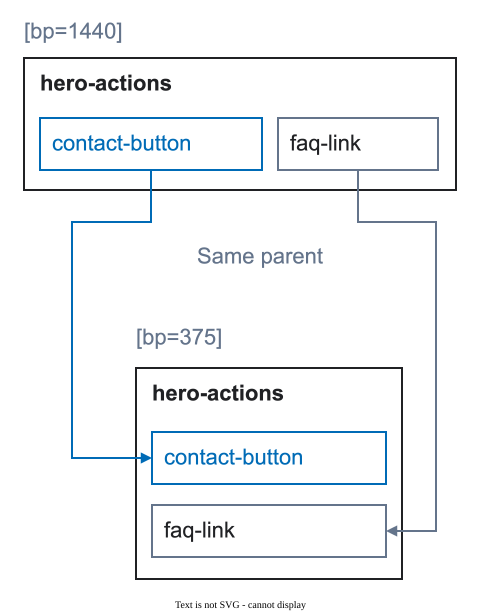

# Layer names and stable identities

A stable name lets the team recognize one logical element across widths and states. It is not a description of the current pixels.


<figure class="bridge-lesson-figure bridge-lesson-diagram">

<figcaption>Follow each connector to find the same named control at both widths. Names identify correspondence; they do not freeze position. Here both controls also keep hero-actions as their parent; a different meaningful parent requires a declared transformation. <a href="../assets/tutorial/diagrams/identity-en.svg">Open full size</a>.</figcaption>
</figure>

The [visual introduction](25-visual-walkthrough.md) shows why these decisions matter to the team.

## The naming rule

Use short English names in `kebab-case`:

```text
hero-title
product-grid
contact-button
```

Avoid editor defaults, visual descriptions, and device suffixes:

```text
frame-42
blue-heading
hero-title-mobile
button-375
```

## When a tag is needed

Use a tag when the meaning is not present in Figma:

```text
home [page=home] [bp=1440] [view=default]
contact-button [action=modal:contact-modal]
```

Do not tag dimensions, layout settings, colors, or component variants that Figma already stores. See [tag grammar](13-tag-grammar.md) for the complete list.

## Keep identity stable

Across prepared widths and states, keep:

- the same logical name;
- the same meaningful parent where possible;
- the same action or target unless the product behavior changes;
- the same content role.

If structure really changes, show the mapping or record the reason. Do not hide the difference in a new device name.

## Names for repeated content

Use a role or type for a collection item and a stable instance name when the item must be tracked:

```text
product-grid [collection=products]
  product-card-oak-chair [item=product]
```

`[item=product]` describes the role. The layer name identifies the prepared instance.

## A quick test

Hide the visual design and read only the layer tree. You should still be able to find the page root, major sections, important content, and actions. If not, improve the structure or name instead of adding more tags.
