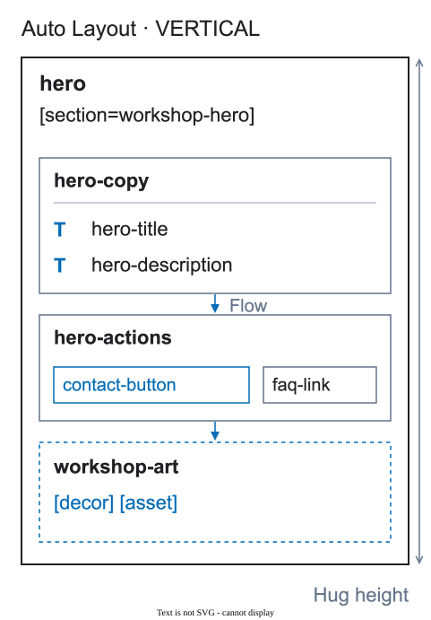

# Wrappers

A wrapper is a real Figma frame or component with a clear job. It is not an extra tag or a note in the layer name.


<figure class="bridge-lesson-figure bridge-lesson-diagram">

<figcaption>Follow the containment: hero-copy owns related text and hero-actions owns related controls. Each wrapper has a layout job. The diagram shows one meaningful structure, not a good-versus-bad comparison or a rule to add wrappers everywhere. <a href="../assets/tutorial/diagrams/structure-en.svg">Open full size</a>.</figcaption>
</figure>

The [visual introduction](25-visual-walkthrough.md) shows why these decisions matter to the team.

## Keep a wrapper when it

- groups elements that adapt together;
- creates a list, grid, surface, or clipping area;
- owns a background or interaction area;
- defines a modal, state, or exportable illustration.

```text
hero-copy
  hero-title
  hero-subtitle
```

## Remove a wrapper when it

- only exists because layers were selected together;
- has one child and no structural purpose;
- changes coordinates without adding meaning;
- is a default `GROUP` or `Frame 53` outside an asset.

Remove the unnecessary level, not the content inside it. If a `GROUP` has a real layout job, replace it with a frame using native Figma layout rather than deleting the relationship. `[decor]` marks a visual layer; it does not excuse a free-form content container. A decorative composition transferred as one whole resource can use `[decor] [asset]`.

## Keep the tree stable

The settings may change between widths, but a meaningful wrapper and its place in the tree should remain recognizable. A wrapper that exists on only one width needs a documented structural reason.
