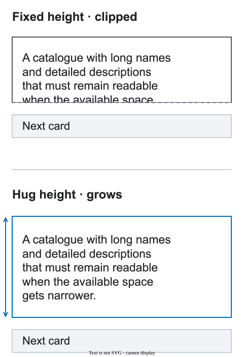

# Content and overflow

Dynamic content should be allowed to use the space it needs. A fixed height is a product decision, not a shortcut for matching one screenshot.

<figure class="bridge-lesson-figure bridge-lesson-diagram">

<figcaption>Compare the same text above and below: in this example, Hug height preserves the final lines and moves the next card down. Fixed height, scrolling and truncation are not universally forbidden; each needs an explicit, appropriate overflow policy. <a href="../assets/tutorial/diagrams/content-en.svg">Open full size</a>.</figcaption>
</figure>

The [visual introduction](25-visual-walkthrough.md) shows why these decisions matter to the team.

## Prefer content-driven height

Let text, data, and lists grow. Test long words, prices, names, localization, errors, and empty states.

## When a fixed height is valid

Use it when the product needs a known viewport, crop, media frame, or scroll region. Then decide what happens when content does not fit. A growing block is no longer fixed-height; if the boundary must stay fixed, define how the content behaves inside it:

- wrap within the boundary; if the whole block must grow, use content-driven height instead;
- clip with a visible reason;
- scroll inside a named region;
- truncate with an accessible way to read the rest.

Do not use manual line breaks or separate mobile text only to preserve a composition.

## Check the edges

Verify that content, focus, validation messages, and interactive targets are not clipped accidentally. See [responsive behavior](03-responsive-breakpoints.md) for intermediate widths.

## Ready

The rule is ready when the team knows how the block behaves with normal, long, empty, and error data.
