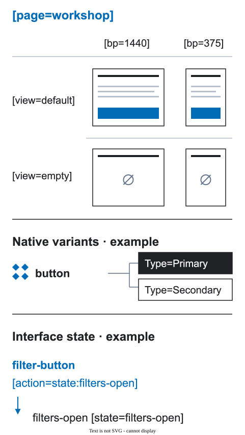

# Components and sections

Use the component library to keep shared visual behavior consistent. Use page structure to show what the current instance means and does.


<figure class="bridge-lesson-figure bridge-lesson-diagram">

<figcaption>Read three separate examples: page views default/empty across widths; native button variants Type=Primary/Secondary; an action targeting filters-open. A component variant is not a page view, and declaring a state target does not implement its runtime transition. <a href="../assets/tutorial/diagrams/axes-en.svg">Open full size</a>.</figcaption>
</figure>

The [visual introduction](25-visual-walkthrough.md) demonstrates this split: a shared button supplies appearance; its page instance points to the local modal.

## Two library levels

- `UI Kit` contains reusable interface parts: buttons, fields, cards, and controls.
- `Page Sections` contains larger reusable page blocks with their own structure and product role.

The size of a component does not decide its level. Its source and responsibility do.

## Component versus instance

The shared component can define visual states and default behavior. The instance on a page supplies its current content, context, and action:

```text
contact-button [action=modal:contact-modal]
```

The same button component may open different targets in different places. Do not put a page-specific action into the shared component name.

For an explicitly interactive source, put `[control]` or `[link]` on the main component, or on its ComponentSet when individual variants have no interaction contract. Page/Section Check can then flag an unannotated instance whose action/destination is still unknown. A source-level default such as `[action=none]` is inherited only when the instance has no local interaction intent; an explicit local draft still requires a decision. Source identities are not copied to instances. The word “Button”, appearance, and text labels are not contracts.

This deterministic source-contract check belongs to the test-verified local 0.10.0 checker candidate, not a claim about the current Community build. It reads only source intent, without traversing instance interiors. Ready covers the declared source checks, not all interactions: unavailable or unclassified sources, instance content overrides, native prototype behavior and runtime QA remain outside this check. Resolve the page-specific target locally, rerun the check, then review those remaining boundaries.

## Section identity

An instance from `Page Sections` already has a stable source. Do not repeat `[section]` unless a local frame is the section boundary. A section built directly in the page uses an explicit key:

```text
checkout-summary [section=checkout-summary]
```

## Keep the source of truth clear

Use instances instead of detached copies when the shared component is still the owner. Keep page-specific content visible and editable. Put product data, actions, and states in the page or structured contract where they belong.

## Check before handoff

- Can the team find the source component?
- Is the page-specific content visible?
- Is the action attached to the current context?
- Are actual states represented instead of hidden old layers?

See [design rules](01-design-rules.md) for the general source-of-truth policy.
