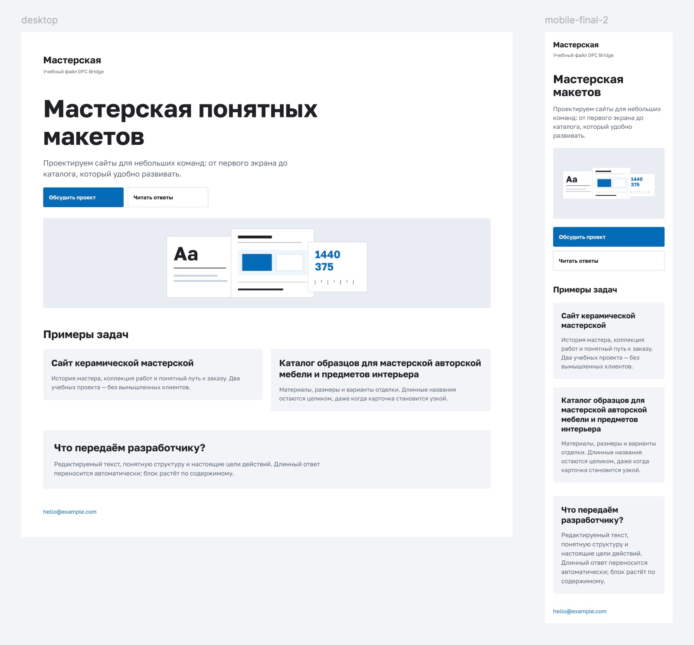
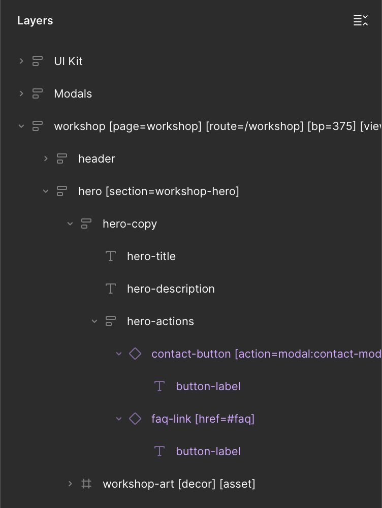
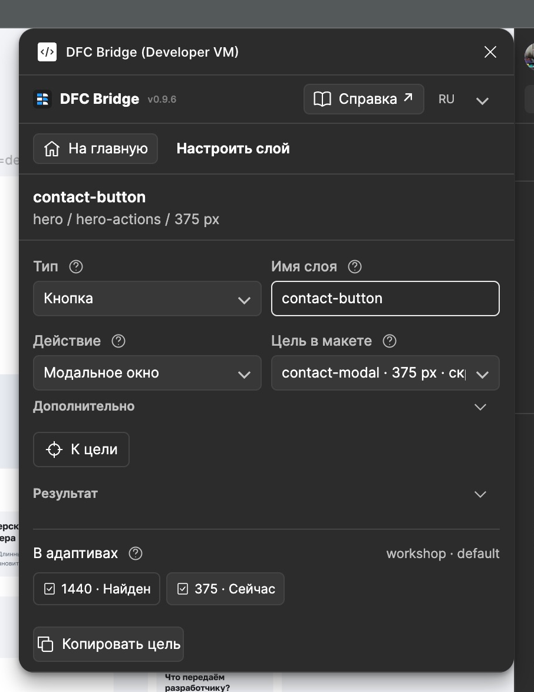
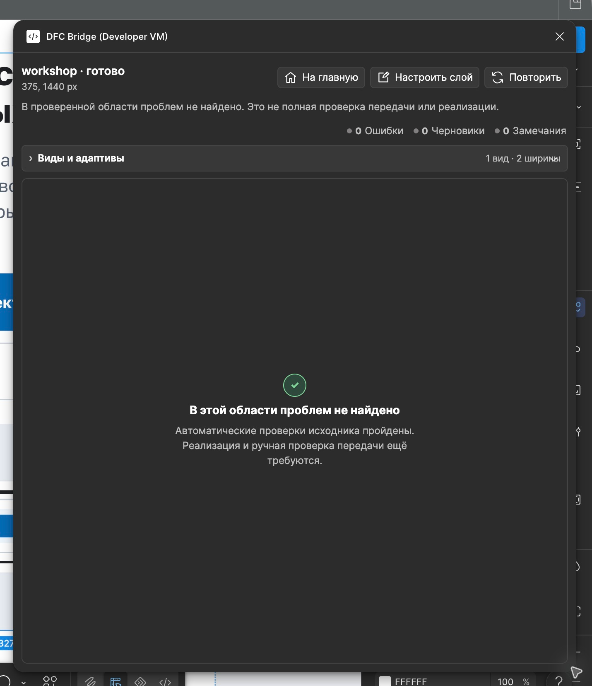

# Why DFC Bridge matters

Look at the design—desktop and mobile:

<figure class="bridge-lesson-figure bridge-lesson-screenshot">

<figcaption>Looks finished. What was handed over is still unclear.</figcaption>
</figure>

The design looks good. Frontend, backend and AI still guess: what to build, where data comes from and where buttons lead.

DFC Bridge does not dictate design. It helps hand off **decisions, not guesses**. Watch one design change.

<a class="bridge-lesson-download" href="../assets/tutorial/dfc-bridge-workshop.fig" download="dfc-bridge-workshop.fig"><span aria-hidden="true">↓</span> Download the design <span class="bridge-lesson-download-format">.fig</span></a>

1. Open Figma.
2. On the home screen, click **Import**.
3. Choose the downloaded `.fig`.

## 1. Looks good. Still unclear

`desktop` and `mobile-final-2`. One page or different screens? The names do not say. The team fills the gaps.

Compare both trees. Which heading and button are the same element?

<div class="bridge-lesson-pair bridge-lesson-tree-pair">
<figure class="bridge-lesson-figure bridge-lesson-screenshot">

<figcaption>Desktop: <code>Heading</code> / <code>Button</code>.</figcaption>
</figure>
<figure class="bridge-lesson-figure bridge-lesson-screenshot">

<figcaption>Mobile: <code>Title mobile</code> / <code>Button copy</code>.</figcaption>
</figure>
</div>

Two more “looks better on mobile” decisions:

- «Мастерская понятных макетов» → «Мастерская макетов». Changed content, not line wrapping.
- Moved all of `hero-actions` from `hero-copy` to `hero`, after the image. Changed parent, not just order.

<figure class="bridge-lesson-figure bridge-lesson-screenshot">
<aside class="bridge-lesson-comment">
<p><strong>Frontend:</strong> Shorter text, buttons below the image—allowed.</p>

</aside>

<figcaption>Mobile loses «понятных» (clear); buttons move below the image.</figcaption>
</figure>

Agree on the copy variant and describe the move. Here neither is declared: frontend and AI guess.

## 2. Connected the screens

Agreed: one `workshop` page, `/workshop` route, `default` view, widths 1440 and 375. Recorded on the roots:

```text
workshop [page=workshop] [route=/workshop] [bp=1440] [view=default]
workshop [page=workshop] [route=/workshop] [bp=375] [view=default]
```

<figure class="bridge-lesson-figure bridge-lesson-diagram">

<figcaption>One page, one view, two widths.</figcaption>
</figure>

Frontend knows what to build. AI stops hunting for the “most final” screen. Tags describe the agreement; they do not create layout or code.

## 3. Found the same elements

Named by role, not device. Frontend and AI can now match elements:

| Before at 1440 / 375 | After at both widths |
| --- | --- |
| `Heading` / `Title mobile` | `hero-title` |
| `Button` / `Button copy` | `contact-button` |

Here we chose the shared `hero-title` and put `hero-actions` back inside `hero-copy`, before `workshop-art`. This is not the only way.

<div class="bridge-lesson-pair bridge-lesson-motion-pair">
<figure class="bridge-lesson-figure bridge-lesson-motion">
<video src="../assets/tutorial/motion/rename-title.mp4" poster="../assets/tutorial/motion/rename-title.png" width="472" height="528" controls playsinline preload="none" aria-label="Step-by-step Figma capture: rename the Title mobile layer to hero-title without changing its text"><a href="../assets/tutorial/motion/rename-title.mp4" download="rename-title.mp4">Download MP4</a></video>
<figcaption>Step-by-step Figma capture: <code>Title mobile</code> → <code>hero-title</code>. Text unchanged. <a href="../assets/tutorial/motion/rename-title.gif" download="rename-title.gif">Download GIF</a>.</figcaption>
</figure>
<figure class="bridge-lesson-figure bridge-lesson-motion">
<video src="../assets/tutorial/motion/move-actions.mp4" poster="../assets/tutorial/motion/move-actions.png" width="472" height="528" controls playsinline preload="none" aria-label="Step-by-step Figma capture: move all of hero-actions into hero-copy, preserving both buttons"><a href="../assets/tutorial/motion/move-actions.mp4" download="move-actions.mp4">Download MP4</a></video>
<figcaption>Step-by-step Figma capture: all of <code>hero-actions</code> → inside <code>hero-copy</code>. <a href="../assets/tutorial/motion/move-actions.gif" download="move-actions.gif">Download GIF</a>.</figcaption>
</figure>
</div>

<figure class="bridge-lesson-figure bridge-lesson-screenshot">

<figcaption>Text and actions are back inside hero-copy.</figcaption>
</figure>

**Different copy needs an [agreed product variant](16-variation-axes.md). A different parent needs a [declared transformation](03-responsive-breakpoints.md).** Reordering within one parent is allowed.

<figure class="bridge-lesson-figure bridge-lesson-diagram">

<figcaption>Same buttons. Different layout.</figcaption>
</figure>

Desktop buttons sit side by side; mobile buttons stack. **Different layouts are fine:** Auto Layout changes; text and parent stay the same here.

<div class="bridge-lesson-pair bridge-lesson-heroes">
<figure class="bridge-lesson-figure bridge-lesson-render">

<figcaption>1440 px: buttons side by side.</figcaption>
</figure>
<figure class="bridge-lesson-figure bridge-lesson-render">

<figcaption>375 px: stacked buttons, before the image.</figcaption>
</figure>
</div>

The heading stays text. `workshop-art [decor] [asset]` stays one image. Do not flatten the interface into PNG.

## 4. Built a shared library

`button-primary` and `button-secondary` became shared components. Edit the source; instances update. No fixing every copy.

**UI-kit** shows both styles’ states; **Modals** holds the shared modal appearance. Frontend and AI see examples, not gaps to fill.

<figure class="bridge-lesson-figure bridge-lesson-screenshot">

<figcaption>Two styles, five state examples. The modal sits beside them.</figcaption>
</figure>

**Appearance in the library. Action on the page instance.** The same button elsewhere can do something different.

- `contact-button [action=modal:contact-modal]` → open the modal.
- `faq-link [href=#faq]` → go to FAQ.

<figure class="bridge-lesson-figure bridge-lesson-diagram">

<figcaption>Button → modal. Link → FAQ.</figcaption>
</figure>

In Assistant, set action and target on the button, not its text:

<div class="bridge-lesson-pair">
<figure class="bridge-lesson-figure bridge-lesson-screenshot">

<figcaption>Action set on the button itself.</figcaption>
</figure>
<figure class="bridge-lesson-figure bridge-lesson-screenshot">
<aside class="bridge-lesson-comment">
<p><strong>AI:</strong> At this width, the target is contact-modal.</p>

</aside>

<figcaption>Target set in the right width.</figcaption>
</figure>
</div>

**Show target** only finds the layer; it does not open the modal. Behavior still needs implementation.

<details>
<summary>How the components work</summary>

Default, hover, keyboard focus, pressed and disabled are examples, not a working prototype.

`State=default/hover/pressed/disabled` are Figma variants, not DFC tags or page views. Focus is independent: `Focus visible=true` can coexist with `hover` and `pressed`.

Disabled shows appearance only. Its condition and decision owner belong in the implementation contract. No loading state: these actions open a modal or follow an anchor, not an asynchronous request.

Each root has its own hidden `[modal=contact-modal]`. The main component in Modals is the appearance source, not another target. Email details, not a submission form.

</details>

Record the source and agreements in the [data contract](20-data-and-visualization.md).

## 5. Checked the result

In the copy with undeclared differences, ran **Check → Check page**. Assistant found different `hero-title` text and a different `hero-actions` parent. Auto Layout stayed enabled.

<figure class="bridge-lesson-figure bridge-lesson-screenshot">

<figcaption>Two source errors, not a ban on design choices.</figcaption>
</figure>

**Show layer → fix → Repeat.** Page 02 shows the solution chosen here: shared heading, shared parent and linked components.

<figure class="bridge-lesson-figure bridge-lesson-screenshot">
<aside class="bridge-lesson-comment">
<p><strong>Backend:</strong> The cards are examples. The data source still needs agreement.</p>

</aside>

<figcaption>The result: consistent design, UI-kit and Modals together.</figcaption>
</figure>

<figure class="bridge-lesson-figure bridge-lesson-screenshot">

<figcaption>Page 02: no findings in the checked scope.</figcaption>
</figure>

**“Ready” means the checked design scope, not a finished application.**

Hand off **source, assets and agreements**. Open questions have owners. Not one PNG and “it’s all obvious”.

## Next, as needed

- [Handoff checklist](17-designer-checklist.md).
- [Content and overflow](07-height-and-overflow.md) — preparation best practices.
- [New section in an old design](19-team-adoption.md).
- [Views and variants](16-variation-axes.md).
- [Accessibility](23-accessibility-profile.md).

Demo design. Captures from Figma; Assistant is a local build. Penguins are generated; team questions are examples. [Verification notes](../assets/tutorial/README.md).
