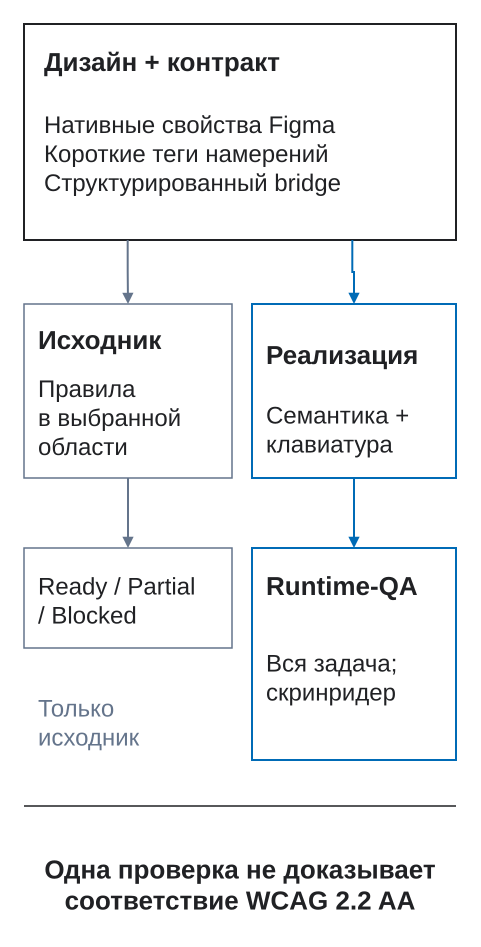

# Контракт переноса DFC Bridge

Контракт DFC Bridge хранит решения, которые нельзя полностью объяснить именами и свойствами Figma: данные, адаптивные преобразования, результаты взаимодействия и свидетельства передачи. Он связывает исходный макет с реализацией и проверкой, не привязываясь к одной целевой платформе.

Этот справочник нужен при создании интеграции или подготовке структурированной передачи. Для первого макета начните с [быстрого старта дизайнера](00-bystryj-start-dlya-dizajnera.md). Ниже оболочка задаёт состав передачи, сопоставления связывают её с элементами макета, а проверки подтверждают эти связи. Структурированная оболочка и [JSON Schema](../../validator/bridge.schema.json) могут меняться до 1.0, поэтому в каждой передаче фиксируйте `contractVersion`, `methodologyVersion` и `rulesVersion`.

## Два взаимодополняющих уровня

DFC Bridge намеренно не превращает имена слоёв в базу данных.

### Короткие теги слоёв

Дизайнер использует небольшую грамматику для намерения, которое должно быть видно при просмотре макета:

```text
catalog [page=catalog] [route=/catalog] [bp=1200] [view=default]
  products [section=product-results]
    product-grid [collection=products]
      product-card-oak-chair [item=product]
  filter [action=state:filters-open]
```

Теги обозначают страницы, варианты, секции, ссылки и действия, цели, поля, коллекции, визуальную политику, переполнение и явные исключения. Они не хранят схему данных, граф состояний, временную шкалу, план доступности и историю поставки.

### Структурированные метаданные `bridge`

Подробные решения хранятся в одном объекте `bridge`. Он ссылается на стабильные идентификаторы макета и может находиться в данных плагина Figma, сопроводительном JSON или данных адаптера. Он передаётся вместе с макетом и проверяется целиком.

```text
Метаданные Figma + короткие опорные теги + структурированные данные bridge
                                      ↓
                         единый контракт переноса
```

Не изобретайте плоские теги, если для смысла уже существует структурированное поле.

<figure class="bridge-lesson-figure bridge-lesson-diagram">

<figcaption>Начните со свидетельств: нативные свойства Figma описывают макет, короткие теги закрепляют намерение, структурированные данные bridge — подробные решения. Затем разделите проверку исходника и реализацию. Отчёт по исходнику охватывает объявленные правила в своей области, но не подтверждает работу продукта или соответствие WCAG. <a href="../../assets/tutorial/diagrams/dfc-bridge-coverage-map-ru.svg">Открыть в полном размере</a>.</figcaption>
</figure>

## Обязательная оболочка

Полная структура имеет корень `bridge`:

| Поле | Назначение |
| --- | --- |
| `contractVersion` | Версия формы структурированных данных. |
| `methodologyVersion` | Выпуск DFC Bridge, использованный при подготовке. |
| `rulesVersion` | Версия каталога правил. |
| `source` | Инструмент, файл/страница, неизменяемая ревизия и контекст получения. |
| `context` | Объявленная область передачи, контекст продукта/страницы по применимости, включённые оси и внешние зависимости. |
| `identity` | Связь роли, шаблона, экземпляра макета, рабочих данных и целевой реализации. |
| `structure` | Логические деревья в объявленных контекстах. Нативные тип узла, режим раскладки, позиционирование и границы ресурсов Figma остаются свидетельством источника и проверяются вместе с деревом. |
| Модули | `data`, `responsive`, `interaction`, `motion`, `accessibility`, `capabilities`, `lifecycle` по применимости. |
| `openQuestions` | Нерешённые вопросы с ответственным, областью, блокирующим статусом, точкой пересмотра и запасным решением. |
| `exceptions` | Намеренные исключения источника/контракта с влиянием и компенсацией. |

Отсутствие модуля означает «не применимо» только тогда, когда область это доказывает. Оно не может означать «никто не проверил».

## Идентичность — это сопоставление, а не один перегруженный ключ

Один ключ не может безопасно обозначать все сущности переноса. DFC Bridge разделяет пять измерений:

| Измерение | Вопрос | Пример |
| --- | --- | --- |
| `role` | Какова логическая задача элемента? | элемент данных / товар |
| `template` | Какое переиспользуемое определение владеет формой и поведением? | `product-card` |
| `designInstance` | Какой подготовленный экземпляр представлен в макете и контекстах? | `product-card-oak-chair` |
| `runtimeData` | Какое правило ключа связывает рабочую запись? | коллекция `products`, поле `sku` |
| `target` | Какая сущность реализации воспроизводит элемент? | веб-компонент `ProductCard` |

`bridgeKey` связывает ссылки контракта, но не смешивает измерения. Значение `[item=product]` обозначает повторяемую роль или тип, а не уникальный экземпляр макета или рабочую запись. Позиционное имя `product-card-3` может быть временным идентификатором примера, но не становится ключом рабочей записи. Для сортировки, фильтрации, пагинации, живых обновлений и внешне одинаковых записей нужен стабильный продуктовый ключ.

Цель реакции — другая сущность: она ссылается на `bridgeKey` модального окна, состояния, формы, маршрута или элемента. Поле `identity.elements[].target` сопоставляет элемент с кодом или другой целевой платформой.

## Канонический пример

Читайте пример как карту связей между модулями, а не как готовый проект для копирования без изменений. Часть упомянутых объектов определена за пределами фрагмента. В реальной передаче оставляют только применимые модули, сохраняют ту же структуру и проверяют все ссылки. Полный исполняемый пример в репозитории: `validator/examples/bridge-contract.valid.json`.

```json
{
  "bridge": {
    "contractVersion": "0.2.0",
    "methodologyVersion": "0.12.0",
    "rulesVersion": "0.5.1",
    "source": {
      "tool": "figma",
      "fileKey": "example-file-key",
      "pageId": "12:4",
      "pageName": "Каталог",
      "versionId": "figma-version-2026-08-13T10:20Z",
      "capturedAt": "2026-08-13T10:25:00Z"
    },
    "context": {
      "transferId": "catalog-default",
      "page": "catalog",
      "route": "/catalog",
      "view": "default",
      "axes": { "locale": "ru-RU", "theme": "light" },
      "contextIds": ["catalog-1200", "catalog-360"]
    },
    "identity": {
      "elements": [{
        "bridgeKey": "product-card-oak-chair",
        "role": { "kind": "data-item", "semantics": "product" },
        "template": {
          "templateKey": "product-card",
          "sourceComponentId": "55:8",
          "sourceComponentName": "UI Kit / Product Card"
        },
        "designInstance": {
          "designInstanceKey": "product-card-oak-chair",
          "sourceNodes": [
            { "contextId": "catalog-1200", "nodeId": "401:72", "layerPath": ["Каталог / 1200", "product-grid", "product-card-oak-chair"] },
            { "contextId": "catalog-360", "nodeId": "509:21", "layerPath": ["Каталог / 360", "product-grid", "product-card-oak-chair"] }
          ]
        },
        "runtimeData": {
          "collection": "products",
          "keyField": "sku",
          "fixtureKey": "oak-chair",
          "runtimeDataKey": "sku:CHAIR-OAK-01"
        },
        "target": {
          "platform": "web",
          "kind": "component",
          "targetKey": "ProductCard",
          "locator": "src/catalog/ProductCard"
        }
      }]
    },
    "structure": {
      "contexts": [
        { "id": "catalog-1200", "rootIdentity": "catalog", "tree": { "product-results": ["product-grid", "filter-button"] } },
        { "id": "catalog-360", "rootIdentity": "catalog", "tree": { "product-results": ["product-grid", "filter-button"] } }
      ]
    },
    "data": {
      "displays": [{
        "displayId": "product-grid",
        "purpose": "Browse products matching the active catalog query",
        "source": { "owner": "catalog-service", "dataset": "products", "refresh": "request" },
        "dimensions": [{ "key": "sku", "type": "string" }],
        "measures": [{ "key": "price", "type": "decimal", "currency": "RUB" }],
        "format": { "locale": "user", "currencyDisplay": "symbol" },
        "states": ["loading", "empty", "error", "partial", "stale"]
      }]
    },
    "responsive": {
      "defaultPolicy": "same-tree",
      "contexts": [
        { "id": "catalog-1200", "driver": "viewport", "width": 1200 },
        { "id": "catalog-360", "driver": "viewport", "width": 360 }
      ],
      "transformations": [{
        "id": "comparison-table-to-disclosures",
        "fromContext": "comparison-wide",
        "toContext": "comparison-narrow",
        "when": { "driver": "container", "container": "comparison-panel", "condition": "max-width: 480px" },
        "mappings": [{ "source": ["comparison-table"], "target": ["comparison-disclosures"], "semantics": "same-records-and-fields" }],
        "preserves": ["content", "actions", "field-relationships", "selection", "accessible-names"],
        "readingOrder": ["comparison-heading", "comparison-disclosures"],
        "focusOrder": ["comparison-disclosure-trigger:*"],
        "stateTransfer": "preserve-selection-and-open-record",
        "history": "no-new-entry"
      }]
    },
    "interaction": {
      "stateMachines": [{
        "id": "catalog-filter",
        "initial": "idle",
        "states": ["idle", "pending", "results", "empty", "failure"],
        "transitions": [{
          "id": "apply-filter",
          "from": ["idle", "results", "empty", "failure"],
          "event": { "type": "submit", "source": "catalog-filter-form" },
          "pending": { "to": "pending", "duplicateEvent": "replace-with-latest" },
          "outcomes": {
            "success": { "to": "results", "focus": "results-heading", "announce": "Results updated" },
            "empty": { "to": "empty", "focus": "results-heading" },
            "failure": { "to": "failure", "focus": "filter-error", "retry": "preserve-values" }
          },
          "history": "replace-query"
        }]
      }]
    },
    "motion": { "sequences": [] },
    "capabilities": {
      "profiles": [{
        "id": "mobile-low-bandwidth",
        "target": { "platform": "web", "runtime": "browser" },
        "essentialExperience": ["product-name-and-price", "filter-and-open-product"],
        "supports": ["responsive-images", "offline-cache"],
        "unsupported": [{ "capability": "scroll-timeline", "fallback": "static-scenes", "owner": "storefront" }],
        "assets": [{
          "element": "product-image",
          "width": 960,
          "height": 960,
          "formats": ["avif", "webp", "jpeg"],
          "quality": "product-detail-visible",
          "artDirection": "square-crop-with-subject-safe-area",
          "loading": { "priority": "results-dependent", "poster": null, "strategy": "lazy-outside-first-window" }
        }],
        "data": { "expectedItems": 48, "maximumItems": 10000, "virtualizeAfter": 200, "strategy": "server-pagination" },
        "conditions": ["low-bandwidth", "offline", "data-saver", "low-power"],
        "budgets": [{ "metric": "initial-results-payload", "limit": 250, "unit": "KiB", "owner": "storefront", "measureAt": "release-qa" }]
      }]
    },
    "accessibility": {
      "profile": { "standard": "WCAG", "version": "2.2", "level": "AA" },
      "elements": [{
        "element": "product-grid",
        "name": "Результаты каталога",
        "readingOrder": ["results-heading", "active-filters", "product-grid", "pagination"],
        "testIds": ["catalog-results-keyboard", "catalog-results-reflow"]
      }]
    },
    "lifecycle": {
      "transferId": "catalog-default",
      "contractRevision": "7",
      "sourceRevision": "figma-version-2026-08-13T10:20Z",
      "targetRevision": "build-1842",
      "status": "qa",
      "owners": { "design": "catalog-design", "contract": "design-systems", "implementation": "storefront", "qa": "quality" },
      "requirements": ["REQ-CATALOG-017", "REQ-CATALOG-021"],
      "evidence": { "tests": ["catalog-grid-default", "catalog-grid-keyboard"] },
      "deviations": []
    },
    "openQuestions": [{
      "id": "OPEN-CATALOG-003",
      "scope": ["catalog", "offline"],
      "question": "May users open a product from stale cached results?",
      "owner": "catalog-product",
      "blocking": true,
      "due": "2026-08-18",
      "reviewAt": "contract-gate",
      "fallback": "Show cached results read-only and disable product navigation",
      "status": "open"
    }],
    "exceptions": []
  }
}
```

Теги остаются видимыми человеку опорными точками; структура добавляет отношения и решения, которые нельзя безопасно уместить в имена.

## По умолчанию одно дерево, преобразование — только по объявлению

`responsive.defaultPolicy` равен `same-tree`. Геометрия, направление Auto Layout, переносы, порядок внутри одного логического родителя и объявленная видимость могут меняться без структурного сопоставления.

Изменение дерева или формы представления допустимо только как запись `responsive.transformations[]`. Она задаёт исходные и результирующие идентификаторы, условие по ширине окна или контейнера, сопоставление полей/сцен/действий, сохраняемый смысл, порядок чтения и фокуса, перенос состояния и поведение истории. Различие без подходящего преобразования — расхождение с контрактом.

### Нативная раскладка остаётся обязательным свидетельством источника

Структурированное дерево `bridge.structure` не дублирует нативные поля Figma `layoutMode`, тип узла и позиционирование. Валидатор источника читает их напрямую и применяет каталог правил:

- корни страниц всегда используют нативный Auto Layout и не могут быть `[asset]`;
- корни секций-фреймов и исходных компонентов `Page Sections` используют Auto Layout, кроме точной секции, которая действительно является непрозрачным цельным визуальным ресурсом;
- обычные контейнеры с поддержкой Auto Layout и не менее чем двумя видимыми значимыми элементами потока используют Auto Layout;
- GROUP допустим только внутри настоящего непрозрачного поддерева `[asset]`;
- примитивы, конечная геометрия и внутренние слои размещённого экземпляра не считаются контейнерами потока;
- `[decor]` обозначает только точный намеренный абсолютный визуальный узел и никогда не создаёт структурного исключения.

Page Check считает размещённый экземпляр атомарным и не определяет его исходный компонент для правила раскладки секции; редактируемый исходный корень проверяется отдельно. Корень ресурса остаётся одной идентичностью в логическом дереве и одним элементом Auto Layout родителя. Исключение manual-layout с причиной может сопровождать найденное структурное отклонение, но не меняет свидетельство источника и не превращает неуспешный Page Check в успешный.

## Область выбранной секции внутри унаследованного продукта

Команда может применять DFC Bridge к одной новой секции, не перенося окружающий продукт. Граница задаётся явно выбранным исходным корнем со стабильным идентификатором секции:

```text
checkout-summary [section=checkout-summary]
```

Не превращайте секцию в фиктивную страницу. `[page]`, `[bp]`, `[view]` и `[route]` остаются тегами корня страницы; их нельзя добавлять только ради запуска проверки. `Check selected section` обходит лишь нормализованный выбранный корень и его потомков. Результат зависит от выбранного объекта:

- Редактируемый `FRAME` или `COMPONENT` получает полную локальную проверку источника. `GROUP` остаётся блокирующей структурной ошибкой.
- Если сам выбранный корень секции является `INSTANCE`, доступна лишь проверка границы, поэтому результат — Partial.
- Обычный дочерний `INSTANCE` считается доверенным неделимым объектом. Его внутренние слои не входят в этот обход и не снижают Ready.
- Точный корень `[section=id] [asset]` допустим как цельный визуальный ресурс с непрозрачной внутренней композицией. Проверка внутренней раскладки неприменима.
- Секция под другим родительским `[asset]`, не являющимся корнем страницы, образует недопустимую область с результатом Blocked: проверка не может пройти сквозь эту границу.

Недопустимый `[asset]` на корне страницы никогда не создаёт непрозрачность: Page Check сообщает о таком корне отдельно, а потомки остаются проверяемыми. Один `[decor]` никогда не останавливает обход.

Структурированная область записывает, что выбрано и что осталось за её пределами. Это **неполный фрагмент**; вставьте его в обязательную оболочку `bridge`:

```json
{
  "context": {
    "project": "Legacy storefront section adoption",
    "scope": {
      "kind": "section",
      "rootIdentity": "checkout-summary",
      "boundary": "selected-subtree",
      "assetBoundary": "none",
      "hostCompliance": "legacy-out-of-scope",
      "selectionMode": "explicit-variants",
      "contextIds": ["summary-container-360", "summary-container-1200"],
      "readinessClaim": "section-source-only"
    },
    "externalDependencies": [{
      "id": "checkout-route-dependency",
      "kind": "route",
      "reference": "/checkout",
      "status": "deferred",
      "owner": "storefront-platform",
      "reviewAt": "host integration gate"
    }]
  },
  "responsive": {
    "defaultPolicy": "same-tree",
    "contexts": [
      {
        "id": "summary-container-360",
        "driver": "container",
        "width": 360,
        "label": "Container 360",
        "labelSource": "inferred-from-selected-root-width"
      },
      {
        "id": "summary-container-1200",
        "driver": "container",
        "width": 1200,
        "label": "Container 1200",
        "labelSource": "inferred-from-selected-root-width"
      }
    ]
  }
}
```

Поля области читаются так:

- `assetBoundary` имеет значение `none` для редактируемого или атомарного корня и `selected-root-opaque` только тогда, когда сам выбранный корень секции содержит `[asset]`. Родительская граница ресурса не может образовать корректный контракт области секции.
- `single-root` объявляет один запрошенный контекст. Исходник может быть готов без выдуманных незапрошенных вариантов.
- `explicit-variants` означает, что пользователь явно выбрал для сравнения два или больше корней с одним идентификатором `[section]`. Валидатор не ищет соседей в унаследованном файле и не расширяет область молча.
- Если инструмент выводит подпись контекста из выбранного корня или ширины контейнера, он записывает `labelSource: inferred-from-selected-root-width`, а не выдаёт подпись за авторское намерение.

Отделяйте локально проверяемые связи от внешних зависимостей:

- Цель действия, найденная внутри выбранных корней, является локальной.
- Полный допустимый адрес `http:`, `https:`, `mailto:` или `tel:` считается заданным автором для области исходника секции и не вызывает Partial. Доступность адреса в работающем продукте остаётся за пределами проверки источника.
- Неполный или некорректный внешний адрес даёт блокирующую ошибку `interaction.href-invalid`, а не Deferred.
- Внутренние маршруты/якоря, цели модального окна/состояния/формы/сброса, компоненты и данные, требующие поиска вне выбранных корней, не считаются ни отсутствующими, ни проверенными. Свяжите внешний контракт или запишите их в `externalDependencies` как отложенные/непроверенные. Подтвердите связи на отдельной проверке файла или интеграции с окружающим продуктом.

Полный исполняемый пример находится в [`bridge-section-contract.valid.json`](../../validator/examples/bridge-section-contract.valid.json).

Успешный контракт области секции означает **готовность исходника секции в объявленных выбранных контекстах**. Он не подтверждает готовность по DFC Bridge унаследованной страницы, маршрутов, полного набора адаптивов, сквозного сценария, реализации или продукта и не является заявлением о соответствии WCAG.

## Сохранённый снимок для разработчика (кандидат 0.10.0)

Используйте этот путь, когда разработчику нужны проверенные факты исходника без повторного сканирования Figma и передачи дерева через ИИ. Это поддерживаемая передача данных в кандидате Assistant 0.10.0, **ещё не опубликованное обновление плагина**. Она дополняет, но не заменяет продуктовый контракт выше.

1. В Figma выберите корень DFC-страницы и запустите **Проверить страницу** либо выберите размеченную секцию (или слой внутри неё) и запустите **Проверить выбранную секцию**. Для нескольких контекстов секции явно выделите их корни. Экспорт страницы включает корни этой логической страницы на текущей странице Figma; экспорт секции не ищет соседние варианты.
2. В отчёте нажмите **Экспорт снимка**. Перед чтением данных повторно выполняется та же проверка. Не меняйте выделение до завершения; смена области или повторные значимые правки отменяют операцию. Убедитесь, что JSON действительно скачан. Отчёт по всему файлу через эту кнопку не экспортируется.
3. Передайте разработчику JSON и соответствующую версию пакета Assistant. С Node.js 22.12+ выполните в распакованном пакете:

```bash
node bin/dfc-bridge.mjs check snapshot.json > preflight.json
node bin/dfc-bridge.mjs manifest snapshot.json > manifest.json
```

`check` повторяет тот же код Page/Section Check без Figma, VM и ИИ. Код выхода `0` означает Ready в области исходника и совпадение записанных замечаний `(ruleId, severity, nodeId)`; `1` — замечания либо непроверенную область/версию; `2` — некорректные данные или вызов. `manifest` проверяет пакет и возвращает сохранённые факты без сканирования Figma. Аналоги в JS — асинхронные `checkSnapshot(text)` и `developerManifest(text)` из `api/index.mjs`. Ready исходника не подтверждает работу приложения, доступность или готовность продукта.

### Какие данные записаны

[Схема снимка](../../validator/handoff.schema.json) и [синтетический пример](../../validator/examples/handoff.valid.json) задают `format: "dfc-bridge-handoff"`, `schemaVersion: 1`, SHA-256 `revision`, версии плагина/каталога, источник, область, нативные узлы, зависимости, записанную проверку и охват. `nodes` содержит только заявленные корни и сохранённых структурных потомков. `dependencies` сохраняет настоящих предков и ссылки на main components/ComponentSets, но не всю библиотеку вариантов. Нативный ID отличается от логической `identity`; повторяющиеся идентичности не объединяются.

- `native` содержит доступные геометрию, auto-layout, sizing, padding/gap, типографику, opacity, fills, **strokes**, положение/толщину обводки, effects, ID стилей, привязки переменных/ID режимов, свойства компонентов, overrides, reactions и export settings.
- `tags` содержит разобранные авторские теги имени; флаги записаны как `true`. Отсутствующее назначение остаётся неизвестным: его не угадывают по внешности или тексту. Подробное продуктовое намерение по-прежнему задаётся структурированными данными `bridge`, а не выдуманными тегами.
- `coverage.unavailable` указывает узел, поле и причину смешанного/недоступного свойства. Отсутствующее поле не равно нулю и не доказывает отсутствие свойства. Ссылки на стили/переменные не являются разрешёнными значениями; настройки экспорта — не байты изображений. Экземпляры остаются атомарными; content/runtime — `not-checked`; варианты компонентов — `not-exported`.

Повторный экспорт без правок даёт те же байты/хеш: ключи объектов отсортированы, порядок массивов сохранён, длительность и время захвата исключены. Контрольная сумма выявляет изменение, **но не доказывает авторство или подлинность**. Неизвестный `source.fileKey` записывается как `null`, без выдуманной ссылки Figma. Пакет может содержать приватные имена, текст и нативные свойства: просмотрите его перед передачей.

### Совместимость и следующая проверка

Потребитель отклоняет неподдерживаемые format/schema, некорректные ссылки, циклы, опасные ключи и пакеты больше 2 МиБ. Вложенность JSON ограничена 64 уровнями, цепочка нативных предков — 256 узлами. Захват ограничен 10 000 узлами вместе с зависимостями; превышение вызывает явную ошибку, а не обрезку. Выберите меньшую секцию и повторите экспорт. `check` требует точного совпадения версий плагина/каталога; несовпадение или `scope.completeness: "partial"` означает непроверенный результат, не Ready. Невидимые в частичном пакете узлы не считаются удалёнными. `full` означает полную заявленную структурную область, не весь продуктовый контракт и не внутренности экземпляров.

**Импорт** Explorer принимает тот же JSON, проверяет ревизию и сохраняет исходный пакет для **Экспорта**. Граф показывает до 1000 нативных записей с явным указанием ограничения; все факты остаются в экспортируемом JSON. Explorer показывает записанную проверку, не запускает проверку повторно. Прежние подготовленные снимки Explorer v1 совместимы без изменений; произвольный File map не является этим форматом.

Далее разберите замечания, недоступные факты и внешние зависимости, затем отдельно проверьте реализацию и поведение. Разрешённые переменные/стили, полные различия вариантов/состояний, байты/хеши ассетов, контракты общего состояния/данных, сравнение контента между ширинами, порционная выгрузка и инкрементальный diff пока не входят в этот шаг; полный пакет разработчика им не завершён.

## Явные неизвестные: никаких неучтённых пробелов

DFC Bridge **не** обещает, что каждое решение уже известно. Он обещает, что ни одно важное неизвестное не осталось неучтённым.

`unknown`, `unsupported`, `TBD` и подобные состояния допустимы только как запись `openQuestions[]`, содержащая:

- стабильный идентификатор и точную область;
- вопрос или неподдерживаемую возможность;
- ответственного владельца;
- блокирующий статус;
- срок или именованный этап пересмотра;
- безопасное запасное решение;
- текущий статус и ссылку на решение после закрытия.

Если запасной путь опасен, недоступен, вводит в заблуждение или разрушает данные, вопрос блокирует прохождение этапа. Вопрос, существующий только устно, в чате, отдельной задаче или памяти участника, — слепая зона DFC Bridge.

## Профиль возможностей и производительности

Контракт не предполагает одинаковые кодеки, способы ввода, средства раскладки, память, сеть и питание на всех целевых платформах. `capabilities.profiles[]` задаёт платформу и среду выполнения, основные задачи пользователя, которые должны оставаться доступными при ухудшении условий, поддерживаемые и неподдерживаемые возможности, а также проверенное запасное решение для каждого неподдерживаемого требования.

Для медиа и ресурсов укажите исходные размеры, приемлемые форматы и качество, композицию и безопасную область обрезки, приоритет загрузки, обложку или предпросмотр, предварительную или отложенную загрузку. Для данных — ожидаемый и максимальный объём, а также порог пагинации, потоковой загрузки или виртуализации. По применимости опишите работу при низкой скорости сети, без сети, в режимах экономии трафика и энергии, при уменьшенном движении и отсутствии нужного API.

Дизайн определяет необходимые сведения, медиа, последовательность и результат задачи. Реализация отвечает за измеримые бюджеты производительности, способ доставки, измерения и свидетельства. Неизвестная возможность или бюджет становится открытым вопросом с ответственным и безопасным запасным решением, а не выводится из самого красивого фрейма.

## Приоритет источников и наследование

У каждого факта один владелец:

1. безопасность, приватность и нативная семантика целевой платформы ограничивают остальные источники;
2. согласованные продуктовые решения определяют смысл;
3. структурированный контракт DFC Bridge задаёт намерение, которого нет в исходном инструменте;
4. метаданные Figma определяют структуру, компоненты, геометрию и стиль;
5. зафиксированные контракты компонентов/системы передают наследуемое поведение;
6. явное согласованное исключение или отклонение фиксирует оставшееся различие.

Не копируйте машину состояний компонента в каждый экземпляр. Сошлитесь на версию шаблона и объявите только содержимое, переопределения и контекст экземпляра.

## Проверка

Валидатор проверяет:

- схему и версии;
- уникальность `bridgeKey`, экземпляров, требований, вопросов, исключений и отклонений;
- ссылки между идентичностями, деревьями, отображениями, преобразованиями, реакциями, движением, доступностью и тестами;
- существование узлов источника и контекстов;
- отсутствие позиционных ключей примера в сопоставлении рабочих записей;
- паритет одного дерева либо покрывающее различие преобразование;
- профиль возможностей с медиа, объёмами данных, ухудшением условий, запасными решениями для неподдерживаемых функций и бюджетами, где применимо;
- достижимость состояний и цели действий;
- обязательные состояния данных и профиль доступности;
- ответственного, область, блокирующий статус, точку пересмотра и запасное решение открытых вопросов;
- даты пересмотра/окончания и свидетельства временных исключений.

Корректный JSON ещё не является корректным продуктовым контрактом. Схема, проверки исходного макета и ручное смысловое ревью дополняют друг друга.

## Совместимость до 1.0

- Источник указывает `contractVersion`.
- Потребитель отклоняет неподдерживаемую основную форму и сообщает о неизвестных полях, не отбрасывая важный смысл молча.
- Дополнительные поля остаются в пространстве имён и документируются.
- Миграция сохраняет стабильные идентификаторы и ссылки требований.
- Принятая для реализации/проверки ревизия неизменяема; изменение создаёт новую.

См. [данные и визуализацию](20-dannye-i-vizualizaciya.md), [адаптивы](03-adaptivy-i-breakpointy.md), [машины состояний](22-sostoyaniya-i-reakcii.md), [движение](21-motion-i-scroll.md), [профиль доступности](23-profil-dostupnosti.md) и [жизненный цикл](24-zhiznennyj-cikl-peredachi.md).
