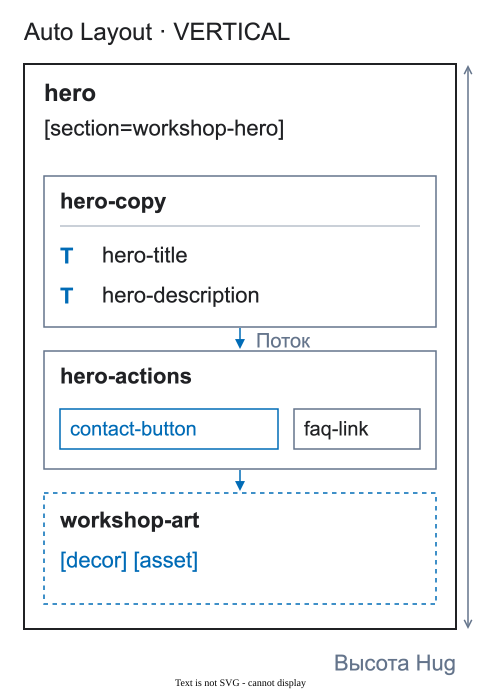

# Осмысленные обёртки

Обёртка — это реальный фрейм или компонент Figma с понятной задачей. Это не дополнительный тег и не пояснение в имени слоя.


<figure class="bridge-lesson-figure bridge-lesson-diagram">

<figcaption>Осмысленные обёртки вместо случайной группы. Объясняющая схема. <a href="../../assets/tutorial/diagrams/structure-ru.svg">Открыть в полном размере</a>.</figcaption>
</figure>

[Визуальный экскурс](25-vizualnyj-urok.md) показывает, зачем эти решения нужны команде.

## Оставляйте обёртку, если она

- объединяет элементы, которые адаптируются вместе;
- создаёт список, сетку, поверхность или область обрезки;
- отвечает за фон или область взаимодействия;
- задаёт модальное окно, состояние или экспортируемую иллюстрацию.

```text
hero-copy
  hero-title
  hero-subtitle
```

## Удаляйте обёртку, если она

- появилась только потому, что слои выбрали вместе;
- содержит один слой и не имеет структурной задачи;
- меняет координаты, но не добавляет смысла;
- является обычным `GROUP` или `Frame 53` вне ресурса.

Удаляйте лишний уровень, а не содержимое. Если у `GROUP` есть настоящая задача раскладки, замените его фреймом с нативной раскладкой Figma, сохранив связь элементов. `[decor]` отмечает визуальный слой, но не оправдывает произвольную раскладку контента. Декоративная композиция, передаваемая одним цельным ресурсом, может использовать `[decor] [asset]`.

## Сохраняйте дерево

Настройки могут меняться на разных ширинах, но осмысленная обёртка и её место в дереве должны оставаться узнаваемыми. Обёртке только на одной ширине нужна записанная структурная причина.
