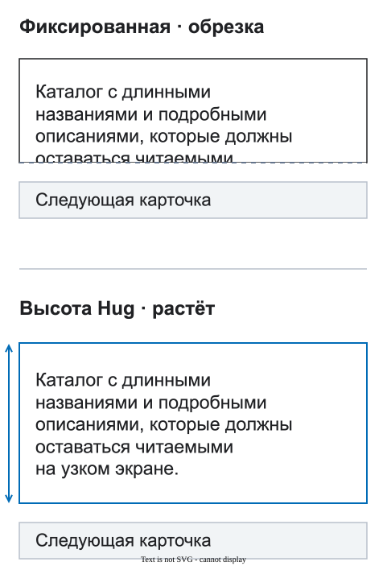

# Контент и переполнение

Динамический контент должен занимать нужное ему место. Фиксированная высота — продуктовое решение, а не способ подогнать один скриншот.

<figure class="bridge-lesson-figure bridge-lesson-diagram">

<figcaption>Длинный текст переносится, карточка растёт вместо обрезки. Объясняющая схема. <a href="../../assets/tutorial/diagrams/content-ru.svg">Открыть в полном размере</a>.</figcaption>
</figure>

[Визуальный экскурс](25-vizualnyj-urok.md) показывает, зачем эти решения нужны команде.

## Предпочитайте высоту по контенту

Позволяйте расти тексту, данным и спискам. Проверьте длинные слова, цены, имена, локализацию, ошибки и пустые состояния.

## Когда фиксированная высота оправдана

Используйте её, если продукту нужны заданная видимая область, обрезка, медиаблок или область прокрутки. Затем решите, что происходит, когда контент не помещается. Растущий блок уже не имеет фиксированной высоты; если граница должна оставаться неизменной, опишите поведение содержимого внутри:

- переносится внутри границы; если должен расти весь блок, используйте высоту по содержимому;
- обрезается по понятной причине;
- прокручивается внутри названной области;
- сокращается, но полный текст можно прочитать.

Не используйте ручные переносы и отдельный мобильный текст только ради композиции.

## Проверьте границы

Убедитесь, что контент, фокус, сообщения об ошибках и интерактивные цели не обрезаются случайно. Для промежуточных ширин см. [адаптивное поведение](03-adaptivy-i-breakpointy.md).

## Когда готово

Команда должна знать, как блок ведёт себя с обычными, длинными, пустыми и ошибочными данными.
