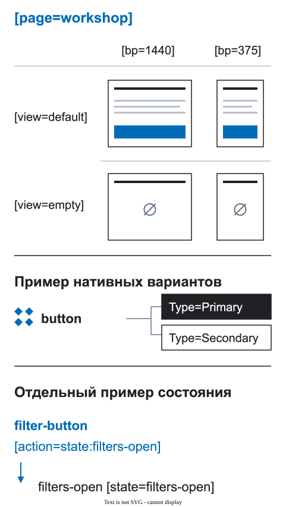

# Компоненты и секции

Библиотека сохраняет единый внешний вид и поведение. Структура страницы показывает, что означает конкретный экземпляр и что он делает в этом месте.


<figure class="bridge-lesson-figure bridge-lesson-diagram">

<figcaption>Читайте три отдельных примера: виды страницы default/empty на разных ширинах; нативные варианты кнопки Type=Primary/Secondary; действие с целью filters-open. Вариант компонента — не вид страницы, а объявление цели состояния не реализует переход во время работы приложения. <a href="../../assets/tutorial/diagrams/axes-ru.svg">Открыть в полном размере</a>.</figcaption>
</figure>

В [визуальном экскурсе](25-vizualnyj-urok.md) общий компонент задаёт вид кнопки, а её экземпляр на странице указывает на локальное окно.

## Два уровня библиотеки

- `UI Kit` содержит повторяемые элементы интерфейса: кнопки, поля, карточки и контролы;
- `Page Sections` содержит крупные блоки страницы со своей структурой и продуктовой ролью.

Уровень определяет не размер компонента, а его источник и ответственность.

## Компонент и экземпляр

Общий компонент задаёт визуальные состояния и стандартное поведение. Экземпляр на странице получает собственные контент, контекст и действие:

```text
contact-button [action=modal:contact-modal]
```

Одна и та же кнопка может открывать разные цели в разных местах. Не записывайте действие конкретной страницы в имя общего компонента.

Для явно интерактивного источника задайте `[control]` или `[link]` на main component либо на его ComponentSet, если у конкретного варианта нет собственного контракта взаимодействия. Тогда Page/Section Check заметит экземпляр без локальной разметки, действие или адрес которого ещё неизвестны. Стандартное поведение источника, например `[action=none]`, наследуется только при отсутствии локального намерения взаимодействия; явная локальная черновая отметка всё равно требует решения. Идентификаторы источника не копируются на экземпляры. Слово «Button», внешний вид и подпись не являются контрактом.

Эта детерминированная проверка контракта источника относится к локальному кандидату 0.10.0, проверенному тестами, а не к обещанию о текущей Community-сборке. Она читает только намерение источника, не обходя внутреннее дерево экземпляра. Ready относится к заявленным проверкам источника, а не ко всем взаимодействиям: недоступные или неклассифицированные источники, контентные переопределения экземпляров, поведение нативного прототипа и проверка работающего приложения остаются за её границей. Задайте цель конкретной страницы локально, повторите проверку и отдельно оцените эти ограничения.

## Идентичность секции

Экземпляр из `Page Sections` уже имеет стабильный источник. Не повторяйте `[section]`, если локальный фрейм не является границей секции. Секция, собранная прямо на странице, получает явный ключ:

```text
checkout-summary [section=checkout-summary]
```

## Сохраняйте источник правды

Используйте экземпляры вместо отвязанных копий, пока библиотека остаётся владельцем компонента. Оставляйте контент страницы видимым и редактируемым. Данные, действия и состояния храните на уровне страницы или структурированного контракта.

## Проверьте перед передачей

- можно ли найти исходный компонент;
- виден ли контент конкретной страницы;
- относится ли действие к текущему месту;
- показаны ли реальные состояния вместо спрятанных старых слоёв.

Общая политика источника правды описана в [правилах подготовки макета](01-pravila-dizajna.md).
