# Зачем нужен DFC Bridge

Макет: desktop и mobile.

<figure class="bridge-lesson-figure bridge-lesson-screenshot">

<figcaption>Выглядит готовым. Что именно передали — пока непонятно.</figcaption>
</figure>

Frontend, backend и ИИ гадают: что собирать, откуда данные и куда ведут кнопки?

DFC Bridge не диктует дизайн. Передаём **решения, а не догадки**.

<a class="bridge-lesson-download" href="../../assets/tutorial/dfc-bridge-workshop.fig" download="dfc-bridge-workshop.fig"><span aria-hidden="true">↓</span> Скачать макет <span class="bridge-lesson-download-format">.fig</span></a>

1. Открой Figma.
2. На главной нажми **Import**.
3. Выбери скачанный `.fig`.

## 1. Красиво. Но непонятно

`desktop` и `mobile-final-2`. Это одна страница или разные? Названия не отвечают. Команда начинает додумывать.

Сравним деревья. Где тот же заголовок и кнопка?

<div class="bridge-lesson-pair bridge-lesson-tree-pair">
<figure class="bridge-lesson-figure bridge-lesson-screenshot">
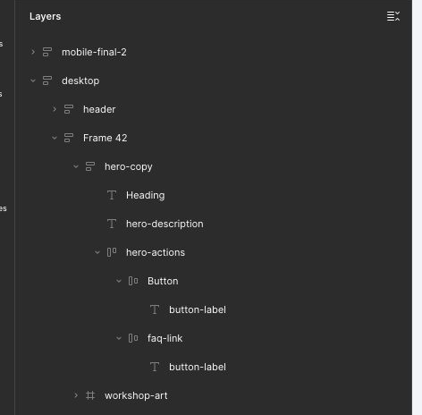
<figcaption>Desktop: <code>Heading</code> / <code>Button</code>.</figcaption>
</figure>
<figure class="bridge-lesson-figure bridge-lesson-screenshot">
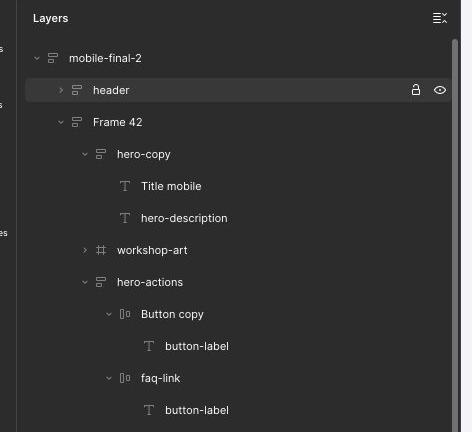
<figcaption>Mobile: <code>Title mobile</code> / <code>Button copy</code>.</figcaption>
</figure>
</div>

Два решения «чтобы на мобильном было красивее»:

- «Мастерская понятных макетов» → «Мастерская макетов». Поменяли текст, не перенос строки.
- Весь `hero-actions` вынесли из `hero-copy` в `hero`, после картинки. Поменяли родителя, не просто порядок.

<div class="bridge-lesson-pair bridge-lesson-heroes">
<figure class="bridge-lesson-figure bridge-lesson-screenshot">
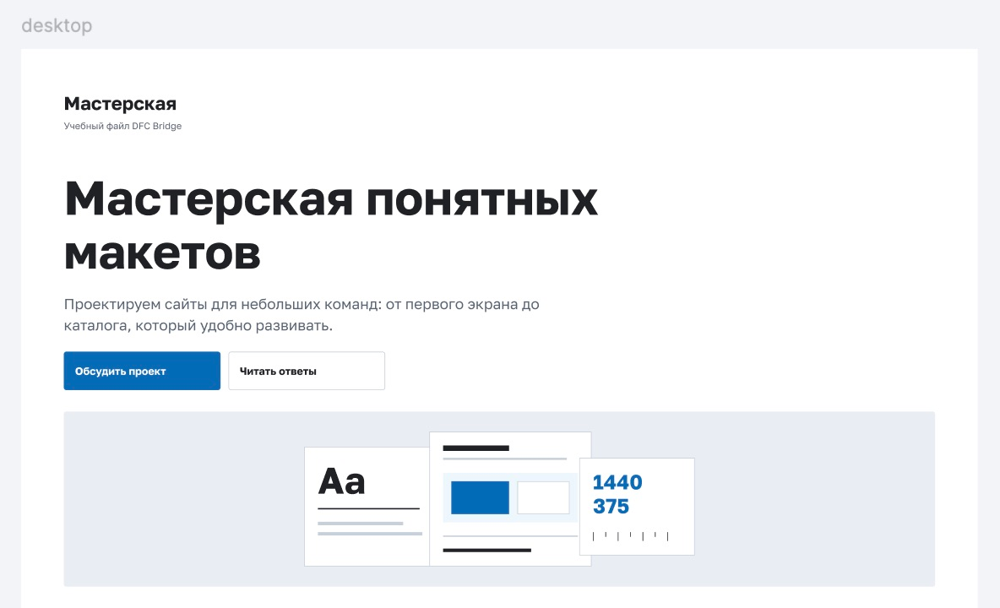
<figcaption>Desktop: полный заголовок, обе кнопки перед картинкой.</figcaption>
</figure>
<figure class="bridge-lesson-figure bridge-lesson-screenshot">
<aside class="bridge-lesson-comment">
<p><strong>Frontend:</strong> Короче текст, кнопки под картинкой — можно.</p>
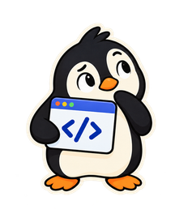
</aside>
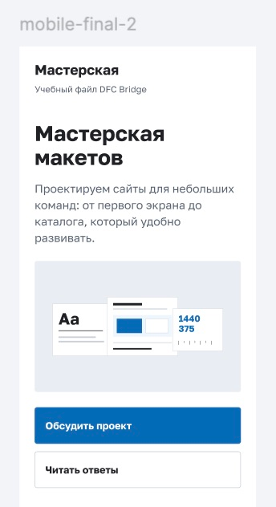
<figcaption>Mobile: пропало «понятных», обе кнопки под картинкой. <a href="../../assets/tutorial/screenshots/figma-before-overview.png">Полный исходный скрин</a>.</figcaption>
</figure>
</div>

Но нужно согласовать вариант текста и описать перенос. Здесь этого нет: frontend и ИИ гадают.

## 2. Связали экраны

Договорились: одна страница `workshop`, маршрут `/workshop`, вид `default`, ширины 1440 и 375. Записали в именах корней:

```text
workshop [page=workshop] [route=/workshop] [bp=1440] [view=default]
workshop [page=workshop] [route=/workshop] [bp=375] [view=default]
```

Отдельные непрерывные записи Figma. Автоматика вводит посимвольно и переносит через Cut/Paste; курсор не сопровождает действия. Подписи и подсветка добавлены поверх.

Детали: «Открыть на весь экран» под записью → «Исходный размер».

<figure class="bridge-lesson-figure bridge-lesson-motion">
<video src="../../assets/tutorial/motion/native/page-metadata-ru.mp4" poster="../../assets/tutorial/motion/native/page-metadata-ru.png" width="802" height="1040" controls playsinline preload="none" aria-label="Указали одну страницу workshop, маршрут /workshop, вид default и ширину 375"><a href="../../assets/tutorial/motion/native/page-metadata-ru.mp4" download="page-metadata-ru.mp4">Скачать MP4</a></video>
<figcaption>Отдельно: связали корни одной страницы. <a href="../../assets/tutorial/motion/native/page-metadata-ru.gif" download="page-metadata-ru.gif">GIF</a>.</figcaption>
</figure>

<figure class="bridge-lesson-figure bridge-lesson-diagram">
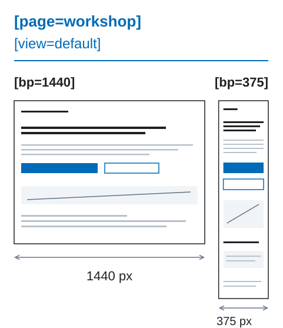
<figcaption>Один вид; две ширины.</figcaption>
</figure>

Frontend знает, что собирать. ИИ не ищет «самый final». Теги описывают договорённость, не создают раскладку или код.

## 3. Нашли те же элементы

Назвали по роли, не по устройству. Теперь frontend и ИИ могут сопоставить элементы:

| Было на 1440 / 375 | Стало на обеих ширинах |
| --- | --- |
| `Heading` / `Title mobile` | `hero-title` |
| `Button` / `Button copy` | `contact-button` |

Здесь выбрали общий заголовок и родителя. Это не единственный путь.

<figure class="bridge-lesson-figure bridge-lesson-motion">
<video src="../../assets/tutorial/motion/native/rename-title-ru.mp4" poster="../../assets/tutorial/motion/native/rename-title-ru.png" width="818" height="570" controls playsinline preload="none" aria-label="Переименовали слой Title mobile в hero-title, не меняя продуктовый текст"><a href="../../assets/tutorial/motion/native/rename-title-ru.mp4" download="rename-title-ru.mp4">Скачать MP4</a></video>
<figcaption><code>Title mobile</code> → <code>hero-title</code>. Имя, не текст. <a href="../../assets/tutorial/motion/native/rename-title-ru.gif" download="rename-title-ru.gif">GIF</a>.</figcaption>
</figure>

<figure class="bridge-lesson-figure bridge-lesson-motion">
<video src="../../assets/tutorial/motion/native/repair-copy-ru.mp4" poster="../../assets/tutorial/motion/native/repair-copy-ru.png" width="798" height="640" controls playsinline preload="none" aria-label="Вернули полный продуктовый заголовок Мастерская понятных макетов"><a href="../../assets/tutorial/motion/native/repair-copy-ru.mp4" download="repair-copy-ru.mp4">Скачать MP4</a></video>
<figcaption>Вернули полное «Мастерская понятных макетов». <a href="../../assets/tutorial/motion/native/repair-copy-ru.gif" download="repair-copy-ru.gif">GIF</a>.</figcaption>
</figure>

<figure class="bridge-lesson-figure bridge-lesson-motion">
<video src="../../assets/tutorial/motion/native/move-actions-ru.mp4" poster="../../assets/tutorial/motion/native/move-actions-ru.png" width="788" height="780" controls playsinline preload="none" aria-label="Перенесли весь hero-actions в существующий hero-copy, сохранив оба элемента и Auto Layout"><a href="../../assets/tutorial/motion/native/move-actions-ru.mp4" download="move-actions-ru.mp4">Скачать MP4</a></video>
<figcaption>Весь <code>hero-actions</code> → в <code>hero-copy</code>. Не одну кнопку. <a href="../../assets/tutorial/motion/native/move-actions-ru.gif" download="move-actions-ru.gif">GIF</a>.</figcaption>
</figure>

**Другой текст — [согласованный продуктовый вариант](16-osi-variativnosti.md). Другой родитель — [описанная трансформация](03-adaptivy-i-breakpointy.md).** Внутри одного родителя порядок менять можно.

<figure class="bridge-lesson-figure bridge-lesson-diagram">
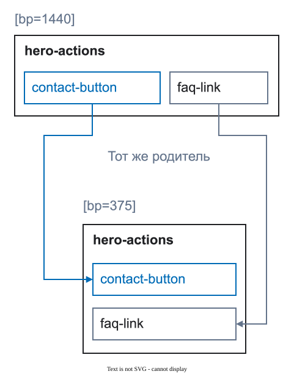
<figcaption>Те же кнопки и родитель.</figcaption>
</figure>

На desktop кнопки рядом, на mobile — друг под другом. **Разная раскладка — нормально:** меняется Auto Layout, текст и родитель здесь те же.

<div class="bridge-lesson-pair bridge-lesson-heroes">
<figure class="bridge-lesson-figure bridge-lesson-render">
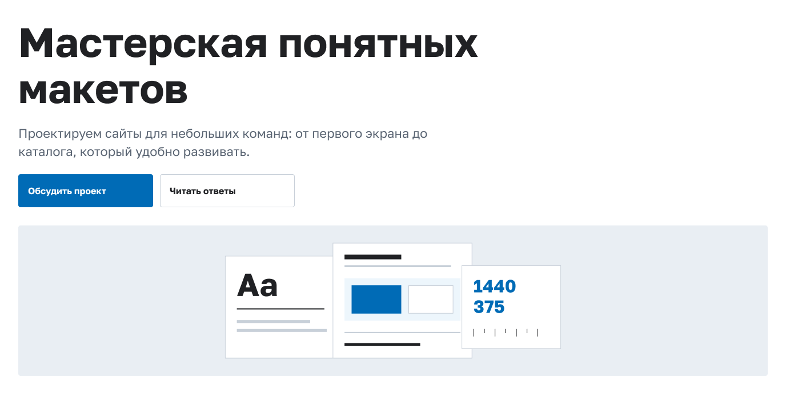
<figcaption>1440 px: кнопки рядом.</figcaption>
</figure>
<figure class="bridge-lesson-figure bridge-lesson-render">
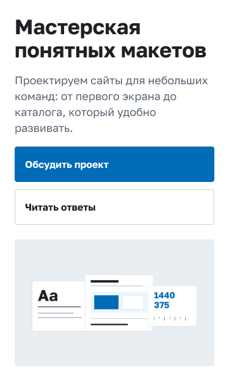
<figcaption>375 px: кнопки друг под другом, перед картинкой.</figcaption>
</figure>
</div>

Заголовок остаётся текстом. `workshop-art [decor] [asset]` — цельной картинкой. Не превращаем весь интерфейс в PNG.

## 4. Собрали библиотеку

`button-primary` и `button-secondary` стали общими компонентами. Правим источник — обновляются экземпляры.

В **UI-kit** показали состояния обоих стилей, в **Modals** — общий вид окна. Frontend и ИИ видят образцы, а не придумывают их.

<figure class="bridge-lesson-figure bridge-lesson-screenshot">
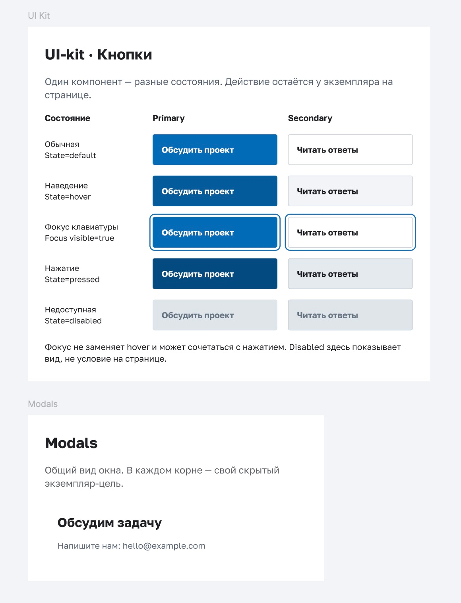
<figcaption>Два стиля, пять примеров состояний. Окно — рядом в Modals.</figcaption>
</figure>

<figure class="bridge-lesson-figure bridge-lesson-motion">
<video src="../../assets/tutorial/motion/native/button-states-ru.mp4" poster="../../assets/tutorial/motion/native/button-states-ru.png" width="1840" height="634" controls playsinline preload="none" aria-label="State: default → hover; затем отдельно включили Focus visible"><a href="../../assets/tutorial/motion/native/button-states-ru.mp4" download="button-states-ru.mp4">Скачать MP4</a></video>
<figcaption>Default → hover, затем отдельный фокус. <a href="../../assets/tutorial/motion/native/button-states-ru.gif" download="button-states-ru.gif">GIF</a>.</figcaption>
</figure>

**В библиотеке — вид. На экземпляре страницы — действие.** Одна и та же кнопка в другом месте может делать другое.

- `contact-button [action=modal:contact-modal]` → открыть окно.
- `faq-link [href=#faq]` → перейти к FAQ.

<figure class="bridge-lesson-figure bridge-lesson-diagram">
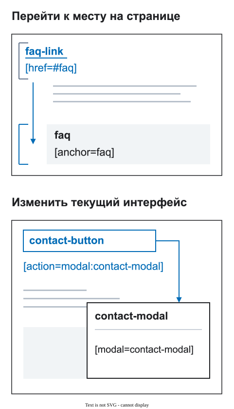
<figcaption>Объявленные цели, не работающий интерфейс.</figcaption>
</figure>

<figure class="bridge-lesson-figure bridge-lesson-motion">
<aside class="bridge-lesson-comment">
<p><strong>ИИ:</strong> В этой ширине цель — contact-modal.</p>

</aside>
<video src="../../assets/tutorial/motion/native/local-action-ru.mp4" poster="../../assets/tutorial/motion/native/local-action-ru.png" width="888" height="930" controls playsinline preload="none" aria-label="На экземпляре contact-button указали действие и скрытую локальную цель contact-modal на 375; К цели находит слой, не открывает окно"><a href="../../assets/tutorial/motion/native/local-action-ru.mp4" download="local-action-ru.mp4">Скачать MP4</a></video>
<figcaption>На экземпляре: действие → цель на 375. <a href="../../assets/tutorial/motion/native/local-action-ru.gif" download="local-action-ru.gif">GIF</a>.</figcaption>
</figure>

**К цели** находит скрытый слой, не открывает окно. Поведение ещё нужно реализовать.

<details>
<summary>Как устроены компоненты</summary>

Это образцы, не работающий прототип.

`State=default/hover/pressed/disabled` — варианты Figma, не DFC-теги или виды страницы. Фокус независим: `Focus visible=true` может сочетаться с `hover` и `pressed`.

Условие отключения и его владелец — в контракте реализации. Загрузки нет: окно и якорь, не запрос.

В каждом корне — свой скрытый `[modal=contact-modal]`. Главный компонент в Modals — источник вида, не ещё одна цель. Окно с почтой, не форма отправки.

</details>

Источник данных и договорённости фиксируем в [контракте данных](20-dannye-i-vizualizaciya.md).

## 5. Проверили

Отдельная копия: разный текст `hero-title` и родитель `hero-actions`. Auto Layout включён. Исправления не показаны. В ролике — старый отчёт и **Повторить**.

<figure class="bridge-lesson-figure bridge-lesson-motion">
<video src="../../assets/tutorial/motion/native/repeat-check-ru.mp4" poster="../../assets/tutorial/motion/native/repeat-check-ru.png" width="1408" height="710" controls playsinline preload="none" aria-label="Повторная проверка отдельной копии workshop после не показанных правок: старый отчёт с двумя ошибками → ноль, только контексты 375 и 1440"><a href="../../assets/tutorial/motion/native/repeat-check-ru.mp4" download="repeat-check-ru.mp4">Скачать MP4</a></video>
<figcaption>Правки — за кадром. Повторить: 2 ошибки → 0. Только 375/1440. <a href="../../assets/tutorial/motion/native/repeat-check-ru.gif" download="repeat-check-ru.gif">GIF</a>.</figcaption>
</figure>

На странице 02 — это решение с UI-kit и Modals.

<figure class="bridge-lesson-figure bridge-lesson-screenshot">
<aside class="bridge-lesson-comment">
<p><strong>Backend:</strong> Карточки пока примеры. Источник данных ещё согласуем.</p>
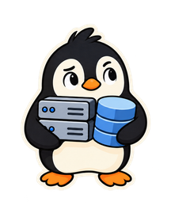
</aside>
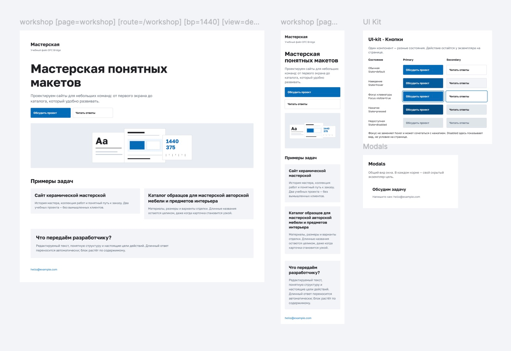
<figcaption>В итоге: согласованный макет, UI-kit и Modals рядом.</figcaption>
</figure>

<figure class="bridge-lesson-figure bridge-lesson-screenshot">
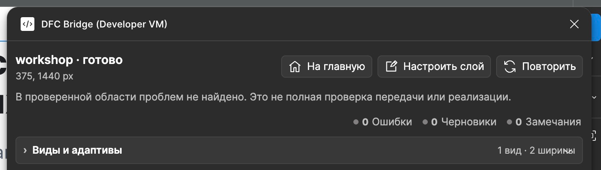
<figcaption>Ранний отчёт страницы 02, не результат предыдущего ролика и не новая проверка обновлённого файла. <a href="../../assets/tutorial/screenshots/assistant-ready-result-local.png">Полный исторический отчёт</a>.</figcaption>
</figure>

**«Готово» — про проверенную область макета, не готовое приложение.**

Передаём **исходник, ресурсы и договорённости**. Незакрытые вопросы — с владельцами. Не один PNG и обещание «там всё понятно».

## Дальше по задаче

- [Чеклист передачи](17-cheklist-dlya-dizaynerov.md).
- [Контент и переполнение](07-vysoty-i-overflow.md) — best practices подготовки.
- [Новая секция в старом макете](19-vnedrenie-v-komandu.md).
- [Виды и варианты](16-osi-variativnosti.md).
- [Доступность](23-profil-dostupnosti.md).

Учебный макет. Скрины — из Figma, Assistant — локальная сборка. Пингвины сгенерированы, вопросы команды — примеры. [Как проверено](../../assets/tutorial/README.md).
