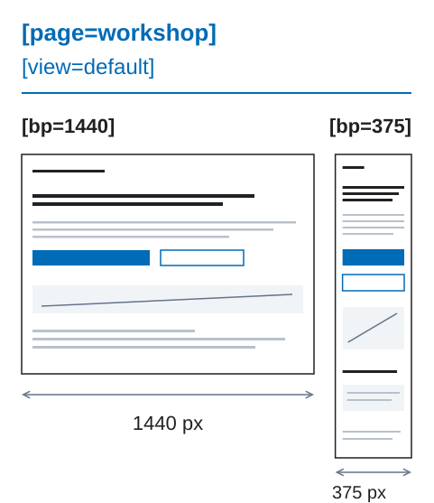

# 设计师快速起步

DFC Bridge 约定如何读懂设计。Figma 保存布局与外观，稳定名称和简短标签补充缺失的含义，让别人不问作者也能找到设计决定。

从一个真实页面开始，不必先读完整规范。以下五步说明基本关系，其余交付要求再用清单检查。

团队为什么需要这些信息？[图解入门](25-visual-walkthrough.md)用真实 Figma 截图说明疑问与交付决策。

## 文件需要回答什么

设计中应该清楚：

1. 当前是哪一个页面和状态；
2. 哪些准备好的宽度属于同一页面；
3. 哪些图层代表同一个元素；
4. 每个链接或按钮会做什么；
5. 哪些内容可编辑、属于装饰或需要导出。

## 一个小例子

假设宽屏和窄屏上的联系按钮都打开同一联系表单。文件应表明：这是同一页面的两个版本，按钮及对应模态框相同，而非两份无关设计。

### 之前：没有会议就看不懂

```text
desktop
  frame-42
    heading
    button

mobile-final-2
  group-91
    title
```

从这些名称看不出它们是否属于同一页面、哪些元素相同，也看不出按钮的作用。

### 之后：文件能够自我说明

括号前是图层名称。括号内的标签补充含义：`[page=home]` 标识页面，`[action=modal:contact-modal]` 说明按钮动作及目标。标签写在图层名称中，不是界面上显示的文字。

```text
home [page=home] [bp=1440] [view=default]
  hero [section=home-hero]
    hero-title
    contact-button [action=modal:contact-modal]
  contact-modal [modal=contact-modal]

home [page=home] [bp=375] [view=default]
  hero [section=home-hero]
    hero-title
    contact-button [action=modal:contact-modal]
  contact-modal [modal=contact-modal]
```

这是简化的层级片段：两个宽度都保留按钮和真实目标。仍须准备原生布局及窗口行为。

<figure class="bridge-lesson-figure bridge-lesson-diagram">

<figcaption>同一 page/view，两种 bp 原生宽度；非 CSS 阈值；route 声明 URL。</figcaption>
</figure>


## 五个步骤准备文件

### 1. 命名页面

先找到包含一个页面版本的画框，这就是页面根图层。为它写下稳定的页面名、宽度和状态：

```text
home [page=home] [bp=1440] [view=default]
```

只有在真实路径已知时才添加 `[route=/real-path]`。不要为了填标签而编造地址。

### 2. 使用稳定的图层名称

使用简短的英文 `kebab-case` 名称：

```text
hero-title
product-grid
contact-button
```

同一逻辑元素在各宽度中使用同一名称。应能直接找到各宽度的 `hero-title`，而不必根据外观猜测。不要在名称中加入 `-mobile`、`-desktop` 或宽度。

### 3. 展示重要宽度

准备团队要实现的宽屏和窄屏版本。保持 `[page]`、`[view]` 一致，在 `[bp]` 中写下准备好的宽度。

默认保留相同元素及其语义父级。尺寸、同一父级内的顺序和可见性可以变化。不同构成需要[明确映射](03-responsive-breakpoints.md)，而不是设备专用名称。

### 4. 说明链接和动作

用 `[href]` 表示跳转，用 `[action]` 表示界面变化：

```text
email-link [href=mailto:sales@example.com]
contact-button [action=modal:contact-modal]
```

本地动作应在声明范围内有对应目标。此处可从按钮动作找到 `[modal=contact-modal]`。地址或动作尚未确定时，用 `[link]` 或 `[control]` 标记草稿，并记录问题和负责人；不要编造目标。

### 5. 检查交付

请没有参与文件制作的人回答：

- 这是哪个页面和状态？
- 哪些宽度属于它，哪些图层相对应？
- 每个交互元素会做什么？
- 哪些内容应保持可编辑或需要导出？

如果仍需口头解释，就补充名称、关系或状态，再复查。随后完成[设计师清单](17-designer-checklist.md)。名称清楚不等于布局或实现已经就绪。

## 只添加 Figma 没有保存的含义

用 Figma 原生设置表达布局、外观与组件属性，不要重复写成标签。`hero-title` 这样的稳定名称若已说明含义，就不需要额外标签。

数据模式、复杂响应式变换及详细行为写入结构化 `bridge` 契约，不要编造标签或使用冗长的图层名称。

参见[设计规则](01-design-rules.md)和[图层命名](02-layer-naming-and-identity.md)。

## 如果你在现有产品中工作

先从一个新区块开始，不要为周围的旧文件编造页面元数据。[团队落地指南](19-team-adoption.md)介绍了后续做法。

## 下一步

- [DFC Bridge 示例](../examples/README.md)
- [设计师清单](17-designer-checklist.md)
- [完整检查](08-preflight-checklist.md)
