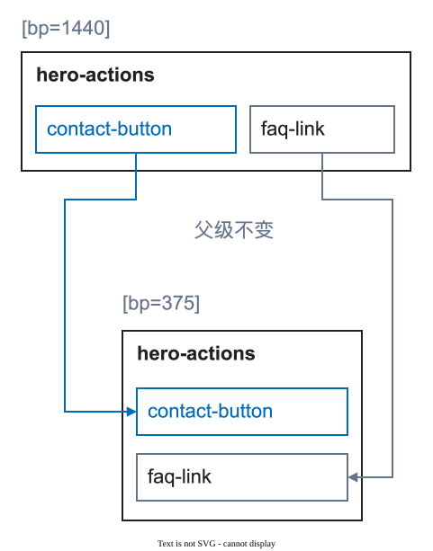

# 图层命名和稳定标识

稳定名称可以帮助团队在不同宽度和状态中识别同一个逻辑元素。它不是当前像素的描述。


<figure class="bridge-lesson-figure bridge-lesson-diagram">

<figcaption>沿连线找到两种宽度中的同名控件。名称表示身份对应，不表示位置必须不变。此例还保留共同父级 hero-actions；若改变有意义的父级，须声明结构转换。 <a href="../../assets/tutorial/diagrams/identity-zh.svg">查看原图</a>。</figcaption>
</figure>

[图解入门](25-visual-walkthrough.md)说明这些决策为什么对团队重要。

## 命名规则

使用简短的英文 `kebab-case` 名称：

```text
hero-title
product-grid
contact-button
```

不要使用编辑器默认名称、外观描述或设备后缀：

```text
frame-42
blue-heading
hero-title-mobile
button-375
```

## 什么时候需要标签

只有在 Figma 中找不到该含义时才添加标签：

```text
home [page=home] [bp=1440] [view=default]
contact-button [action=modal:contact-modal]
```

不要重复标记尺寸、布局设置、颜色或组件变体。完整列表见[标签语法](13-tag-grammar.md)。

## 保持标识稳定

在准备好的宽度和状态中保持：

- 同一个逻辑名称；
- 尽可能保持同一个有意义的父级；
- 同一个动作或目标，除非产品行为确实改变；
- 同一个内容角色。

如果结构确实改变，请展示对应关系或记录原因。不要把差异藏在新的设备名称中。

## 重复内容的名称

为集合元素使用角色或类型；如果需要追踪具体实例，再使用稳定的实例名称：

```text
product-grid [collection=products]
  product-card-oak-chair [item=product]
```

`[item=product]` 描述角色，图层名称标识准备好的实例。

## 快速检查

隐藏视觉设计，只阅读图层树。你仍应能找到页面根图层、主要区块、重要内容和动作。如果不能，请先改进结构或名称，不要继续添加标签。
