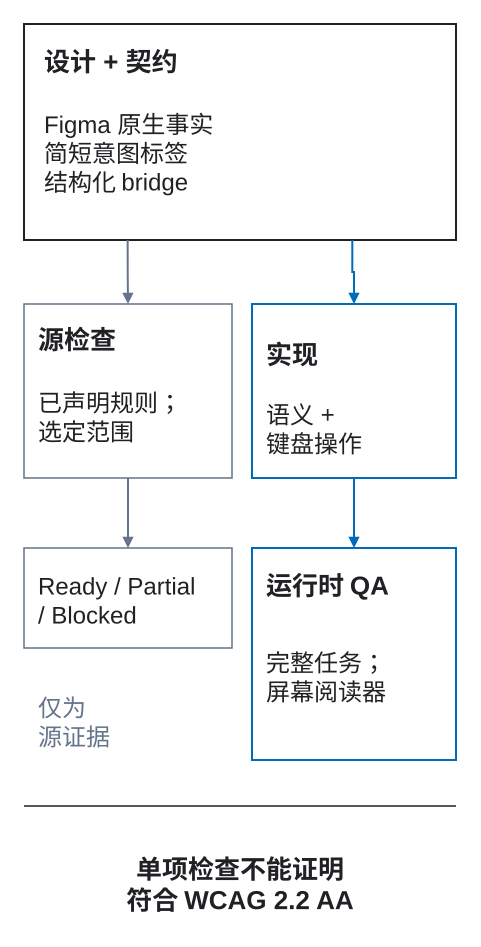

# DFC Bridge 交付契约

<a id="dfc-bridge-转让合约"></a>

DFC Bridge 契约记录图层名称和 Figma 属性无法完整表达的决定：数据、响应式转换、交互结果和交付证据。它将源设计与实现、QA 连接起来，不依赖某一种目标平台。

本页供集成开发或结构化交付使用。准备第一份设计页面时，请先读[设计师快速起步](00-designer-quick-start.md)。下文先说明一起传递的数据，再说明它们如何关联设计元素，以及如何验证这些关联。外层结构和 [JSON Schema](../validator/bridge.schema.json) 在 1.0 之前可能变化，因此每次交换都要固定 `contractVersion`、`methodologyVersion` 和 `rulesVersion`。

<a id="两个互补的表面"></a>

## 两种互补的表达方式

图层名称用于浏览和定位，不应成为存放所有信息的数据库。

<a id="短层标签"></a>

### 简短的图层标签

设计师用少量标签表达浏览设计时就需要看见的意图：

```text
catalog [page=catalog] [route=/catalog] [bp=1200] [view=default]
  products [section=product-results]
    product-grid [collection=products]
      product-card-oak-chair [item=product]
  filter [action=state:filters-open]
```

标签标识页面、变体、区块、链接和动作、目标、字段、集合、视觉策略、溢出及明确的例外。数据模型、状态图、动效时间线、无障碍测试计划和交付历史则不放进标签。

### 结构化 `bridge` 元数据

详细信息统一放在 `bridge` 对象中，并引用设计中的稳定标识。它可以保存在 Figma 插件数据、随附的 JSON 文件或适配器传输数据中，但必须随设计一起交付，并作为整体接受验证。

```text
Figma/source metadata + short DFC Bridge anchors + structured bridge metadata
                                ↓
                    one transferable contract
```

已有结构化字段能表达的信息，不要再创建新的图层标签。

<figure class="bridge-lesson-figure bridge-lesson-diagram">

<figcaption>先看证据：Figma 原生属性描述设计，简短标签定位意图，结构化 bridge 元数据记录更详细的决策。再分别阅读源检查与实现路径。源报告只覆盖其范围内声明的规则，不代表运行时获准交付，也不证明符合 WCAG。 <a href="../../assets/tutorial/diagrams/dfc-bridge-coverage-map-zh.svg">查看原图</a>。</figcaption>
</figure>

<a id="所需信封"></a>

## 外层结构与核心字段

完整数据以 `bridge` 为根对象。核心内容包括：

| 字段 | 用途 |
| --- | --- |
| `contractVersion` | 结构化数据格式的版本。 |
| `methodologyVersion` | 准备交付时采用的 DFC Bridge 版本。 |
| `rulesVersion` | 验证所用的规则目录版本。 |
| `source` | 来源工具、文件/页面、不可变修订版本和采集上下文。 |
| `context` | 声明的交付范围、适用的产品/页面上下文、包含的变化轴及外部依赖。 |
| `identity` | 角色、模板、设计实例、运行时数据与目标实现之间的对应关系。 |
| `structure` | 各响应式/数据上下文中的逻辑树。Figma 的原生节点类型、布局模式、定位和资源边界仍属于源证据，与逻辑树一起验证。 |
| 契约模块 | 按适用范围包含 `data`、`responsive`、`interaction`、`motion`、`accessibility`、`capabilities` 和 `lifecycle`。 |
| `openQuestions` | 未决问题及其负责人、范围、是否阻塞、复查时点和备用方案。 |
| `exceptions` | 明确的源设计/契约例外，以及影响和补偿措施。 |

只有范围证明某模块不适用，才能省略它。缺少模块不能表示“没有人检查”。

<a id="identity-是一种映射而不是一个重载的-id"></a>

## 用映射区分不同标识

一个名称不能同时可靠地表示交付中的所有身份。DFC Bridge 区分五个维度：

| 维度 | 回答的问题 | 示例 |
| --- | --- | --- |
| `role` | 元素承担什么逻辑作用？ | 数据项 / 商品 |
| `template` | 哪个可复用定义拥有其形态和行为？ | `product-card` |
| `designInstance` | 这是设计及其上下文中的哪个具体实例？ | `product-card-oak-chair` |
| `runtimeData` | 通过什么记录键规则或样例绑定运行时内容？ | 集合 `products`，键字段 `sku` |
| `target` | 哪个实现实体对应此元素？ | Web 组件 `ProductCard` |

`bridgeKey` 用于连接契约引用，不会把这些维度合并成一个。`[item=product]` 表示可重复的角色或类型，不是唯一设计实例或运行时记录 ID。`product-card-3` 这样的顺序名称可以临时标识设计样例，但不能成为运行时记录键。排序、筛选、分页、实时更新，以及看起来相同的不同记录，都需要稳定的业务键。

交互目标与实现映射也不同：交互反应引用模态窗口、状态、表单、路由或元素的 `bridgeKey`；`identity.elements[].target` 则把元素映射到实现代码或另一目标平台。

<a id="规范说明性有效负载"></a>

## 模块组合示例

把本例当作模块关系图，而不是可原样复制的完整项目。部分引用对象的完整定义未包含在此片段中。实际交付只包含适用模块，保留同样的命名空间结构，并验证所有引用。仓库中的完整可执行示例位于 `validator/examples/bridge-contract.valid.json`。

```json
{
  "bridge": {
    "contractVersion": "0.2.0",
    "methodologyVersion": "0.12.2",
    "rulesVersion": "0.5.1",
    "source": {
      "tool": "figma",
      "fileKey": "example-file-key",
      "pageId": "12:4",
      "pageName": "Catalog",
      "versionId": "figma-version-2026-08-13T10:20Z",
      "capturedAt": "2026-08-13T10:25:00Z"
    },
    "context": {
      "transferId": "catalog-default",
      "page": "catalog",
      "route": "/catalog",
      "view": "default",
      "axes": { "locale": "en-US", "theme": "light" },
      "contextIds": ["catalog-1200", "catalog-360"]
    },
    "identity": {
      "elements": [{
        "bridgeKey": "product-card-oak-chair",
        "role": { "kind": "data-item", "semantics": "product" },
        "template": {
          "templateKey": "product-card",
          "sourceComponentId": "55:8",
          "sourceComponentName": "UI Kit / Product Card"
        },
        "designInstance": {
          "designInstanceKey": "product-card-oak-chair",
          "sourceNodes": [
            { "contextId": "catalog-1200", "nodeId": "401:72", "layerPath": ["Catalog / 1200", "product-grid", "product-card-oak-chair"] },
            { "contextId": "catalog-360", "nodeId": "509:21", "layerPath": ["Catalog / 360", "product-grid", "product-card-oak-chair"] }
          ]
        },
        "runtimeData": {
          "collection": "products",
          "keyField": "sku",
          "fixtureKey": "oak-chair",
          "runtimeDataKey": "sku:CHAIR-OAK-01"
        },
        "target": {
          "platform": "web",
          "kind": "component",
          "targetKey": "ProductCard",
          "locator": "src/catalog/ProductCard"
        }
      }]
    },
    "structure": {
      "contexts": [
        { "id": "catalog-1200", "rootIdentity": "catalog", "tree": { "product-results": ["product-grid", "filter-button"] } },
        { "id": "catalog-360", "rootIdentity": "catalog", "tree": { "product-results": ["product-grid", "filter-button"] } }
      ]
    },
    "data": {
      "displays": [{
        "displayId": "product-grid",
        "purpose": "Browse products matching the active catalog query",
        "source": { "owner": "catalog-service", "dataset": "products", "refresh": "request" },
        "dimensions": [{ "key": "sku", "type": "string" }],
        "measures": [{ "key": "price", "type": "decimal", "currency": "USD" }],
        "format": { "locale": "user", "currencyDisplay": "symbol" },
        "states": ["loading", "empty", "error", "partial", "stale"]
      }]
    },
    "responsive": {
      "defaultPolicy": "same-tree",
      "contexts": [
        { "id": "catalog-1200", "driver": "viewport", "width": 1200 },
        { "id": "catalog-360", "driver": "viewport", "width": 360 }
      ],
      "transformations": [{
        "id": "comparison-table-to-disclosures",
        "fromContext": "comparison-wide",
        "toContext": "comparison-narrow",
        "when": { "driver": "container", "container": "comparison-panel", "condition": "max-width: 480px" },
        "mappings": [{ "source": ["comparison-table"], "target": ["comparison-disclosures"], "semantics": "same-records-and-fields" }],
        "preserves": ["content", "actions", "field-relationships", "selection", "accessible-names"],
        "readingOrder": ["comparison-heading", "comparison-disclosures"],
        "focusOrder": ["comparison-disclosure-trigger:*"],
        "stateTransfer": "preserve-selection-and-open-record",
        "history": "no-new-entry"
      }]
    },
    "interaction": {
      "stateMachines": [{
        "id": "catalog-filter",
        "initial": "idle",
        "states": ["idle", "pending", "results", "empty", "failure"],
        "transitions": [{
          "id": "apply-filter",
          "from": ["idle", "results", "empty", "failure"],
          "event": { "type": "submit", "source": "catalog-filter-form" },
          "pending": { "to": "pending", "duplicateEvent": "replace-with-latest" },
          "outcomes": {
            "success": { "to": "results", "focus": "results-heading", "announce": "Results updated" },
            "empty": { "to": "empty", "focus": "results-heading" },
            "failure": { "to": "failure", "focus": "filter-error", "retry": "preserve-values" }
          },
          "history": "replace-query"
        }]
      }]
    },
    "motion": { "sequences": [] },
    "capabilities": {
      "profiles": [{
        "id": "mobile-low-bandwidth",
        "target": { "platform": "web", "runtime": "browser" },
        "essentialExperience": ["product-name-and-price", "filter-and-open-product"],
        "supports": ["responsive-images", "offline-cache"],
        "unsupported": [{ "capability": "scroll-timeline", "fallback": "static-scenes", "owner": "storefront" }],
        "assets": [{
          "element": "product-image",
          "width": 960,
          "height": 960,
          "formats": ["avif", "webp", "jpeg"],
          "quality": "product-detail-visible",
          "artDirection": "square-crop-with-subject-safe-area",
          "loading": { "priority": "results-dependent", "poster": null, "strategy": "lazy-outside-first-window" }
        }],
        "data": { "expectedItems": 48, "maximumItems": 10000, "virtualizeAfter": 200, "strategy": "server-pagination" },
        "conditions": ["low-bandwidth", "offline", "data-saver", "low-power"],
        "budgets": [{ "metric": "initial-results-payload", "limit": 250, "unit": "KiB", "owner": "storefront", "measureAt": "release-qa" }]
      }]
    },
    "accessibility": {
      "profile": { "standard": "WCAG", "version": "2.2", "level": "AA" },
      "elements": [{
        "element": "product-grid",
        "name": "Catalog results",
        "readingOrder": ["results-heading", "active-filters", "product-grid", "pagination"],
        "testIds": ["catalog-results-keyboard", "catalog-results-reflow"]
      }]
    },
    "lifecycle": {
      "transferId": "catalog-default",
      "contractRevision": "7",
      "sourceRevision": "figma-version-2026-08-13T10:20Z",
      "targetRevision": "build-1842",
      "status": "qa",
      "owners": { "design": "catalog-design", "contract": "design-systems", "implementation": "storefront", "qa": "quality" },
      "requirements": ["REQ-CATALOG-017", "REQ-CATALOG-021"],
      "evidence": { "tests": ["catalog-grid-default", "catalog-grid-keyboard"] },
      "deviations": []
    },
    "openQuestions": [{
      "id": "OPEN-CATALOG-003",
      "scope": ["catalog", "offline"],
      "question": "May users open a product from stale cached results?",
      "owner": "catalog-product",
      "blocking": true,
      "due": "2026-08-18",
      "reviewAt": "contract-gate",
      "fallback": "Show cached results read-only and disable product navigation",
      "status": "open"
    }],
    "exceptions": []
  }
}
```

图层标签仍是人可以直接看到的定位依据；结构化数据补充无法放进名称的关系和决定。

<a id="默认情况下是同一棵树通过声明进行转换"></a>

## 默认保持同一棵树，结构变化需要声明

`responsive.defaultPolicy` 为 `same-tree`。几何、Auto Layout 方向、换行、同一逻辑父级内的顺序，以及已声明的可见性变化，不需要结构映射。

树结构或呈现方式发生变化时，必须用 `responsive.transformations[]` 记录。记录包括源和结果标识、视口/容器条件、字段/场景/动作映射、保留的语义、阅读与焦点顺序、状态传递和历史行为。没有对应转换记录的差异属于契约偏移。

### 原生布局仍然需要源证据

`bridge.structure` 不重复保存 Figma 的原生 `layoutMode`、节点类型和定位字段。源验证器直接读取这些字段并应用规则目录：

- 页面根始终使用原生 Auto Layout，不能标记为 `[asset]`；
- 由画框构建的区块根与 `Page Sections` 源根使用 Auto Layout，除非该区块本身确实是整体交付的视觉资源；
- 支持 Auto Layout 且至少包含两个可见、有意义的内容流子节点的普通容器使用 Auto Layout；
- `GROUP` 只允许位于真正不透明的 `[asset]` 子树内；
- 基础图形、叶节点几何与已放置的 `INSTANCE` 内部不作为内容流容器检查；
- `[decor]` 只标识具体的、具有明确意图的绝对定位视觉节点，不构成结构检查豁免。

Page Check 将放置的 `INSTANCE` 视为原子对象，不会为了区块布局规则继续解析其源组件；应单独检查可编辑源根。资源根仍是逻辑树中的一个标识，也是父级 Auto Layout 中的一项。附带原因的手动布局例外可以记录结构偏差，但不会改变源证据，也不会把失败的 Page Check 变成通过。

<a id="旧主机内的选定部分范围"></a>

## 在现有产品中限定选中区块的范围

团队可以先对一个新区块采用 DFC Bridge，不必同时迁移周围的产品。边界是明确选中的源根节点，并具有稳定的区块标识：

```text
checkout-summary [section=checkout-summary]
```

不要把区块伪装成页面。`[page]`、`[bp]`、`[view]` 和 `[route]` 仍是页面根标签，不能只为启动验证而添加。**Check selected section（检查选中区块）** 只遍历规范化后的选中根节点及其后代。结果取决于所选对象：

- 可编辑的 `FRAME` 或 `COMPONENT` 接受完整的本地源检查。`GROUP` 仍是阻塞性的结构问题。
- 如果选中的区块根节点本身是 `INSTANCE`，只能检查其边界，结果为 Partial。
- 普通后代 `INSTANCE` 被视为可信的原子边界。本次遍历不检查其内部，因此它不会降低 Ready。
- `[section=id] [asset]` 位于选中的根节点本身时，可形成有效的整体视觉资源边界，内部布局检查不适用。
- 如果区块位于另一个非页面根的 `[asset]` 祖先之下，范围无效，结果为 Blocked；检查不能穿过这条继承的资源边界。

页面根上的非法 `[asset]` 不会隐藏内部结构。Page Check 会单独报告该根的问题，后代仍可检查。单独的 `[decor]` 也不会停止遍历。

结构化范围记录选中了什么，以及什么仍在范围之外。以下是**非独立片段**，应放入完整的 `bridge` 外层结构：

```json
{
  "context": {
    "project": "Legacy storefront section adoption",
    "scope": {
      "kind": "section",
      "rootIdentity": "checkout-summary",
      "boundary": "selected-subtree",
      "assetBoundary": "none",
      "hostCompliance": "legacy-out-of-scope",
      "selectionMode": "explicit-variants",
      "contextIds": ["summary-container-360", "summary-container-1200"],
      "readinessClaim": "section-source-only"
    },
    "externalDependencies": [{
      "id": "checkout-route-dependency",
      "kind": "route",
      "reference": "/checkout",
      "status": "deferred",
      "owner": "storefront-platform",
      "reviewAt": "host integration gate"
    }]
  },
  "responsive": {
    "defaultPolicy": "same-tree",
    "contexts": [
      {
        "id": "summary-container-360",
        "driver": "container",
        "width": 360,
        "label": "Container 360",
        "labelSource": "inferred-from-selected-root-width"
      },
      {
        "id": "summary-container-1200",
        "driver": "container",
        "width": 1200,
        "label": "Container 1200",
        "labelSource": "inferred-from-selected-root-width"
      }
    ]
  }
}
```

范围字段的含义如下：

- 对于可编辑或原子源根，`assetBoundary` 为 `none`。只有选中的区块根本身带有 `[asset]` 时，才为 `selected-root-opaque`。祖先资源边界不能构成有效的区块范围契约。
- `single-root` 表示只请求了一个上下文。无需编造未请求的变体，也可以达到源就绪。
- `explicit-variants` 表示用户明确选中了两个或更多具有相同 `[section]` 标识的根进行比较。验证器不能自行寻找旧文件中的相邻对象并扩大范围。
- 工具根据选中根或容器宽度推导上下文名称时，应记录 `labelSource: inferred-from-selected-root-width`，不能把推导结果当作作者明确表达的意图。

区分本地证据与外部依赖：

- 在选中根内部找到的动作目标属于本地目标。
- 完整且有效的 `http:`、`https:`、`mailto:` 或 `tel:` 地址，在区块源范围内视为作者已明确给出，不会导致 Partial。地址在运行时是否可用不属于源检查范围。
- 不完整或格式错误的外部地址属于阻塞性的 `interaction.href-invalid` 问题，而不是 Deferred。
- 需要到选中根之外查找的内部路由/锚点、模态窗口/状态/表单/重置目标、组件和数据，既不能判为缺失，也不能视为已验证。应关联外部契约，或在 `externalDependencies` 中记录为待确认/未验证，再由独立的文件或产品集成检查确认。

完整可执行示例见 [`bridge-section-contract.valid.json`](../validator/examples/bridge-section-contract.valid.json)。

成功的区块契约只表示 **选中区块的源设计在声明的上下文中就绪**。它不证明周围的旧页面、路由、完整响应式版本、端到端流程、实现或产品已就绪，也不代表符合 WCAG。

<a id="显式未知数没有未跟踪的盲点"></a>

## 保存给开发者的快照（0.10.0 候选版）

当开发者需要检查过的源文件事实，而不想重新扫描 Figma 或把整棵树交给 AI 时，使用此流程。这是 Assistant 0.10.0 候选版支持的只读交付路径，**尚未作为插件更新发布**。它补充而不替代上面的产品契约。

1. 在 Figma 中选择 DFC 页面根节点并运行 **Check page**，或选择带标记的区块（或其中的图层）并运行 **Check selected section**。若需要多个区块上下文，请明确选择各根节点。页面导出包含当前 Figma 页面上该逻辑页面的所有根；区块导出不会自动寻找同级变体。
2. 在报告中点击 **Export snapshot**。读取事实前会重新运行同一个检查。完成前不要改变选择；范围变化或重复的相关编辑会取消操作。确认 JSON 已实际下载。此按钮不导出整文件报告。
3. 把 JSON 和版本匹配的 Assistant 包交给开发者。在解压后的包内，使用 Node.js 22.12+ 运行：

```bash
node bin/dfc-bridge.mjs check snapshot.json > preflight.json
node bin/dfc-bridge.mjs manifest snapshot.json > manifest.json
```

`check` 在不连接 Figma、不使用 VM 或 AI 的情况下重新运行同一个 Page/Section 检查核心。退出码 `0` 表示源范围为 Ready，且记录的 `(ruleId, severity, nodeId)` 问题一致；`1` 表示存在问题或范围/版本未经验证；`2` 表示输入或调用无效。`manifest` 验证包并返回保存的事实，不扫描 Figma。JS 对应接口为 `api/index.mjs` 中的异步 `checkSnapshot(text)` 和 `developerManifest(text)`。源文件 Ready 不代表运行行为、无障碍或产品验收通过。

### 快照记录什么

[快照模式](../validator/handoff.schema.json)和[合成示例](../validator/examples/handoff.valid.json)定义 `format: "dfc-bridge-handoff"`、`schemaVersion: 1`、SHA-256 `revision`、插件/规则目录版本、来源、范围、原生节点、依赖、记录的预检及覆盖范围。`nodes` 仅包含声明的根和已捕获的结构后代。`dependencies` 保留真实祖先以及引用的 main component/ComponentSet，而非完整变体库。原生 ID 与逻辑 `identity` 不同；重复身份不会被合并。

- `native` 记录可读取的几何、auto-layout、sizing、padding/gap、排版、opacity、fills、**strokes**、描边位置/粗细、effects、样式 ID、变量绑定/模式 ID、组件属性、overrides、reactions 和 export settings。
- `tags` 保存从作者图层名称解析出的标记；无值标记为 `true`。缺失意图保持未知，不根据外观或文字猜测。复杂的产品意图仍属于结构化 `bridge` 数据，不应发明新标签。
- `coverage.unavailable` 给出混合值或不可读属性的节点、字段及原因。缺失字段不是零，也不证明该属性不存在。样式/变量引用不等于解析后的值；导出设置不是图片字节。实例内部保持原子边界；content/runtime 为 `not-checked`；组件变体为 `not-exported`。

没有编辑时，重复导出产生相同字节/哈希：对象键排序，数组顺序保留，不包含耗时及捕获时间。校验和能发现改动，**不能证明作者身份或真实性**。未知 `source.fileKey` 为 `null`，不会生成虚构的 Figma 链接。包可能包含私有名称、文字和原生属性；分享前请检查。

### 兼容性与下一步检查

消费者拒绝不支持的 format/schema、无效引用、循环、不安全键以及超过 2 MiB 的包。JSON 嵌套上限为 64 层，原生祖先链上限为 256 个节点。捕获上限为含依赖在内的 10,000 个节点；超限会明确失败，而非截断。请选择更小的区块后重新导出。`check` 要求插件/目录版本与生成器完全一致；版本不匹配或 `scope.completeness: "partial"` 均为未经验证，绝不为 Ready。部分包中未出现的节点不代表删除。`full` 仅指声明的结构范围完整，不表示产品契约或实例内部完整。

Explorer 的 **Import** 接受同一个 JSON，验证修订并为 **Export** 保留原包。图最多展示 1,000 条原生记录，并明确提示此限制；所有事实仍保留在导出的 JSON 中。Explorer 展示记录的预检，不重新运行检查。已有的人工整理 Explorer v1 快照保持兼容；任意 File map 数据并非此格式。

下一步审查记录的问题、不可读取事实及外部依赖，然后单独验证实现及运行行为。解析后的变量/样式、完整变体/状态差异、资源二进制/哈希、共享状态/数据契约、跨 breakpoint 内容比较、分块读取及增量 diff 不属于本次快照增量；完整开发者包尚未完成。

## 组件检查（0.10.1 候选版）

实现 UI Kit 组件前，先按上文用 **0.10.1 候选版**导出所选页面/区块。此版本写入 `schemaVersion: 2`：结构外层保持不变，`componentInspection` 单独保存引用的 main component 及其 ComponentSet 中每个原生变体的只读事实。旧 v1 包仍可验证；仅支持 v1 的旧读取器必须拒绝 v2，不能静默丢弃检查数据。[合成组件示例](../validator/examples/handoff-components.valid.json)不需要私人文件或令牌。这不是已发布的插件，也不是内容审计。

在匹配的包中运行：

```bash
node bin/dfc-bridge.mjs components snapshot.json --expect State=Focus > components.json
```

异步 JS 等价接口为 `componentManifest(text, { expected: [{ axis: "State", value: "Focus" }] })`。命令验证已保存的校验和，无需 Figma、AI 或网络；退出 `0` 表示成功生成可检查报告，而不是批准就绪。无效输入/用法退出 `2`。实现前请阅读 `status`、`missing` 和 `unavailable`。

- `families` 保留原生 ID/键、源页面、属性轴及属性定义/defaults；`matrix` 列出真实 `variantProperties`。`instances` 将当前 `componentProperties`、`overrides` 与 defaults 分开保存。只有源文件已知时才提供本地源链接；远程/未知来源不会被错误赋予当前文件的 URL。
- 每个变体保存根及后代的几何、布局、排版、opacity、fills **和 strokes**、effects 与圆角。空 `strokes: []` 表示没有描边绘制；单独的 `strokeWeight` 不能证明可见边框。嵌套实例仍保持原子边界。API 可提供时，保存绑定 Style/Variable 的名称、源 ID、模式及解析值。getter/库读取失败时保留可读取的几何，并记录节点/字段/原因，不编造值，也不让整个组件族导出失败。
- `diffs` 将每个真实变体与确定性基准比较：原生 ID 排序后的第一个，**不是**推断的 Default。用 `--baseline nativeId`（JS `baselineId`）选择其他基准。每项变化包含前后原生节点 ID 和字段。子节点索引路径比较渲染树位置，而非逻辑身份；类型/名称变化视为替换。根在画布上的 `x/y` 仍作为事实保留，但不参与视觉状态差异。
- `--expect Axis=Value` 是调用方明确提出的要求，不是猜测的标签。请求状态缺失时标为 `not-prepared`；变体元数据不可读时标为 `unknown`。报告不会合成 Focus/Active，也不会把未请求的状态假定为必需。请根据真实实现要求审查原生矩阵。

`coverage.componentVariants: "inspected"` 只说明完成了此项检查，不是对全部组件、内容或运行时的批准。统一的 2 MiB 和 10,000 条记录上限包含检查与实例记录；超限明确停止导出，不截断。下一步先解决不可用事实和缺失的必需状态，再分别检查交互、内容和运行时。资源二进制、未公开的实例内容及增量交付仍需独立处理。

## 显式审计已保存的内容槽

当需要跨上下文比较**明确对应**的实例标签、值或图片时，使用此独立的可选检查。结构就绪不代表实例内容已检查。审计在 0.10.1 候选包中读取已保存的 v1/v2 原生事实，不打开 Figma，也不遍历实例内部。

1. 按上文导出并检查快照。支持原生公开 TEXT `componentProperties` 和根节点 IMAGE `fills`。未公开的内部文字/图片 overrides **不可用**，不得从 defaults、名称、位置或 `overrides` 指针推断其值。
2. 参照[模式](../validator/content-bindings.schema.json)与[合成绑定](../validator/examples/content-bindings.valid.json)，为对应的[合成快照](../validator/examples/handoff-components.valid.json)编写精确修订绑定文件。`groups[].key` 是显式内容身份；每个来源声明 `contextId`、原生 `instanceId` 及命名 `slots`。`text-property` 槽声明精确的原生 `property`；`image-fill` 槽声明根节点的精确 `fillIndex`。独立的 `label`、`value` 槽键保留配对关系。不引入新的图层标签。请将报告中的原生断点/页面/视图与声明的上下文核对。
3. 运行基于已保存事实的命令，或从 `api/index.mjs` 调用异步 `contentAudit(snapshotText, bindingsText)`：

```bash
node bin/dfc-bridge.mjs content snapshot.json bindings.json > content-audit.json
```

只在明确绑定的上下文之间比较同一内容/槽键。基准为排序后的第一个显式上下文 ID，不推断 desktop/default。相同值不产生发现；文字/图片变化报告前后原生实例 ID、main component 引用、上下文和精确属性/填充。不同键下重复使用图片不会自动判错。这不能判断物理规格、宣传声明或操作步骤是否真实正确。

报告分开显示记录的 `sourcePreflight`、有限的 `interactionCoverage` 和 `contentCoverage: "explicit-bound-slots-only"`。范围内每个实例均列在 `uncheckedInstances`，同时列出已检查的槽键：实例内部仍未检查。`contentReady` 始终为 `false`，内容所有者批准和运行时均为 `not-checked`。缺失绑定/值以及部分快照仍是 Partial，不是 Content Ready，也不是删除证据。退出 `0` 表示绑定槽没有差异或差异有明确原因；`1` 表示 Review/Partial；`2` 表示输入/用法无效。

对于有意的响应式差异，在变化上下文的 `exceptions` 中添加 `{ "slotKey": "label", "reason": "…" }`。差异及原因仍可见；它记录意图，不代表所有者批准。绑定限制为 64 KiB，必须匹配 `snapshotRevision`；源文件变化后需明确重新审查并绑定，不能自动沿用旧例外。下一步先解决 Review/Partial，再单独请内容所有者确认真实内容。

## 明确记录未知项，不留下未跟踪的问题

DFC Bridge **不**承诺所有决定都已确定，而是要求所有相关未知项都有记录。

`unknown`、`unsupported`、`TBD` 等状态只有记录到 `openQuestions[]` 才有效。记录包含：

- 稳定 ID 和准确范围；
- 未决问题或不支持的能力；
- 负责人；
- 是否阻塞；
- 截止日期或明确的复查阶段；
- 未解决时的安全备用方案；
- 当前状态，以及解决后的决定链接。

如果备用方案不安全、不满足无障碍需求、有误导性或会破坏数据，该问题就是阻塞项，受影响范围不能通过对应验收。只存在于口头讨论、聊天、孤立任务或个人记忆中的问题，仍是 DFC Bridge 的盲点。

<a id="目标能力和性能概况"></a>

## 目标能力与性能约束

契约不能假设所有目标平台都有相同的编解码器、输入方式、布局能力、内存、网络和电力条件。`capabilities.profiles[]` 声明目标平台与运行环境、降级时必须保留的核心体验、支持与不支持的能力，以及每项不支持需求对应的已测试备用方案。

- 媒体和资源：声明原始尺寸、可接受的格式与质量、构图和裁剪安全区、加载优先级、封面/预览，以及预加载或延迟加载策略。
- 数据：声明预期和最大数据量，以及分页、流式加载或虚拟化的阈值。
- 适用条件：覆盖低带宽、离线、省流量、低功耗、减少动效和 API 缺失等情况。

设计负责声明必要内容、媒体、顺序和任务结果。实现负责可测量的性能预算、交付策略、测量手段和证据。尚未确定的能力或预算应成为有负责人、有安全备用方案的未决问题，不能从某张漂亮的设计图中推断。

<a id="源优先级和继承"></a>

## 来源优先级与继承

每项事实有一个负责来源：

1. 目标平台的安全、隐私和原生语义约束所有其他来源；
2. 已批准的产品和内容决定定义含义；
3. 结构化 DFC Bridge 契约定义源工具无法表达的意图；
4. Figma/源元数据定义设计中的结构、组件、几何和样式；
5. 已固定版本的组件/系统契约提供继承行为；
6. 明确批准的例外或偏差记录剩余差异。

不要把组件状态机复制到每个实例。引用已固定版本的模板，只声明实例专属内容、覆盖项和上下文。

## 验证

契约验证器应检查：

- 数据模式及固定的版本字段；
- 范围内 `bridgeKey`、设计实例、需求、问题、例外和偏差 ID 的唯一性；
- 标识、树、数据显示、转换、反应、动效、无障碍与测试之间的引用有效性；
- 源节点和上下文是否存在；
- 运行时记录映射是否误用了样例的顺序索引；
- 是否保持同一逻辑树，或存在覆盖差异的适用转换；
- 能力配置是否按需包含资源/媒体、数据量、降级、不支持功能的备用方案，以及有负责人的预算；
- 状态机可达性与动作目标；
- 必需的数据状态和无障碍配置；
- 未决问题的负责人、范围、阻塞状态、复查时点和备用方案；
- 临时例外/偏差的复查或到期日期，以及证据。

JSON 格式有效不等于产品契约有效。确定性模式检查、源设计检查和人工语义评审互为补充。

<a id="10之前的兼容性"></a>

## 1.0 之前的兼容性

- 生成方必须明确输出 `contractVersion`。
- 使用方必须拒绝不支持的主要数据结构，并报告未知字段，不得默默丢弃必要含义。
- 新增扩展字段应保留命名空间并附有说明。
- 迁移必须保留稳定标识和需求链接。
- 契约修订一旦用于已接受的实现/QA 执行，就不可修改；变更应创建新修订。

参见[数据与可视化](20-data-and-visualization.md)、[响应式行为](03-responsive-breakpoints.md)、[状态与反应](22-state-machines-and-reactions.md)、[动效与长滚动](21-motion-and-scroll.md)、[无障碍配置](23-accessibility-profile.md)和[交付生命周期](24-delivery-lifecycle.md)。
