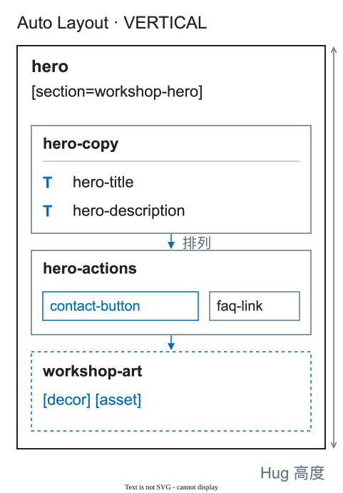

# 容器

<a id="包装器"></a>

容器（wrapper）是包围相关元素、具有明确作用的 Figma 画框或组件。它不是额外标签，也不是写在图层名称中的说明。


<figure class="bridge-lesson-figure bridge-lesson-diagram">

<figcaption>有意义的容器而不是随意分组. 说明示意图。 <a href="../../assets/tutorial/diagrams/structure-zh.svg">查看原图</a>.</figcaption>
</figure>

[图解入门](25-visual-walkthrough.md)说明这些决策为什么对团队重要。

<a id="保留包装器如果它"></a>

## 保留容器，如果它

- 将一起响应式变化的元素组合在一起；
- 创建列表、网格、表面或裁剪区域；
- 负责背景或交互区域；
- 定义模态窗口、状态或可导出插图。

```text
hero-copy
  hero-title
  hero-subtitle
```

<a id="删除包装器如果它"></a>

## 删除容器，如果它

- 只是因为图层被同时选中才存在；
- 只有一个子图层且没有结构作用；
- 改变坐标但不增加含义；
- 是资源之外的普通 `GROUP` 或 `Frame 53`。

删除多余层级，而不是删除里面的内容。如果 `GROUP` 承担实际布局任务，应将它换成使用 Figma 原生布局的画框，保留元素关系。`[decor]` 只标记视觉图层，不能为任意内容布局提供理由。确实作为一个整体资源交付的装饰组合可以使用 `[decor] [asset]`。

## 保持树稳定

不同宽度可以改变设置，但有意义的容器及其在图层树中的位置应保持可识别。只在一个宽度中存在的容器需要记录结构原因。
