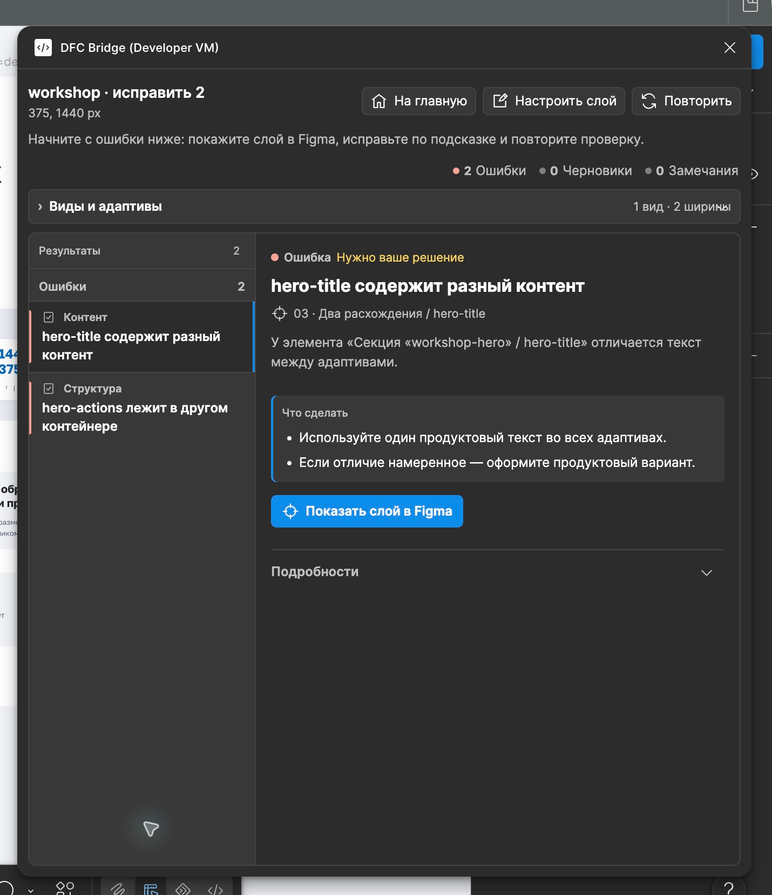

# 验证与自动检查

验证把准备好的源设计转化为具体问题和待解决决策。先选择页面或所选区块范围，再修复问题、重新检查，并复核工具未覆盖的部分。本页解释检查边界和更广泛的验证模型，不代表插件已经执行下面的全部规则。


<figure class="bridge-lesson-figure bridge-lesson-screenshot">

<figcaption>本地报告：两个真实错误、定位图层与重新检查。本地开发版的真实截图，并非已发布界面。 <a href="../../assets/tutorial/screenshots/assistant-errors-local.png">查看原图</a>。</figcaption>
</figure>

[图解入门](25-visual-walkthrough.md)说明这些决策为什么对团队重要。

## 验证层

这些层级用于组织方法论规则。[当前覆盖范围](12-project-roadmap.md#separate-automation-scopes)区分了已实现的源检查，以及需要结构化数据、实际实现或人工判断的检查。

1. **语法验证** — 标签、布尔视觉意图/草稿标志、可选标签值、键、href/action 语法、断点标签。
2. **身份验证** — 身份唯一性、身份稳定性、断点中性身份值、类型稳定性以及从身份标签计数中正确排除 `[decor]`/`[asset]` 标志。
3. **响应式验证** — 标识覆盖、树结构和节点数量、父子关系稳定性、可见性变化、视觉意图漂移、内容漂移、顺序变化、断点完整性。
4. **结构验证** — 页面/区块/内容容器的 Auto Layout、资源边界外禁止的 GROUP 节点、包装层、裁切、定位意图、固定高度、重叠。
5. **交互图验证** — href 链接、草稿链接/控件标记、操作、目标、模态框、状态、表单。
6. **内容验证** — 文本一致性、严格的法律/价格内容、富文本、本地化风险；装饰视觉或整体资源根内的文本不参与产品文案漂移检查。
7. **资源验证** — 资源策略、原生文本误用、导出设置、视觉焦点。
8. **无障碍验证** — 对比度风险、触摸目标、标签、可聚焦状态，以及装饰层是否已从无障碍树中隐藏。
9. **适配器能力验证** — 目标平台不支持的功能。

## 自动化水平

- **自动** — 可以从提取的设计数据中进行确定性检查。
- **启发式** — 工具能够识别可疑情况，但可能需要设计师确认。
- **手动** — 必须由人工检查，但检查表应明确说明。

## 报告严重性

- **error（错误）** — 阻止已检查范围被判定为就绪。
- **warning（警告）** — 正式交付前需要解释或修复。
- **info（信息）** — 为实现者和适配器提供有用的上下文。

## 最小验证器管道

```text
extract design tree
  -> normalize names, boolean visual-intent tags, optional tag values, keys, and Figma metadata
  -> discover page roots among direct Figma-page children and through native Figma SECTION organizers only
  -> group roots by page, then by view, then by breakpoint
  -> build identity map and type map
  -> check optional identity-bearing values against current breakpoint names/widths
  -> compare responsive tree cardinality and parent identities only inside one page/view group
  -> compare visibility, sibling order, and visual-intent flags inside each parent
  -> compare product content across breakpoints, excluding decorative/root asset visuals
  -> classify page, section, generic content-container, primitive/leaf, component-instance, and opaque asset boundaries
  -> inspect native node type and layout mode; require Auto Layout and reject non-asset GROUP nodes
  -> validate exact-node absolute decor/overlay intent without treating [decor] as a structural exemption
  -> classify remaining wrappers and positioning intent
  -> build href/action-target graph
  -> inspect geometry, overflow, and fixed heights
  -> check assets and component states
  -> emit report with rule IDs, severity, location, and fix hints
```

原生 Figma Section 仅在查找页面根时作为可穿透的画布组织容器。验证器不会继承其名称/标签，不会将它纳入 DFC Bridge 页面树，也不会用它豁免布局规则。查找遇到普通 `FRAME`/`GROUP` 包装层就停止；随后只验证找到的带标签页面根及其子树。

<a id="检查所选部分"></a>

## 检查所选区块

**Check selected section（检查所选区块）**是用于旧有/非 DFC Bridge 宿主内新建区块的独立审核模式，不能通过伪造页面元数据来运行页面检查流程。

```text
read explicit selection
  -> resolve each selected node to its nearest own/ancestor [section=<stable-id>] boundary
  -> reject empty/untagged selection, a page root, mixed section ids, or a section below an inherited [asset] as Blocked scope
  -> deduplicate normalized roots; traverse only those roots and descendants
  -> treat [asset] as opaque, descendant INSTANCE as a trusted atomic boundary, and [decor] as traversed intent
  -> run local identity, syntax, structure, content, and internal-target checks
  -> compare only explicitly selected variants of one section when 2+ usable roots exist
  -> defer only references that require lookup outside selected roots plus file/page/integration concerns
  -> emit scope-qualified Ready, Partial, or Blocked plus a persistent coverage matrix
```

可编辑的 `FRAME` 或 `COMPONENT` 根会接受完整子树检查。选中的 `GROUP` 可以被识别为检查根，以便报告阻塞错误 `layout.group-outside-asset`；它在不透明资源之外不能成为 Ready。若所选区块根本身是 `INSTANCE`，只能提供边界证据，因此结果是 Partial。普通后代组件实例是受信任的原子边界：其内部不适用于本次遍历，不会降低 Ready。恰好选中的 `[section=id] [asset]` 根有效且不透明，其内部布局检查不适用。位于另一个资源祖先内的区块会在遍历前判为 Blocked；祖先的不透明边界不能用来获得豁免。单独的 `[decor]` 永远不会停止遍历。

一个识别后的根代表一个请求的上下文；该上下文没有待处理问题时可以是 Ready。用户未请求的变体标为 `not requested`，不是 Partial，也不是缺少断点错误。明确选中的两个或更多根必须具有同一区块 ID，才作为声明的所选变体。由根/容器宽度推断的上下文标签必须注明来源是推断；验证器不会擅自查找相邻旧画框来扩大覆盖范围。

|覆盖等级|所选区块的含义 |
|--- |--- |
|本地|所选子树可以验证本地标签/标识、action/href 语法、源结构、内容证据、根内目标，以及完整有效的 `http:`、`https:`、`mailto:`、`tel:` href 值。不完整或格式错误的外部值会阻塞检查，不能标为 Deferred。|
|所选变体|只在明确选中的可比较变体之间检查标识/类型、逻辑树/节点数量、父子关系、产品文案和视觉意图。|
|待验证|需要在选定根之外查找的内部路由/锚点和操作/组件/数据目标，以及页面根、页面/视图/路由完整性、所需的页面断点、全局唯一性、主机放置、页面语义、运行时、生产无障碍和 WCAG 一致性需要单独的证据。|

已实现的规则 ID 和适用条件以[所选区块覆盖清单](../validator/section-check-coverage.json)为准。它独立于 Page Check 统计；两个范围重叠，规则数量不能相加。

## 规则目录概述

机器可读的规则目录位于 [`../validator/rules.json`](../validator/rules.json) 中。

|分组|规则示例 |严重性 |自动化|
|--- |--- |--- |--- |
|身份|`identity.missing-stable-identity` |错误 |自动|
|身份|`identity.same-identity-different-type` |错误 |自动 |
|身份|`identity.breakpoint-specific-id` |错误|自动|
|身份|`identity.decor-asset-flags-not-identities` |错误|自动|
|身份|`identity.multiple-identity-tags` |警告|自动 |
|语法 |`syntax.decor-asset-value-not-kebab-case` |错误|自动 |
|语法 |`syntax.identity-value-not-kebab-case` |警告|自动|
|语法 |`syntax.duplicate-tag` |错误 |自动 |
|语法 |`syntax.figma-metadata-tag-invalid` |错误 |自动|
|结构|`layout.page-root-missing-auto-layout` |错误 |自动|
|结构|`layout.page-root-cannot-be-asset` |错误|自动 |
|结构|`layout.section-missing-auto-layout` |错误|自动 |
|结构|`layout.container-missing-auto-layout` |错误 |自动 |
|结构|`layout.group-outside-asset` |错误 |自动 |
|结构|`layout.positioned-without-intent` |警告|自动|
|区块|`section.component-source-unclassified` |警告|启发式|
|区块|`section.redundant-instance-section-tag` |警告|启发式|
|组件|`component.ui-kit-used-as-section` |警告|启发式|
|响应式|`responsive.identity-missing-in-required-breakpoint` |错误 |自动 |
|响应式|`responsive.view-missing-required-breakpoint` |错误|自动 |
|响应式|`responsive.tree-cardinality-changed` |错误 |自动 |
|响应式|`responsive.parent-changed-across-breakpoints` |错误|自动 |
|响应式|`responsive.visual-intent-drift` |错误|自动|
|内容 |`content.text-changed-between-breakpoints` |错误|启发式|
|内容 |`content.decorative-asset-text-excluded-from-product-drift` |信息 |自动|
|内容 |`content.manual-line-break-in-dynamic-text` |错误 |启发式|
|结构|`layout.one-child-wrapper-without-role` |警告|启发式|
|结构|`layout.overlap-without-overlay-role` |警告|启发式|
|交互|`interaction.clickable-without-action` |警告|启发式|
|交互 |`interaction.link-without-href` |信息 |自动|
|交互|`interaction.control-without-action` |信息 |自动|
|交互 |`interaction.href-placeholder-invalid` |错误|自动|
|交互|`interaction.href-invalid` |错误|自动|
|交互|`interaction.optional-id-value-invalid` |错误|自动 |
|交互 |`interaction.action-invalid` |错误 |自动|
|交互 |`interaction.control-action-duplicate` |错误 |自动|
|交互 |`interaction.modal-target-missing` |错误 |自动|
|交互 |`interaction.form-target-missing` |错误 |自动 |
|交互 |`interaction.reset-target-missing` |警告|自动|
|路由|`routing.page-route-missing` |信息 |自动 |
|路由|`routing.page-root-required` |错误 |自动 |
|路由|`routing.default-view-missing` |警告|自动 |
|路由|`routing.route-not-production-url` |错误 |自动 |
|高度|`height.fixed-height-without-reason` |警告|自动 |
|溢出|`overflow.text-clipping-risk` |错误 |启发式|
|资源|`asset.raster-text-without-reason` |错误 |启发式/手动 |
|无障碍 |`accessibility.decorative-layer-exposed` |警告|自动 |
|交互 |`interaction.form-field-missing-label` |警告|自动|

对于 `layout.section-missing-auto-layout`，“自动”指审核树中带有 `[section]` 的非页面 `FRAME` 或 `COMPONENT`。已放置的 `INSTANCE` 作为原子边界处理：Page Check 不会解析它的源组件，也不会对该实例报告区块布局错误。请另外选择可编辑的组件源树进行审核。

## 建议的报告格式

```json
{
  "methodology": "DFC Bridge",
  "status": "not-ready",
  "summary": {
    "errors": 3,
    "warnings": 8,
    "info": 4
  },
  "issues": [
    {
      "ruleId": "interaction.modal-target-missing",
      "severity": "error",
      "nodeId": "contact-cta",
      "breakpoint": 320,
      "message": "Button references modal `contact-modal`, but no modal target exists.",
      "fix": "Create `[modal=contact-modal]` or change the action."
    }
  ]
}
```

区块范围的报告应包含检查边界和未完成的证据，不能只列问题数量：

```json
{
  "methodology": "DFC Bridge",
  "mode": "section",
  "status": "partial",
  "scope": {
    "kind": "section",
    "rootIdentity": "checkout-summary",
    "boundary": "selected-subtree",
    "readinessClaim": "section-source-only"
  },
  "coverage": {
    "evaluated": ["local-structure", "local-syntax"],
    "notRequested": ["selected-variant-comparison"],
    "deferred": ["file-resolved-targets", "host-integration"]
  },
  "issues": []
}
```

`Ready` 要求声明的所选范围内没有错误、警告/TODO、所选根的源证据缺口或待验证检查；受信任的后代实例和未请求变体不会降低它。`Partial` 表示没有本地阻塞错误，但仍有所选根 `INSTANCE`、无法区分的所选上下文，或其他警告/待验证缺口。`Blocked` 表示标签边界缺失/无效、根相互嵌套/区块 ID 混用，或存在阻塞问题。这些状态都不代表页面、实现、产品或 WCAG 已就绪。

## 清单模式

### 设计师快速检查

在向工程人员展示文件之前使用：

- 身份缺失；
- 缺少动作；
- 明显的固定高度文本；
- 缺少模态框/状态目标；
- 移动端文案发生变化。

<a id="审稿人严格把关"></a>

### 审核者严格检查

批准交付前使用。按规则声明的自动、启发式或人工方式审核下列内容；这不是一个插件“执行全部规则”命令：

- 完整的规则目录；
- 边缘情况清单；
- 状态覆盖范围；
- 无障碍警告；
- 适配器功能说明。

### 适配器认证检查

用于证明目标实现路径支持 DFC Bridge：

- 支持的标签；
- 支持的操作；
- 不支持的视觉功能；
- 资源替代方案行为；
- 响应式映射规则。

<a id="什么应该立即阻止切换"></a>

## 哪些问题应立即阻止交付

- 重要元素上缺少稳定的身份。
- 断点/视图范围内的重复身份。
- 比较不同 `[view=...]` 值的响应树。每个视图都是一个单独的响应式合约，并且仅在其自己的断点之间进行比较。
- 断点特定的可选标识值，例如 `[bp=375]` 根内的 `[control=button-reviews-box-375]`。
- 相同的标识用于不同的逻辑类型。
- 页面根目录禁用了原生自动布局；零/一个子级、`[asset]`、`[decor]` 或页面根目录上的异常元数据不会抑制该规则。
- 页面根带有 `[asset]`。这是独立的阻塞错误，不会创建不透明边界，也不会停止后代验证。
- 由框架构建的区块禁用了原生自动布局，除非该确切部分是合法的不透明整体视觉 `[asset]` ，没有实时内容流。
- 当禁用自动布局时，支持通用自动布局的容器具有两个或更多可见的、有意义的直接流子级。
- Figma `GROUP` 存在于不透明 `[asset]` 子树之外。手动布局加原因记录了建议的偏差，但不能抑制结构错误。
- 在所需的断点上缺少稳定的装饰/资源根标识。
- 响应式元素树的节点数量或父子关系变化，却没有声明结构例外。
- 视觉意图漂移，例如桌面上的 `sneg [decor] [asset]` 在移动设备上变成普通的 `sneg`。
- 没有已知 `[href=...]` 或 `[action=...]` 的最终可点击元素；草稿 `[link]` / `[control]` 标记是 TODO，而不是语法错误。
- 无效的未知 href 占位符 `[href=#]`；使用 `[link]` 代替。
- 虚假或占位符 `[route=...]` 值；省略路由，直到知道生产 URL。
- 操作目标缺失。
- 模态框没有关闭行为。
- 文本使用固定高度却没有溢出策略。
- 依赖于手动换行符的动态文本。
- 隐藏的带标识图层被用作事实来源。
- 没有明确原因的光栅化文本。

没有已知路由的页面根是草稿 TODO（`routing.page-route-missing`），不是阻塞错误。同样，草稿 `[link]` 和 `[control]` 是合法的待完成决策标记，并不证明交互已就绪。

## 误报是可以接受的

验证器应优先暴露需要确认的情况，而不是静默漏过问题。如果报告说明了如何记录有意的例外，误报可以接受：

```text
[bridge-exception=overlay] [reason=decorative-layered-composition]
```

目标不是禁止复杂设计，而是让复杂性明确可见。即使存在 `[bridge-exception=manual-layout] [reason=...]`，仍会报告 Auto Layout/GROUP 结构错误；这些标签只为独立的偏差审批关口提供证据，不会让 Page Check 自动通过。`[bridge-exception=overlay] [reason=...]` 可以说明该具体绝对定位叠层节点的定位意图。
