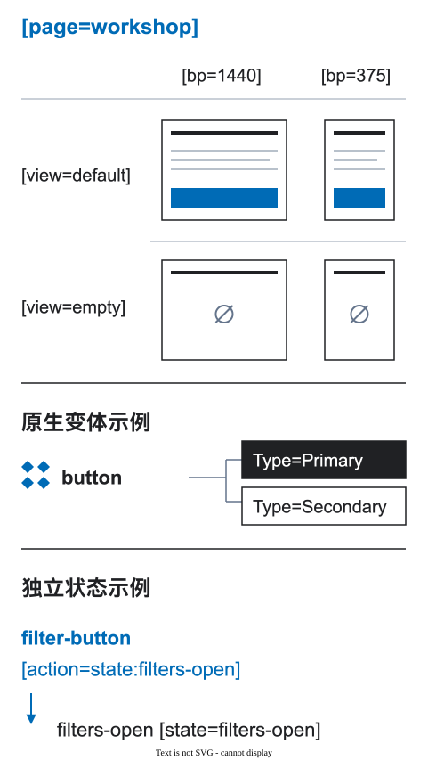

# 变化轴

两个画框可能因为屏幕变窄、语言改变或数据尚未加载而不同。比较它们之前，先说明原因。DFC Bridge 把每个独立原因称为一个**轴**；宽度不能解释未经声明的内容或行为变化。

<figure class="bridge-lesson-figure bridge-lesson-diagram">

<figcaption>页面、视图、宽度、状态目标与组件变体是独立的维度。说明示意图。<a href="../../assets/tutorial/diagrams/axes-zh.svg">查看原图</a>。</figcaption>
</figure>

[图解入门](25-visual-walkthrough.md)展示了这些区别如何影响团队交付。

## 核心规则

> 默认情况下，响应式断点是同一逻辑树的另一种布局。不同结构需要声明响应式变换；宽度本身不能解释结构变化。

文本改变时，说明产品原因，例如语言或经批准的实验。为了响应式可用性而改变父级或结构时，声明新旧结构的对应关系。两种变化都不能成为根节点之间无法解释的差异。

## 规范轴

| 轴 | 设计中的标记 | 内容能否改变 | 用途 |
| --- | --- | --- | --- |
| 页面 | `[page=...]` | 本身不允许 | 逻辑页面标识 |
| 路由 | `[route=...]` / `[route-pattern=...]` | 不允许 | 已知生产 URL 或路径模板 |
| 断点 | `[bp=...]` | 不允许 | 已设计的响应式宽度 |
| 视图 | `[view=...]` | 可随状态改变 | 加载、空、部分结果、错误等页面或数据状态 |
| 语言区域 | `[locale=...]` | 允许 | 翻译和区域格式 |
| 方向 / 书写模式 | 结构化上下文 | 本身不允许 | `ltr`/`rtl` 与横向或纵向逻辑流 |
| 主题 | `[theme=...]` | 不允许 | 视觉设计令牌的上下文 |
| 实验 | `[experiment=...]` | 按批准范围改变 | 产品实验 |
| 角色 | `[role-view=...]` | 按批准范围改变 | 用户或权限视图 |
| 数据场景 | `[data=...]` | 仅测试样例 | 长值、缺失、最小量、最大量、过期或失败的数据 |
| 目标平台 / 能力 | 结构化上下文或配置 | 需明确决策 | 平台、输入、媒体、性能能力及替代方案 |

标签只提供简短的设计定位信息。方向、书写模式、能力、映射和验收标准放在 `bridge.context`、`bridge.responsive` 或目标平台能力配置中。

## 断点轴

```text
catalog [page=catalog] [route=/catalog] [bp=1200] [view=default]
catalog [page=catalog] [route=/catalog] [bp=360] [view=default]
```

默认允许改变几何、间距、字号、自然换行、列数和视觉排列。不允许悄悄丢失内容、动作、数据、语义关系或无障碍能力。参见[响应式行为](03-responsive-breakpoints.md)。

## 视图轴

视图是实际可到达的页面或数据状态样例：

```text
catalog [page=catalog] [route=/catalog] [bp=1200] [view=default]
catalog [page=catalog] [route=/catalog] [bp=1200] [view=loading]
catalog [page=catalog] [route=/catalog] [bp=1200] [view=empty]
catalog [page=catalog] [route=/catalog] [bp=1200] [view=error]
```

产品状态改变时，视图内容可以改变。同一视图的各断点仍需保留默认的逻辑树，或声明变换。组件的局部状态属于组件或状态机契约，不应另建页面根节点。

<a id="区域设置轴"></a>

## 语言区域轴

```text
contacts [page=contacts] [route=/contacts] [bp=1200] [locale=en-US]
contacts [page=contacts] [route=/contacts] [bp=1200] [locale=ru-RU]
```

语言区域可以改变翻译、复数形式、日期、数字、货币格式，以及按产品规则选择的法律文本。测试文本变长、不可断行的值、字体覆盖和格式。不要借语言区域之名缩短移动端文案。

<a id="方向和写作模式"></a>

## 方向和书写模式

语言区域与文字方向有关，但不能互相替代。在结构化上下文中记录 `direction: ltr | rtl` 和 `writingMode`：

```json
{
  "direction": "rtl",
  "writingMode": "horizontal-tb"
}
```

声明布局是否镜像，使用逻辑 `start`/`end`，区分需要镜像和保持原样的图标。覆盖混合方向的姓名、电话、日期、标识符、代码和数字；定义图表轴和类别顺序。阅读与键盘顺序应保持语义，不必跟随视觉镜像。支持 RTL 或双向文本时，提供极端测试样例和截图。

## 主题轴

```text
dashboard [page=dashboard] [bp=1200] [theme=light]
dashboard [page=dashboard] [bp=1200] [theme=dark]
```

主题改变设计令牌、媒体选择和对比度处理，不得擅自改变产品文案、数据、动作或可用功能。测试交互、数据、焦点、禁用、错误以及强制或高对比度状态，而不只看默认背景。

## 实验轴

```text
pricing [page=pricing] [route=/pricing] [bp=1200] [experiment=cta-a]
pricing [page=pricing] [route=/pricing] [bp=1200] [experiment=cta-b]
```

实验可以改变经批准的内容或流程。记录假设、分组方式、曝光事件、指标、期限、负责人、替代方案、无障碍等价性以及交互和历史映射。不要把实验伪装成断点差异。

## 角色轴

```text
dashboard [page=dashboard] [route=/dashboard] [bp=1200] [role-view=guest]
dashboard [page=dashboard] [route=/dashboard] [bp=1200] [role-view=admin]
```

角色或权限变体可以改变信息和动作。运行时授权系统才是权限依据；隐藏图层不是安全控制。还要覆盖页面打开期间权限发生变化的情况。

## 数据场景轴

数据场景用于 QA 测试，不是生产变体：

```text
product-card [data=short]
product-card [data=long]
product-grid [collection=products] [data=max-items]
product-grid [collection=products] [data=empty]
```

覆盖零条、一条、典型量、最大或未知数量，长文本和混合方向文本，缺失值或媒体、重复、部分结果、过期、失败和无权限数据。测试样例顺序或数字后缀绝不能成为运行时记录标识。参见[数据与可视化](20-data-and-visualization.md)。

<a id="目标和能力概况"></a>

## 目标平台和能力配置

目标平台可能不支持悬停、sticky 定位、滚动时间轴、某种图表、编解码器，或缺少内存和带宽。不要为每项能力新增平面标签。结构化配置应声明：

- 平台、运行时和支持的输入输出能力；
- 资源或媒体的格式、尺寸、质量版本及不同场景的构图；
- 加载优先级、封面或预览、预加载或延迟加载策略；
- 预期数据量，以及分页或虚拟化的阈值和策略；
- 低带宽、离线、省流量、低功耗和减少动态效果时的行为；
- 不支持某项能力时的替代方案和负责人；
- 性能预算及实现阶段的测量位置。

设计明确哪些媒体、信息和体验不可缺少；实现团队负责可测量的预算和平台映射。未知能力应进入有负责人的 `openQuestions[]`，而不是默认已有替代方案。

<a id="轴构成"></a>

## 轴的组合

交付上下文可以组合多个轴：

```text
catalog [page=catalog] [route=/catalog] [bp=360] [view=empty] [locale=ar-SA] [theme=dark]
```

结构化上下文还可添加 `direction: rtl`、`writingMode: horizontal-tb` 和目标配置 `mobile-low-bandwidth`。按风险选择两两组合或完整组合进行检查，不必画出全部笛卡尔积。但每个省略的组合必须能按明确规则继承，或记录为未决问题。

## 无效示例

```text
// breakpoint hides a content experiment
hero-title desktop = "Launch your store in one day"
hero-title mobile = "Launch faster"

// fake locale hides mobile copy
hero [bp=320] [locale=mobile-short]

// theme changes product behavior
delete [theme=light] [action=modal:confirm-delete]
delete [theme=dark] [action=none]
```

## 验证

验证器或人工评审应报告：

- 断点或主题间的内容、动作、数据变化没有适用的变化轴；
- 结构变化没有声明响应式变换；
- 用语言区域编码设备或布局差异；
- 只做视觉镜像，没有决定双向文本、阅读、键盘、图标和图表行为；
- 实验没有批准的负责人或监测方案；
- 把角色可见性当成授权控制；
- 把测试数据当成运行时标识或生产变体；
- 不支持的能力没有替代方案、负责人、预算或未决问题；
- 未准备的组合缺少明确继承规则。
