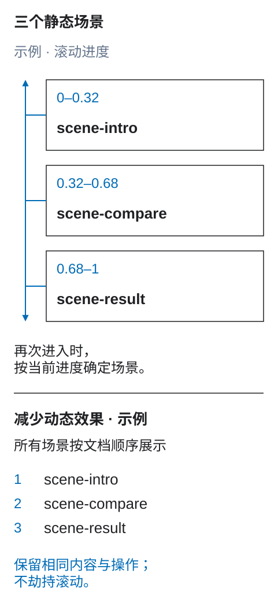

# 动效与长滚动契约

<a id="动作和长卷轴合约"></a>

动效是随时间发生的行为。可交付的设计不仅提供两个好看的关键帧，还应说明驱动来源、状态、时间参数、中断、再次进入和无障碍替代方案。

<figure class="bridge-lesson-figure bridge-lesson-diagram">

<figcaption>先读三个静态场景，再读滚动区间与再次进入规则。32% 和 68% 是此例的选择，不是必需默认值。减少动态效果的替代形式按文档顺序展示全部场景，保留等价内容与操作；必须实现并验证，不能假定会自动出现。 <a href="../../assets/tutorial/diagrams/motion-scroll-storyboard-zh.svg">查看原图</a>。</figcaption>
</figure>

*先描述稳定场景，再描述过渡以及驱动它们的条件。*

## 从目标和稳定状态开始

每段动效都要有目的：保持空间连续性、解释因果、引导注意、显示进度、确认操作或讲述明确的故事。装饰动效不能延迟或遮挡用户任务。

先设计没有动画也能理解的状态：

```text
feature-story
  scene-intro
  scene-compare
  scene-result
```

每个状态都应能作为静帧理解。动效决定它们之间如何过渡。如果内容只能在运动中理解，替代方案就不完整。

交互流程先定义[哪个事件改变状态](22-state-machines-and-reactions.md)。本章再补充时间上的过渡；动画不能成为完成操作的唯一途径。

<a id="声明驱动程序"></a>

## 声明驱动来源

| 来源 | 示例 | 契约要求 |
| --- | --- | --- |
| 时间 | 进入、退出、循环、进度 | 开始条件、时长、延迟、次数、最终状态 |
| 用户事件 | 点击、提交、拖动、悬停、焦点 | 事件、等价输入方式、取消或反向行为 |
| 滚动 | 区块或文档中的滚动进度 | 滚动容器、范围、轴、偏移、映射、再次进入 |
| 可见性 | 元素进入或离开可视区域 | 阈值、根区域、只执行一次或重复执行 |
| 媒体 / 数据 | 播放时间或实时值 | 时钟或数据源、缓冲和缺失数据时的行为 |
| 系统 | 路由改变、连接、偏好设置 | 触发条件、状态保留、替代方案 |

只写“随滚动”不够。明确滚动是跨过阈值、连续驱动进度，还是选择离散场景。

<a id="时间表合同"></a>

## 时间轴契约

每个过渡或轨道记录：

- 稳定的起始和目标状态标识；
- 驱动来源和触发条件；
- 变化的属性或语义效果；
- 起止值及单位；
- 时长或输入范围；
- 延迟、缓动、重复次数，以及区间前后的填充行为；
- 同步和先后关系；
- 变换原点和坐标系；
- 取消、中断、尺寸或内容改变时的行为；
- 反向和再次进入时的行为；
- 减少动态效果或平台不支持时的结果。

在保留预期几何的前提下，优先考虑变换和透明度动画。但性能不能凌驾于语义、焦点和可读内容之上。动效令牌可提供共享时长和缓动；具体故事仍需自己的状态和驱动契约。

<a id="将丰富的运动保留在图层名称之外"></a>

## 不把完整动效写进图层名

在设计中使用普通、稳定的标识：

```text
story [section=feature-story]
  story-visual
  scene-intro
  scene-compare
  scene-result
```

不要创建 `[fade]`、`[duration]`、`[easing]`、`[pin]`、`[scroll-start]` 等平面标签语法。改为在结构化 DFC Bridge 元数据中引用标识：

> **非独立模块片段。** 此例只展示 `bridge.motion`，省略了必需的外层字段。交换数据或验证完整契约前，将其放入[交付契约](04-transfer-contract.md#required-envelope)规定的完整 `bridge` 结构。

```json
{
  "bridge": {
    "motion": {
      "sequences": [{
        "sequenceId": "feature-story-scroll",
        "purpose": "Explain the product workflow in three steps",
        "driver": {
          "type": "scroll-progress",
          "source": "document",
          "range": { "start": "feature-story block-start 80%", "end": "feature-story block-end 20%" },
          "axis": "block"
        },
        "scenes": [
          { "id": "intro", "range": [0, 0.32], "content": "scene-intro" },
          { "id": "compare", "range": [0.32, 0.68], "content": "scene-compare" },
          { "id": "result", "range": [0.68, 1], "content": "scene-result" }
        ],
        "pin": { "element": "story-visual", "mode": "sticky", "container": "feature-story" },
        "reentry": "derive-from-current-progress",
        "reducedMotion": "show-all-scenes-in-document-order"
      }]
    }
  }
}
```

适用的 Web 场景可以使用 [CSS 滚动驱动动画规范](https://www.w3.org/TR/scroll-animations-1/)实现。其他平台可选不同机制，但须保留同一契约。

<a id="长卷故事"></a>

## 长滚动叙事

长滚动序列应定义：

1. **叙事单元：** 场景、稳定标识及每个场景表达的含义。
2. **滚动来源：** 文档或具名容器，嵌套滚动容器须明确。
3. **范围：** 起止偏移，以及采用视口还是容器坐标。
4. **映射：** 连续进度、阈值、吸附或离散场景选择。
5. **布局：** 预留高度、sticky 或固定区域、正常文档流中的内容。
6. **进入：** 从上方、下方、锚点或恢复的历史到达时的初始状态。
7. **退出：** 两个方向的最终状态和清理。
8. **变化：** 尺寸、方向、字体加载、本地化或动态内容变化后的重新计算。
9. **替代方案：** 脚本、sticky 或滚动时间轴不可用时，仍可阅读的正常文档流。

不能只考虑向前滚动。向后拖动滚动进度时，应按规则反向播放或跳到声明的稳定状态。直接打开中途的深层链接，不能要求用户先回到顶部滚动才能初始化。

<a id="粘性和固定区域"></a>

## Sticky 与固定区域

原生 sticky 满足设计时优先使用它。契约要定义包含块、偏移、起止边界、预留空间、堆叠和碰撞规则，以及固定对象高于视口时的行为。

固定呈现不得：

- 改变无障碍树中有意义的内容顺序；
- 困住滚轮、触摸或键盘滚动；
- 让获得焦点的控件被页头或浮层遮挡；
- 让活动与非活动副本重复暴露同一可读内容；
- 要求特定设备高度才能到达下一区块。

文档顺序应是语义与键盘顺序。视觉图层可以重叠，但不能取代它。

<a id="重入反向和中断"></a>

## 再次进入、反向和中断

每个序列明确以下策略：

- **重复：** 每会话一次、每次视图一次，还是每次进入都执行；
- **再次进入：** 重启、恢复、按当前驱动值计算，或保持完成；
- **反向：** 反转原时间轴、使用另一过渡，或立即切换；
- **中断：** 完成、取消、从当前值融合，或保留进度；
- **快速输入：** 防抖、排队、替换或忽略，规则必须确定；
- **路由或历史恢复：** 依据 URL、保存状态或当前滚动位置重建；
- **焦点进入：** 立即显示获得焦点的目标，不等待动画。

实现不能把 `animationend` 当作进入必需产品状态的唯一途径：减少动态效果、后台标签页或取消可能跳过该事件。

<a id="减少运动和后退"></a>

## 减少动态效果与替代方案

即使 WCAG 没有要求移除每种动画，DFC Bridge 仍要求减少动态效果的设计。尊重 [CSS Media Queries](https://www.w3.org/TR/mediaqueries-5/#prefers-reduced-motion) 中的用户偏好 `prefers-reduced-motion`。

为每个序列选择实际可用的策略：

- 移除非必要的视差、缩放、旋转和大幅位移；
- 用立即切换或短暂淡化替代运动；
- 停止自动循环；必要动效提供控制；
- 按文档顺序展示长滚动场景；
- 保持进度、完成结果、焦点和目标状态不变。

如果仍有滚动劫持、闪烁、固定布局或隐藏内容，仅把时长改成接近零并不完整。禁用脚本或 API 不受支持时，所有重要内容和操作仍须可用。

<a id="响应运动"></a>

## 响应式动效

动效遵循同一逻辑树规则。布局坐标和路径长度可调整，标识、目的、状态效果及完成含义保持不变。

若窄屏把固定叙事改成可展开列表或静态序列，须声明[响应式变换](03-responsive-breakpoints.md)：逐一映射场景，保留阅读和操作顺序，定义焦点与历史，并让两种呈现具有等价的减少动态效果方案。

<a id="动作审查门"></a>

## 动效评审条件

以下问题检查序列的动效契约，不是整页 Ready 结果：

- 动效有何用途？没有动画时有哪些稳定状态？
- 什么驱动进度？精确范围和时间参数是什么？
- 反向、再次进入、快速输入、尺寸变化和深层链接会怎样？
- 需要时能否暂停或停止运动内容？
- 固定呈现是否保留有意义的顺序？
- 键盘焦点是否可见，目标是否已经呈现？
- 减少动态效果后，内容、操作、状态和任务是否仍完整？
- 首选动画机制不可用时，替代方案能否工作？

每个最终实现都要符合 WCAG 2.2 的[暂停、停止、隐藏](https://www.w3.org/TR/WCAG22/#pause-stop-hide)和[闪烁限制](https://www.w3.org/TR/WCAG22/#three-flashes-or-below-threshold)要求。
