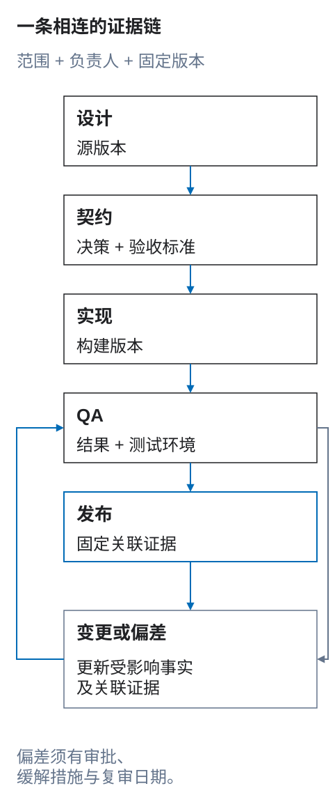

# 交付生命周期

确定交付范围后，按本生命周期推进。每个阶段都要明确负责人、固定当前修订版本，并关联下一次决策需要的证据：

> **设计 → 契约 → 实现 → QA → 发布**

<figure class="bridge-lesson-figure bridge-lesson-diagram">

<figcaption>沿设计 → 契约 → 实现 → QA → 发布阅读，并固定范围、负责人和版本。变更须返回受影响的事实来源，更新关联证据，再验证后发布。已批准偏差也需要缓解措施与复审，不能绕过 QA。这是流程图，不是某次发布已通过的证据。 <a href="../../assets/tutorial/diagrams/delivery-lifecycle-zh.svg">查看原图</a>。</figcaption>
</figure>

*偏差是必须回到验证环节的受控分支，不是绕过契约的捷径。*

## 一系列证据

为每个重要需求分配稳定的需求 ID，并关联各阶段的证据：

```text
REQ-CATALOG-017
  design: Catalog / Default / 1200 → product-grid
  contract: bridge.data.displays → product-grid
  implementation: ProductGrid + catalog query adapter
  tests: catalog-grid-default, catalog-grid-empty, catalog-grid-keyboard
  deviations: none
```

不要创建五份互不关联的规范。Figma 提供设计中的视觉和结构证据；结构化 DFC Bridge 元数据记录 Figma 无法表达的意图；代码实现它；测试验证结果；偏差记录已知差异。稳定标识将这些证据连接起来。

## 角色和责任

| 角色 | 责任 |
| --- | --- |
| 产品/设计负责人 | 产品含义、完整状态、设计证据、内容、响应式意图。 |
| 契约负责人 | 一致性、标识映射、结构化元数据、验收标准、变更日志。 |
| 实现负责人 | 语义行为、目标平台决策、代码和实现证据。 |
| QA/无障碍负责人 | 覆盖范围、测试环境、预期结果、问题记录、回归证据。 |
| 偏差审批者 | 用户/业务影响决策、缓解措施、负责人、到期日期和后续跟进。 |

一个人可以兼任多个角色，但不能只有作者本人能够解释设计。引入已知差异的实现者也不能自行默许该差异。

## 生命周期记录

每个交付单元（页面、流程、区块或组件）都有一份生命周期记录：

> **不能独立验证的模块片段。** 以下示例只展示 `bridge.lifecycle` 和用于说明上下文的 `contractVersion`，有意省略了其他必需字段。交换数据或验证完整契约前，将其放入[交付契约](04-transfer-contract.md#required-envelope)要求的完整 `bridge` 外层结构中。

```json
{
  "bridge": {
    "contractVersion": "0.2.0",
    "lifecycle": {
      "transferId": "catalog-default",
      "contractRevision": "7",
      "sourceRevision": "figma-version-2026-08-13T10:20Z",
      "targetRevision": "build-1842",
      "status": "qa",
      "owners": {
        "design": "catalog-design",
        "contract": "design-systems",
        "implementation": "storefront",
        "qa": "quality"
      },
      "requirements": ["REQ-CATALOG-017", "REQ-CATALOG-021"],
      "evidence": {
        "design": ["page=catalog;view=default;bp=1200"],
        "tests": ["catalog-grid-default", "catalog-grid-keyboard"]
      },
      "deviations": []
    }
  }
}
```

示例中的名称仅用于说明。记录可以存储在仓库、任务系统、设计插件或构建系统中，但必须有版本、可链接，并随交付单元一起提供。

<a id="旧主机内的选定部分"></a>

## 旧主机内的所选区块

区块范围的生命周期包含两个不同的源设计/集成关口：

1. **所选区块源设计关口** — 固定 `[section=<stable-id>]` 根、所选子树边界、所选上下文、源修订版本、本地检查结果和待验证依赖；
2. **文件/宿主集成关口** — 验证需要在所选根之外查找的内部路由/锚点及操作/组件/数据目标、父级放置与裁切/堆叠、路由与页面关系、产品要求的上下文、页面语义、运行时行为和实现的无障碍能力。完整有效的 `http:`、`https:`、`mailto:`、`tel:` href 在源设计关口已经明确并完成解析；不完整或格式错误的外部值会阻塞该关口，不能延后处理。

如果所选区块位于另一个不透明 `[asset]` 祖先内，源设计关口无效：遍历开始前就将该范围判定为 Blocked。恰好选中的 `[section=id] [asset]` 根仍可作为一个有效、不透明的整体视觉资源；其内部布局检查不适用。

**Check selected section（检查所选区块）**可以为第一个关口提供 Ready、Partial 或 Blocked 结果。必须同时保存结果的范围和覆盖矩阵；不要用它替换 `bridge.lifecycle.status`，也不要用它证明第二个关口已通过。只请求一个上下文时，该单一上下文的区块源设计可以是 Ready。待文件级解析的引用，或本身为 `INSTANCE` 的所选区块根，会使源设计结果保持 Partial，相关关口仍需补充证据。普通后代组件实例是受信任的原子边界，不会降低 Ready。

旧有宿主是明确声明的范围边界，不是已接受的 DFC Bridge 偏差，也不意味着必须暗中迁移整个宿主。生命周期记录必须写明 `hostCompliance: legacy-out-of-scope`，为每项外部依赖关联负责人和复核点，并防止后续状态或发布说明把“区块源设计就绪”写成“页面/产品就绪”。

## 第一阶段：设计

设计负责人准备有代表性、符合实际生产场景的证据：

- 页面根的页面/视图/断点标识，以及已知的真实路由；
- 响应式状态之间默认一致的逻辑树，以及每项声明的转换；
- 稳定的元素标识和组件/模板来源；
- 真实内容和运行时数据样本；
- 完整的反应、目标、表单、异步状态和失败状态；
- 动效状态及替代方案；
- 无障碍意图及替代方案；
- 必需的媒体/体验、资源视觉适配方案，以及具有代表性的低能力条件；
- 已知的目标限制和候选例外。

**设计关口：**非作者的审阅者无需私下解释，就能识别结构、变体、内容/数据含义、操作、目标、响应式行为、无障碍要求和待解决的决策。

产物：带版本的设计引用、样本/场景清单、待解决决策清单和初始需求 ID。

<a id="第二阶段合同"></a>

## 第二阶段：契约

契约负责人整合证据，而不是重复制造证据：

1. 从 Figma 或源工具提取技术事实；
2. 区分角色、模板、设计实例、运行时数据和目标实现的稳定标识；
3. 补充数据、响应式转换、反应、动效、无障碍和生命周期的结构化契约；
4. 定义验收标准和目标能力；
5. 将每个未知或不受支持的能力记录为待解决问题，明确负责人、范围、是否阻塞、复核点和安全替代方案；
6. 定义预期数据量、虚拟化/分页阈值、资源交付意图，以及由实现方负责的性能预算；
7. 验证引用、目标、schema、状态可达性、一致性和例外；
8. 冻结供实现使用的契约修订版本。

**契约关口：**每个必需决策都应明确写出、从固定版本的组件/系统契约继承，或记录为有负责人且阻塞受影响范围的待解决决策。对实现至关重要的信息不得只存在于聊天或会议中。

产物：固定的源修订版本、结构化契约、追踪矩阵、目标能力声明、验证报告和获批的实现范围。

<a id="第三阶段实施"></a>

## 第三阶段：实现

实现负责人将契约映射到目标平台。适配器或开发者必须：

- 保留语义标识和关系，而不是盲目复制坐标；
- 在满足契约的前提下使用目标平台原生行为和设计系统；
- 先实现明确声明的画框/场景，再实现连续变化的尺寸和容器行为；
- 使用稳定数据键映射运行时记录，而不是依赖 Figma 样本顺序；
- 实现所有可达状态、反应、历史/焦点效果和替代方案；
- 记录无法从视觉结果观察到的目标平台决策；
- 实现并测量资源、数据量、加载、低带宽/离线/节省流量/低功耗和能力降级的预算；
- 在替换行为之前指出无法实现或有害的要求。

**实现关口：**功能能够构建，确定性的契约检查通过，每个需求都关联实现证据，没有隐藏任何已知差异。

产物：实现修订版本、映射/决策说明、自动化测试和候选偏差记录。

## 第四阶段：质量检查

QA 根据冻结的契约验证可观察结果，而不是凭记忆或单张截图判断。

必须覆盖：

- 明确声明的断点及其之间的尺寸范围；
- 容器驱动的变化和每项声明的结构转换；
- 典型及压力数据、每种必需的数据状态和本地化；
- 正常、无效、待处理、空、部分、失败、取消、重试和历史导航路径；
- 动效的反向、重新进入和减少动态效果行为；
- 键盘、焦点、缩放/重排、屏幕阅读器、对比度、目标尺寸和媒体要求；
- 支持的浏览器、设备、目标运行时和替代方案生效条件；
- 声明的能力配置下的资源尺寸/质量/视觉适配/加载优先级，以及数据量/虚拟化阈值；
- 适用的低带宽、离线、节省流量、低功耗、缺失能力和预算证据；
- 有意义状态下的组件/系统继承和视觉回归。

结果使用 `pass`、`fail`、`not-applicable`、`blocked` 或 `accepted-deviation`，并附上证据和环境。“看起来差不多”不是验证结果。

**QA 关口：**每项验收标准都有结果；阻塞问题已解决；接受的偏差已批准且可见；高风险行为有回归测试覆盖。

产物：可链接的 QA 报告、证据、缺陷记录、批准的偏差和发布建议。

## 第五阶段：发布与运营

发布时，将以下版本固定并关联：

- 设计/源修订版本；
- 契约及规则/schema 版本；
- 实现/构建修订版本；
- 测试环境和证据修订版本；
- 仍有效的偏差及其到期日期。

发布后，运行时证据可能揭示样本中没有覆盖的内容长度、数据量、设备条件、辅助技术问题或性能限制。将这些发现反馈到源设计、组件契约、示例和测试中。不要只长期修补生产代码，却让规范契约一直保持错误。

<a id="开放式问题协议"></a>

## 待解决问题协议

DFC Bridge 承诺的是没有**未被追踪的**未知项，而不是无所不知。决策只有记录在 `bridge.openQuestions[]` 中，并具备稳定 ID、精确范围、负责人、是否阻塞、到期日期或明确的复核关口、安全替代方案和状态/决策链接，才可以保持 `unknown`、`unsupported` 或 `TBD`。

在每个生命周期关口：

- 复核涉及下一阶段范围的每个问题；
- 如果替代方案不安全、不满足无障碍要求、具有误导性或破坏性，或无法测试，则阻塞该范围；
- 将非阻塞的替代方案纳入实现和 QA 验收标准；
- 只有关联了决策并更新受影响的证据后，才能关闭记录；
- 将逾期问题上报，而不是默默假定答案。

只存在于口头对话、聊天、未关联任务或个人记忆中的问题是盲点，会阻止该范围被判定为就绪。

<a id="变更控制和合同漂移"></a>

## 变更控制和契约漂移

先由受影响事实的负责人更新其权威来源：

| 变更 | 先更新 | 再复核 |
| --- | --- | --- |
| 文案、视觉层级或产品流程 | 设计证据 | 契约、实现、测试 |
| 数据 schema/来源/格式 | 数据契约 | 样本、展示、状态、测试 |
| 交互/状态行为 | 反应契约 | 设计、焦点/历史、实现、测试 |
| 组件 API 或目标限制 | 实现/系统契约 | 设计映射、偏差、回归 |
| 无障碍问题 | 需求和受影响证据 | 设计、契约、实现、所有变体 |

通过稳定标识和需求 ID 分析影响。契约冻结后，源修订版本的变化必须产生新的契约修订版本，或者被明确证明不会改变语义。悄悄替换截图就是契约漂移。

## 偏差协议

**偏差**是经过审查、有意接受的契约与实现或所支持目标之间的差异，不是未经记录的变通办法。

每项偏差记录在 `bridge.lifecycle.deviations` 中：

> **不能独立验证的模块片段。** 此示例只展示一条 `bridge.lifecycle.deviations` 记录，有意省略其余生命周期字段和必需的外层字段。将它放入[契约外层结构](04-transfer-contract.md#required-envelope)内的完整生命周期记录中。

```json
{
  "bridge": {
    "lifecycle": {
      "deviations": [{
        "id": "DEV-CATALOG-004",
        "requirement": "REQ-CATALOG-021",
        "scope": ["catalog", "catalog-360"],
        "difference": "Comparison table uses horizontal scroll instead of the declared card transformation",
        "reason": "Card mapping loses grouped header relationships in target version",
        "impact": "Comparison remains available with preserved table semantics and no data loss, but narrow-screen users need additional horizontal navigation",
        "mitigation": "Sticky first column, overflow instructions, edge affordance",
        "evidence": ["qa-catalog-360-table-scroll"],
        "owner": "storefront",
        "approvedBy": "product-and-accessibility",
        "status": "accepted",
        "reviewDate": "2026-11-30",
        "resolution": "Reassess after target table component upgrade"
      }]
    }
  }
}
```

必须遵守：

- 指明违反的需求和精确的受影响范围；
- 说明对用户、无障碍、数据和维护的影响；
- 比较可行的替代方案；
- 提供缓解措施和验证证据；
- 明确负责人和审批者；
- 为临时偏差设置到期/复核日期；
- 在交付、QA 和发布记录中明确展示；
- 只有契约与实现重新一致并通过复测后，才能关闭偏差。

导致 WCAG 2.2 AA 不符合项的偏差，不能改名为“符合”。安全、隐私、法律和数据完整性约束优先于视觉保真度，必须上报相关负责人。

## 准备和完成的定义

<a id="准备实施"></a>

### 准备实现

- [ ] 范围和修订版本已固定。
- [ ] 稳定标识和目标映射没有歧义。
- [ ] 结构化契约覆盖适用的数据、转换、反应、动效和无障碍要求。
- [ ] 验收标准和测试场景已具备。
- [ ] 必需决策有负责人；阻塞决策已解决。
- [ ] 每个剩余的未知/不受支持项都是有范围、负责人和复核机制的待解决问题，并有经过测试的安全替代方案。
- [ ] 目标能力、必需媒体/体验、数据量、降级条件和由实现方负责的预算已声明。
- [ ] 没有把候选偏差隐藏为“实现细节”。

对于所选区块交付，源检查的 Ready 只满足上表中的源证据部分。只有计划实现所需的每项阻塞/待验证依赖都有对应证据，或有负责人维护的安全替代方案，该单元才具备实现条件。页面、产品及 WCAG 的就绪状态仍需在后续各自范围内判定。

### 完成发布

- [ ] 已实现行为能够追溯到接受的契约。
- [ ] 必需的精确尺寸、连续尺寸变化、状态、数据、动效和无障碍测试已通过。
- [ ] 发布范围内的每个失败项均已修复，或批准为可见偏差。未解决的阻塞问题即使已有负责人，仍会阻止受影响范围发布。
- [ ] 仍有效的偏差有缓解措施和复核日期。
- [ ] 源、契约、代码/构建和 QA 修订版本已关联。
- [ ] 运行时反馈能够回到规范源。

## 工作变更示例

目录表格设计提供 1200 和 360 px 两种宽度。契约要求默认保持同一逻辑树并重排；当 `comparison-panel` 容器小于 480 px 时，将表格转换为可展开的条目，并把每一列映射到带标签的字段。实现时发现，目标展开组件无法保留多行选择。

团队不能默默删除移动端的选择能力：

1. `REQ-CATALOG-021` 要求切换展示方式时保留选择状态。
2. 开发者在替换行为之前记录能力缺口。
3. 设计方比较保留语义完整的可滚动表格，或为展开组件增加选择能力。
4. 无障碍和产品负责人临时批准使用可滚动表格作为缓解方案。
5. QA 在受影响尺寸范围内测试键盘滚动、表头、焦点、选择、缩放和前进/后退。
6. 发布记录关联 `DEV-CATALOG-004`，并注明负责人和到期日期。
7. 组件具备选择能力后，团队实现原定转换、重新测试并关闭偏差。

这就是 DFC Bridge 生命周期的要求：差异可见、有人负责、经过测试，并最终消除。
