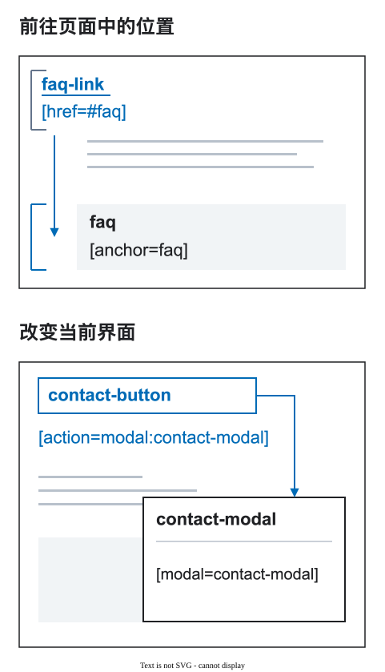

# 为何用 DFC Bridge

设计：

<figure class="bridge-lesson-figure bridge-lesson-screenshot">

<figcaption>交付对象不明。</figcaption>
</figure>

前后端、AI 在猜：做什么，数据哪来，按钮去哪？

DFC Bridge 不规定设计。交付**决定，不是猜测**。

<a class="bridge-lesson-download" href="../../assets/tutorial/dfc-bridge-workshop.fig" download="dfc-bridge-workshop.fig"><span aria-hidden="true">↓</span> 下载设计 <span class="bridge-lesson-download-format">.fig</span></a>

1. 打开 Figma。
2. 首页点 **Import**。
3. 选择下载的 `.fig`。

## 1. 好看，但不清楚

`desktop`、`mobile-final-2`：同一页面？名称没说。

两棵树：哪些元素相同？

<div class="bridge-lesson-pair bridge-lesson-tree-pair">
<figure class="bridge-lesson-figure bridge-lesson-screenshot">

<figcaption>桌面: <code>Heading</code> / <code>Button</code>.</figcaption>
</figure>
<figure class="bridge-lesson-figure bridge-lesson-screenshot">

<figcaption>移动: <code>Title mobile</code> / <code>Button copy</code>.</figcaption>
</figure>
</div>

两项移动版决定：

- 标题删掉 «понятных»（清晰）。改了内容，不是换行。
- 整个 `hero-actions` 从 `hero-copy` 移到 `hero`，放在图后。换了父级，不只是顺序。

<div class="bridge-lesson-pair bridge-lesson-heroes">
<figure class="bridge-lesson-figure bridge-lesson-screenshot">

<figcaption>桌面：完整标题，两按钮在图前。</figcaption>
</figure>
<figure class="bridge-lesson-figure bridge-lesson-screenshot">
<aside class="bridge-lesson-comment">
<p><strong>前端:</strong> 短文案、图下按钮，都可以。</p>

</aside>

<figcaption>移动：少了 «понятных»，两按钮在图下。 <a href="../../assets/tutorial/screenshots/figma-before-overview.png">完整截图</a>.</figcaption>
</figure>
</div>

但需约定文案变体、结构变换，否则只能猜。

## 2. 连起两个画面

根节点约定：`workshop` 页面、`/workshop` 路由、`default` 视图，宽度 1440 和 375：

```text
workshop [page=workshop] [route=/workshop] [bp=1440] [view=default]
workshop [page=workshop] [route=/workshop] [bp=375] [view=default]
```

Figma 各操作的连续录屏。自动逐字输入与剪切粘贴；光标不随操作移动。字幕和高亮是后加提示。

下方“全屏查看”→“原始大小”。

<figure class="bridge-lesson-figure bridge-lesson-motion">
<video src="../../assets/tutorial/motion/native/page-metadata-zh.mp4" poster="../../assets/tutorial/motion/native/page-metadata-zh.png" width="802" height="1040" controls playsinline preload="none" aria-label="声明 workshop 页面、/workshop 路由、default 视图和 375 宽度"><a href="../../assets/tutorial/motion/native/page-metadata-zh.mp4" download="page-metadata-zh.mp4">下载 MP4</a></video>
<figcaption>独立操作：关联同一页面的根。 <a href="../../assets/tutorial/motion/native/page-metadata-zh.gif" download="page-metadata-zh.gif">GIF</a>.</figcaption>
</figure>

<figure class="bridge-lesson-figure bridge-lesson-diagram">

<figcaption>同一页面、视图，两种宽度。</figcaption>
</figure>

标签记录约定，不生成布局或代码。

## 3. 找到同一元素

按用途命名，不按设备：

| 原名称 1440 / 375 | 两种宽度的新名称 |
| --- | --- |
| `Heading` / `Title mobile` | `hero-title` |
| `Button` / `Button copy` | `contact-button` |

此例统一文案和父级，也可另定方案。

<figure class="bridge-lesson-figure bridge-lesson-motion">
<video src="../../assets/tutorial/motion/native/rename-title-zh.mp4" poster="../../assets/tutorial/motion/native/rename-title-zh.png" width="818" height="570" controls playsinline preload="none" aria-label="Title mobile 改名为 hero-title，不改产品文案"><a href="../../assets/tutorial/motion/native/rename-title-zh.mp4" download="rename-title-zh.mp4">下载 MP4</a></video>
<figcaption><code>Title mobile</code> → <code>hero-title</code>，只改名称。 <a href="../../assets/tutorial/motion/native/rename-title-zh.gif" download="rename-title-zh.gif">GIF</a>.</figcaption>
</figure>

<figure class="bridge-lesson-figure bridge-lesson-motion">
<video src="../../assets/tutorial/motion/native/repair-copy-zh.mp4" poster="../../assets/tutorial/motion/native/repair-copy-zh.png" width="798" height="640" controls playsinline preload="none" aria-label="恢复完整产品标题 Мастерская понятных макетов"><a href="../../assets/tutorial/motion/native/repair-copy-zh.mp4" download="repair-copy-zh.mp4">下载 MP4</a></video>
<figcaption>恢复完整标题。 <a href="../../assets/tutorial/motion/native/repair-copy-zh.gif" download="repair-copy-zh.gif">GIF</a>.</figcaption>
</figure>

<figure class="bridge-lesson-figure bridge-lesson-motion">
<video src="../../assets/tutorial/motion/native/move-actions-zh.mp4" poster="../../assets/tutorial/motion/native/move-actions-zh.png" width="788" height="780" controls playsinline preload="none" aria-label="整个 hero-actions 移入已有 hero-copy，保留两个控件和 Auto Layout"><a href="../../assets/tutorial/motion/native/move-actions-zh.mp4" download="move-actions-zh.mp4">下载 MP4</a></video>
<figcaption>整个 <code>hero-actions</code> → <code>hero-copy</code>，不是一个按钮。 <a href="../../assets/tutorial/motion/native/move-actions-zh.gif" download="move-actions-zh.gif">GIF</a>.</figcaption>
</figure>

**不同文案需[约定的产品变体](16-variation-axes.md)，换父级需[声明的响应式变换](03-responsive-breakpoints.md)。** 同一父级可调顺序。

<figure class="bridge-lesson-figure bridge-lesson-diagram">

<figcaption>同按钮，不同布局。</figcaption>
</figure>

桌面并排，移动版竖排。**不同布局没问题：** 改 Auto Layout，这里的文字与父级不变。

<div class="bridge-lesson-pair bridge-lesson-heroes">
<figure class="bridge-lesson-figure bridge-lesson-render">

<figcaption>1440 px：按钮并排。</figcaption>
</figure>
<figure class="bridge-lesson-figure bridge-lesson-render">

<figcaption>375 px：按钮竖排，在图前。</figcaption>
</figure>
</div>

`workshop-art [decor] [asset]` 是图片，标题保留文字。

## 4. 做好组件库

`button-primary`、`button-secondary` 均为可复用组件：改源头，实例更新。

**UI-kit** 展示两种样式的状态，**Modals** 管窗口外观。

<figure class="bridge-lesson-figure bridge-lesson-screenshot">

<figcaption>两种样式、五个状态。窗口在旁。</figcaption>
</figure>

<figure class="bridge-lesson-figure bridge-lesson-motion">
<video src="../../assets/tutorial/motion/native/button-states-zh.mp4" poster="../../assets/tutorial/motion/native/button-states-zh.png" width="1840" height="634" controls playsinline preload="none" aria-label="State：default → hover，再单独启用 Focus visible"><a href="../../assets/tutorial/motion/native/button-states-zh.mp4" download="button-states-zh.mp4">下载 MP4</a></video>
<figcaption>默认 → 悬停，再单独启用焦点。 <a href="../../assets/tutorial/motion/native/button-states-zh.gif" download="button-states-zh.gif">GIF</a>.</figcaption>
</figure>

**组件库管外观，页面实例管动作。** 同款按钮，别处用途可不同。

- `contact-button [action=modal:contact-modal]` → 打开窗口。
- `faq-link [href=#faq]` → 去 FAQ。

<figure class="bridge-lesson-figure bridge-lesson-diagram">

<figcaption>按钮 → 窗口。链接 → FAQ。</figcaption>
</figure>

<figure class="bridge-lesson-figure bridge-lesson-motion">
<aside class="bridge-lesson-comment">
<p><strong>AI:</strong> 此宽度的目标是 contact-modal。</p>

</aside>
<video src="../../assets/tutorial/motion/native/local-action-zh.mp4" poster="../../assets/tutorial/motion/native/local-action-zh.png" width="888" height="930" controls playsinline preload="none" aria-label="给 contact-button 实例设置动作，并找到 375 的隐藏本地 contact-modal；前往目标只找图层，不开窗"><a href="../../assets/tutorial/motion/native/local-action-zh.mp4" download="local-action-zh.mp4">下载 MP4</a></video>
<figcaption>实例上设置动作，目标在 375。 <a href="../../assets/tutorial/motion/native/local-action-zh.gif" download="local-action-zh.gif">GIF</a>.</figcaption>
</figure>

**前往目标**只找隐藏图层，不开窗。行为要实现。

<details>
<summary>组件细节</summary>

不是可运行原型。

`State=default/hover/pressed/disabled` 是 Figma 变体，不是 DFC 标签或页面视图。焦点独立：`Focus visible=true` 可与 `hover`、`pressed` 同时出现。

禁用条件与负责人写进实现契约。无异步请求，不加加载态。

各根有隐藏 `[modal=contact-modal]`。Modals 主组件只管外观，不是目标。邮箱窗口，不提交表单。

</details>

来源写进[数据契约](20-data-and-visualization.md)。

## 5. 检查结果

独立副本：`hero-title` 文案、`hero-actions` 父级不同。Auto Layout 开启。修正未入镜；视频只有旧报告与复查。

<figure class="bridge-lesson-figure bridge-lesson-motion">
<video src="../../assets/tutorial/motion/native/repeat-check-zh.mp4" poster="../../assets/tutorial/motion/native/repeat-check-zh.png" width="1408" height="710" controls playsinline preload="none" aria-label="独立 workshop 副本在未录入的修正后复查：旧报告两项错误到零，仅检查 375 和 1440 上下文"><a href="../../assets/tutorial/motion/native/repeat-check-zh.mp4" download="repeat-check-zh.mp4">下载 MP4</a></video>
<figcaption>修正未入镜。复查：2 项错误 → 0，仅 375/1440。 <a href="../../assets/tutorial/motion/native/repeat-check-zh.gif" download="repeat-check-zh.gif">GIF</a>.</figcaption>
</figure>

页面 02 是此方案，旁边有 UI-kit 和 Modals。

<figure class="bridge-lesson-figure bridge-lesson-screenshot">
<aside class="bridge-lesson-comment">
<p><strong>后端:</strong> 卡片仍是示例，数据来源还需确认。</p>

</aside>

<figcaption>设计、UI-kit、Modals。</figcaption>
</figure>

<figure class="bridge-lesson-figure bridge-lesson-screenshot">

<figcaption>页面 02 的较早报告，不是上段录像的结果，也不是对更新文件的新检查。 <a href="../../assets/tutorial/screenshots/assistant-ready-result-local.png">完整历史报告</a>.</figcaption>
</figure>

**“就绪”只指检查范围，不是应用完成。**

交付**源文件、资源和约定**。未决问题有负责人。不只一张 PNG 和“都懂了吧”。

## 按需继续

- [交付清单](17-designer-checklist.md)。
- [内容与溢出](07-height-and-overflow.md) — 准备最佳实践。
- [旧设计中的新区块](19-team-adoption.md)。
- [视图与变体](16-variation-axes.md)。
- [无障碍](23-accessibility-profile.md)。

示例。Figma 真截图，Assistant 本地版。企鹅为生成插画，问题为示例。[验证记录](../assets/tutorial/README.md)。
