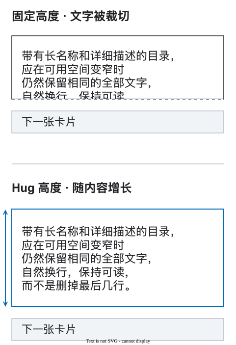
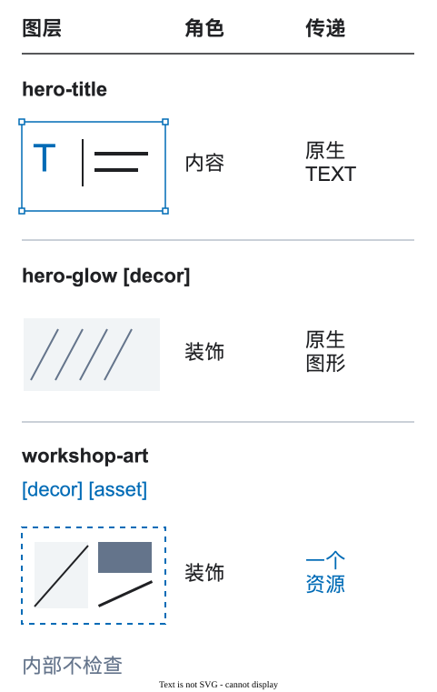

# DFC Bridge 示例

当设计问题已经明确时，使用这些简短示例。每个示例只说明一个问题、一个修正和一个原因。选择与你当前任务相符的示例，不必按顺序阅读。

[交付决策图解入门](../docs/25-visual-walkthrough.md)：团队疑问、决策原因与真实 Figma 截图。

## 1. 页面和宽度

**问题：** 文件中有互不关联的 `desktop` 和 `mobile-final-2` 根图层。

**使用：**

```text
home [page=home] [route=/] [bp=1440] [view=default]
home [page=home] [route=/] [bp=375] [view=default]
```

相同的 `[page]` 和 `[view]` 表示准备好的宽度属于同一页面。`[bp]` 记录每个根图层展示的宽度。

<figure class="bridge-lesson-figure bridge-lesson-diagram">

<figcaption>独立 workshop 示例，非上方 home 代码。先读共同的 page 和 view，再读两个 bp 值：它们是同一页面视图的不同宽度。URL 由 route 另行声明；bp 记录已准备的原生宽度，不是 CSS 媒体查询阈值。 <a href="../../../assets/tutorial/diagrams/contexts-zh.svg">查看原图</a>。</figcaption>
</figure>

## 2. 不同宽度使用同一个名称

**问题：** `hero-title-mobile` 看起来像一个新元素。

**使用：**

```text
hero-title
```

尺寸或位置可以变化，但稳定名称能让人识别同一个逻辑元素。

<figure class="bridge-lesson-figure bridge-lesson-diagram">

<figcaption>按钮示意，不是上方 hero-title。沿连线找到两种宽度中的同名控件。名称表示身份对应，不表示位置必须不变。此例还保留共同父级 hero-actions；若改变有意义的父级，须声明结构转换。 <a href="../../../assets/tutorial/diagrams/identity-zh.svg">查看原图</a>。</figcaption>
</figure>

## 3. 页面区块

直接在页面中制作区块时使用 `[section]`：

```text
product-results [section=product-results]
  product-grid [collection=products]
```

来自 `Page Sections` 库的实例已经有源组件。如果当前图层不是区块边界，就不要重复添加区块键。

<figure class="bridge-lesson-figure bridge-lesson-diagram">

<figcaption>hero 示意，不是上方 product-results 树。从外向内阅读嵌套框：hero 包含文字组、动作组和插图；文字与控件分别属于有意义的父级。这是结构示意，不是宽度对比，也不是 Figma 截图。 <a href="../../../assets/tutorial/diagrams/structure-zh.svg">查看原图</a>。</figcaption>
</figure>

## 4. 链接还是动作

使用 `[href]` 表示跳转，使用 `[action]` 表示当前界面发生变化：

```text
catalog-link [href=/catalog]
filter-button [action=state:filters-open]
```

不要给按钮使用假的 `href`，也不要给普通链接使用假的动作。

<figure class="bridge-lesson-figure bridge-lesson-diagram">

<figcaption>锚点与模态框示意，不是上方路由与状态代码。分别阅读两条路径：href 声明 FAQ 锚点目的地，action 声明在当前界面打开的模态框。这些是意图，不是已连接的 Figma 原型，也不证明导航、模态框焦点或关闭行为已实现。 <a href="../../../assets/tutorial/diagrams/interactions-zh.svg">查看原图</a>。</figcaption>
</figure>

## 5. 按钮和模态窗口

动作指向模态窗口的稳定标识：

```text
contact-button [action=modal:contact-modal]

contact-modal [modal=contact-modal]
  modal-title
  close-button
```

同一个 `UI Kit` 按钮可以在不同位置执行不同动作。动作属于页面中的实例，而不是共享组件的名称。

<figure class="bridge-lesson-figure bridge-lesson-screenshot">

<figcaption>本地助手：按钮、真实目标与定位操作。本地开发版的真实截图，并非已发布界面。 <a href="../../../assets/tutorial/screenshots/assistant-layer-local.png">查看原图</a>。</figcaption>
</figure>

## 6. 有意义的结构

**问题：** 相邻图层只是因为被同时选中才被分在一起。

**使用：**

```text
hero
  hero-copy
    hero-title
    hero-subtitle
  hero-actions
    contact-button
```

每个容器都应有实际作用：内容、布局、裁剪、背景或交互区域。详细规则请看[设计规则](../docs/01-design-rules.md)和[容器规则](../docs/06-wrapper-policy.md)。

<figure class="bridge-lesson-figure bridge-lesson-diagram">

<figcaption>扩展结构示意，非上方简略树。沿嵌套关系阅读：hero-copy 包含相关文字，hero-actions 包含相关控件；每个容器都有布局作用。图中只展示一种有意义的结构，不是正误对比，也不要求处处增加容器。 <a href="../../../assets/tutorial/diagrams/structure-zh.svg">查看原图</a>。</figcaption>
</figure>

## 7. 真实内容

展示可能改变布局的数据：

```text
product-card
  product-title
  product-price
  product-image
```

检查短、长、空、加载和错误状态。不要用一张最终构图图片替代会变化的内容。

<figure class="bridge-lesson-figure bridge-lesson-diagram">

<figcaption>比较上下相同的文字：此例中 Hug 高度保留末尾行，并将下一张卡片下移。固定高度、滚动与截断并非一律禁止，但都需要明确且适用的溢出策略。 <a href="../../../assets/tutorial/diagrams/content-zh.svg">查看原图</a>。</figcaption>
</figure>

## 8. 内容、装饰和导出

在准确的视觉图层上使用最短且清晰的规则：

```text
product-image
hero-glow [decor]
campaign-illustration [asset]
```

`[decor]` 表示视觉作用，`[asset]` 表示整个视觉作为一个资源交付。如果两个说明都成立，同一图层可以同时使用两个标签。

<figure class="bridge-lesson-figure bridge-lesson-diagram">

<figcaption>这是使用 hero-title、hero-glow 和 workshop-art 的独立示意。逐行从角色读到传递边界：文字保持可编辑；decor 声明视觉用途；asset 将整个视觉作为单一资源传递。两者是不同决策，因此 decor 与 asset 可以并用。此图不表示所有产品图片都是装饰。 <a href="../../../assets/tutorial/diagrams/roles-zh.svg">查看原图</a>。</figcaption>
</figure>

## 如何使用示例目录

找到与你的文件相符的问题，采用最小的适用写法，然后按[设计师清单](../docs/17-designer-checklist.md)检查选定的交付范围。

图层名称不能代替完整的行为说明。[数据](../docs/20-data-and-visualization.md)、[反应](../docs/22-state-machines-and-reactions.md)、[动效](../docs/21-motion-and-scroll.md)和[无障碍](../docs/23-accessibility-profile.md)决策应写入结构化[交付契约](../docs/04-transfer-contract.md)。从仓库中可验证的 `validator/examples/bridge-contract.valid.json` 文件开始。文章中的说明性示例和单个模块片段并不构成完整交付。
