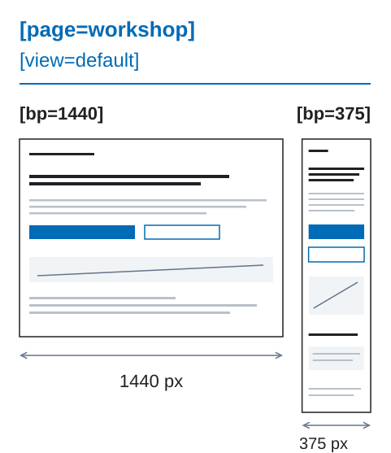
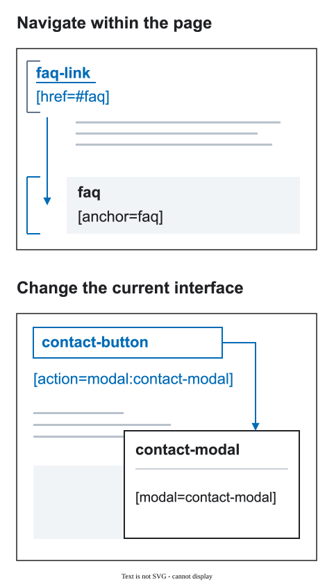
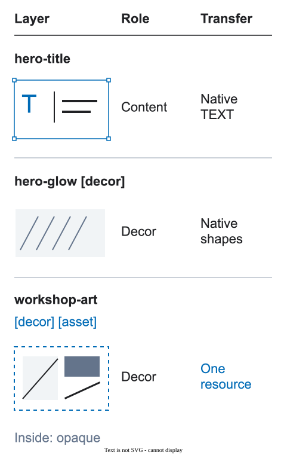

# DFC Bridge examples

Use these short recipes when a design question is concrete. Each example has one problem, one correction, and one reason. Choose the example that matches your current problem; you do not need to read them in order.

[A visual introduction to handoff decisions](../docs/25-visual-walkthrough.md): team questions, reasons and real Figma captures.

## 1. Page and widths

**Problem:** the file has unrelated `desktop` and `mobile-final-2` roots.

**Use:**

```text
home [page=home] [route=/] [bp=1440] [view=default]
home [page=home] [route=/] [bp=375] [view=default]
```

The same `[page]` and `[view]` connect the prepared widths. `[bp]` records the width shown by each root.

<figure class="bridge-lesson-figure bridge-lesson-diagram">

<figcaption>Same page and view, two native widths. Explanatory diagram. <a href="../assets/tutorial/diagrams/contexts-en.svg">Open full size</a>.</figcaption>
</figure>

## 2. One name across widths

**Problem:** `hero-title-mobile` looks like a new element.

**Use:**

```text
hero-title
```

The size or position can change. The stable name keeps the same logical element recognizable.

<figure class="bridge-lesson-figure bridge-lesson-diagram">

<figcaption>Names and meaningful parents survive reflow. Explanatory diagram. <a href="../assets/tutorial/diagrams/identity-en.svg">Open full size</a>.</figcaption>
</figure>

## 3. A page section

Use `[section]` for a section built directly in the page:

```text
product-results [section=product-results]
  product-grid [collection=products]
```

An instance from the `Page Sections` library already has a source component. Do not repeat the section key unless the local frame really is the section boundary.

<figure class="bridge-lesson-figure bridge-lesson-diagram">

<figcaption>A section contains meaningful copy and action wrappers. Explanatory diagram. <a href="../assets/tutorial/diagrams/structure-en.svg">Open full size</a>.</figcaption>
</figure>

## 4. Link or interface action

Use `[href]` when the user navigates and `[action]` when the current interface changes:

```text
catalog-link [href=/catalog]
filter-button [action=state:filters-open]
```

Do not use a fake `href` for a button or a fake action for a normal link.

<figure class="bridge-lesson-figure bridge-lesson-diagram">

<figcaption>Navigation and interface change point to different targets. Explanatory diagram. <a href="../assets/tutorial/diagrams/interactions-en.svg">Open full size</a>.</figcaption>
</figure>

## 5. Button and modal

The action points to the modal’s stable identifier:

```text
contact-button [action=modal:contact-modal]

contact-modal [modal=contact-modal]
  modal-title
  close-button
```

The same UI Kit button can have different actions in different contexts. The action belongs to the instance in the page, not to the shared component name.

<figure class="bridge-lesson-figure bridge-lesson-screenshot">

<figcaption>Local Assistant: button, actual modal and jump to destination. Real capture of a local development build, not the published UI. <a href="../assets/tutorial/screenshots/assistant-layer-local.png">Open full size</a>.</figcaption>
</figure>

## 6. Meaningful structure

**Problem:** nearby layers are grouped only because they were selected together.

**Use:**

```text
hero
  hero-copy
    hero-title
    hero-subtitle
  hero-actions
    contact-button
```

Each wrapper has a real job: content, layout, clipping, background, or interaction area. Detailed layout policy is in [design rules](../docs/01-design-rules.md) and [wrapper policy](../docs/06-wrapper-policy.md).

<figure class="bridge-lesson-figure bridge-lesson-diagram">

<figcaption>Semantic wrappers versus an arbitrary group. Explanatory diagram. <a href="../assets/tutorial/diagrams/structure-en.svg">Open full size</a>.</figcaption>
</figure>

## 7. Real content

Show the data that can change the layout:

```text
product-card
  product-title
  product-price
  product-image
```

Check short, long, empty, loading, and error states. Do not replace changing content with a picture of the final composition.

<figure class="bridge-lesson-figure bridge-lesson-diagram">

<figcaption>Long text wraps and the card grows instead of clipping. Explanatory diagram. <a href="../assets/tutorial/diagrams/content-en.svg">Open full size</a>.</figcaption>
</figure>

## 8. Content, decoration, and export

Use the smallest clear policy on the exact visual layer:

```text
product-image
hero-glow [decor]
campaign-illustration [asset]
```

`[decor]` describes visual purpose. `[asset]` says that the visual is transferred as one resource. A layer can use both when both statements are true.

<figure class="bridge-lesson-figure bridge-lesson-diagram">

<figcaption>Editable content, decoration and indivisible export are distinct. Explanatory diagram. <a href="../assets/tutorial/diagrams/roles-en.svg">Open full size</a>.</figcaption>
</figure>

## How to use this catalog

Find the question that matches your file and apply the smallest relevant pattern. Then use the [designer checklist](../docs/17-designer-checklist.md) to review the chosen handoff scope.

Layer names are not the place for an entire behavior specification. When the design needs [data](../docs/20-data-and-visualization.md), [reactions](../docs/22-state-machines-and-reactions.md), [motion](../docs/21-motion-and-scroll.md), or [accessibility](../docs/23-accessibility-profile.md), describe those decisions in the structured [transfer contract](../docs/04-transfer-contract.md). Use the executable `validator/examples/bridge-contract.valid.json` file in the repository as the starting point; the article’s illustrative excerpt and individual module fragments are not a complete handoff.
