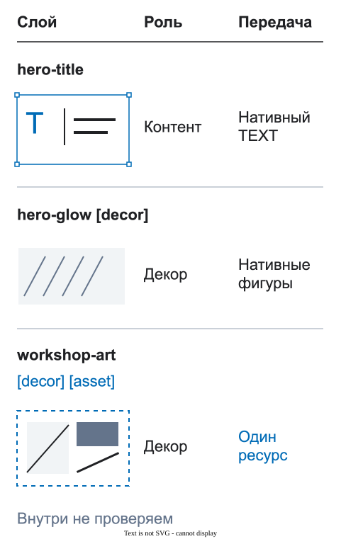

# DFC Bridge на примерах

Используйте эти короткие рецепты, когда вопрос по макету уже понятен. Каждый пример показывает одну проблему, одно исправление и короткую причину. Выберите пример под текущую задачу; читать их по порядку необязательно.

[Визуальный экскурс о смысле передачи](../docs/ru/25-vizualnyj-urok.md): вопросы команды, причины решений и настоящие снимки Figma.

## 1. Страница и ширины

**Проблема:** в файле есть несвязанные корни `desktop` и `mobile-final-2`.

**Используйте:**

```text
home [page=home] [route=/] [bp=1440] [view=default]
home [page=home] [route=/] [bp=375] [view=default]
```

Одинаковые `[page]` и `[view]` связывают подготовленные ширины. `[bp]` записывает ширину каждого корня.

<figure class="bridge-lesson-figure bridge-lesson-diagram">

<figcaption>Одна страница и один вид на двух нативных ширинах. Объясняющая схема. <a href="../assets/tutorial/diagrams/contexts-ru.svg">Открыть в полном размере</a>.</figcaption>
</figure>

## 2. Одно имя на разных ширинах

**Проблема:** `hero-title-mobile` выглядит как новый элемент.

**Используйте:**

```text
hero-title
```

Размер и положение могут измениться. Стабильное имя помогает узнать тот же логический элемент.

<figure class="bridge-lesson-figure bridge-lesson-diagram">

<figcaption>Имена и смысловые родители сохраняются при перестроении. Объясняющая схема. <a href="../assets/tutorial/diagrams/identity-ru.svg">Открыть в полном размере</a>.</figcaption>
</figure>

## 3. Секция страницы

Используйте `[section]` для секции, собранной прямо на странице:

```text
product-results [section=product-results]
  product-grid [collection=products]
```

Экземпляр из библиотеки `Page Sections` уже имеет исходный компонент. Не повторяйте ключ секции, если локальный фрейм не является её границей.

<figure class="bridge-lesson-figure bridge-lesson-diagram">

<figcaption>Секция содержит осмысленные обёртки текста и действий. Объясняющая схема. <a href="../assets/tutorial/diagrams/structure-ru.svg">Открыть в полном размере</a>.</figcaption>
</figure>

## 4. Ссылка или действие

Используйте `[href]` для перехода и `[action]` для изменения текущего интерфейса:

```text
catalog-link [href=/catalog]
filter-button [action=state:filters-open]
```

Не используйте фальшивый `href` для кнопки и фальшивое действие для обычной ссылки.

<figure class="bridge-lesson-figure bridge-lesson-diagram">

<figcaption>Переход и изменение интерфейса ссылаются на разные цели. Объясняющая схема. <a href="../assets/tutorial/diagrams/interactions-ru.svg">Открыть в полном размере</a>.</figcaption>
</figure>

## 5. Кнопка и модальное окно

Действие ссылается на стабильный идентификатор модального окна:

```text
contact-button [action=modal:contact-modal]

contact-modal [modal=contact-modal]
  modal-title
  close-button
```

Одна и та же кнопка из `UI Kit` может выполнять разные действия в разных местах. Действие задаётся экземпляру на странице, а не общему имени компонента.

<figure class="bridge-lesson-figure bridge-lesson-screenshot">

<figcaption>Локальный помощник: кнопка, настоящая цель и переход к ней. Настоящий снимок локальной сборки, не опубликованного интерфейса. <a href="../assets/tutorial/screenshots/assistant-layer-local.png">Открыть в полном размере</a>.</figcaption>
</figure>

## 6. Осмысленная структура

**Проблема:** соседние слои сгруппированы только потому, что их выбрали вместе.

**Используйте:**

```text
hero
  hero-copy
    hero-title
    hero-subtitle
  hero-actions
    contact-button
```

У каждой обёртки должна быть настоящая задача: содержимое, раскладка, обрезка, фон или область взаимодействия. Подробности — в [правилах подготовки макета](../docs/ru/01-pravila-dizajna.md) и [правилах обёрток](../docs/ru/06-politika-obertok.md).

<figure class="bridge-lesson-figure bridge-lesson-diagram">

<figcaption>Осмысленные обёртки вместо случайной группы. Объясняющая схема. <a href="../assets/tutorial/diagrams/structure-ru.svg">Открыть в полном размере</a>.</figcaption>
</figure>

## 7. Реальный контент

Показывайте данные, которые могут изменить раскладку:

```text
product-card
  product-title
  product-price
  product-image
```

Проверьте короткий, длинный, пустой, загружаемый и ошибочный варианты. Не заменяйте изменяемый контент картинкой готовой композиции.

<figure class="bridge-lesson-figure bridge-lesson-diagram">

<figcaption>Длинный текст переносится, карточка растёт вместо обрезки. Объясняющая схема. <a href="../assets/tutorial/diagrams/content-ru.svg">Открыть в полном размере</a>.</figcaption>
</figure>

## 8. Контент, декор и экспорт

Используйте самое короткое понятное правило на точном визуальном слое:

```text
product-image
hero-glow [decor]
campaign-illustration [asset]
```

`[decor]` описывает визуальную роль. `[asset]` означает, что визуал передаётся одним ресурсом. Один слой может использовать оба тега, если верны оба утверждения.

<figure class="bridge-lesson-figure bridge-lesson-diagram">

<figcaption>Редактируемый контент, декор и неделимый экспорт различаются. Объясняющая схема. <a href="../assets/tutorial/diagrams/roles-ru.svg">Открыть в полном размере</a>.</figcaption>
</figure>

## Как пользоваться каталогом

Найдите похожую задачу и примените минимальный подходящий пример. Затем пройдите [чеклист дизайнера](../docs/ru/17-cheklist-dlya-dizaynerov.md) для выбранной области передачи.

Имя слоя не заменяет описание всего поведения. Решения о [данных](../docs/ru/20-dannye-i-vizualizaciya.md), [реакциях](../docs/ru/22-sostoyaniya-i-reakcii.md), [движении](../docs/ru/21-motion-i-scroll.md) и [доступности](../docs/ru/23-profil-dostupnosti.md) записывайте в структурированном [контракте переноса](../docs/ru/04-kontrakt-perenosa.md). Начните с проверяемого файла `validator/examples/bridge-contract.valid.json` в репозитории. Иллюстративный пример в статье и отдельные фрагменты модулей не являются полной передачей.
